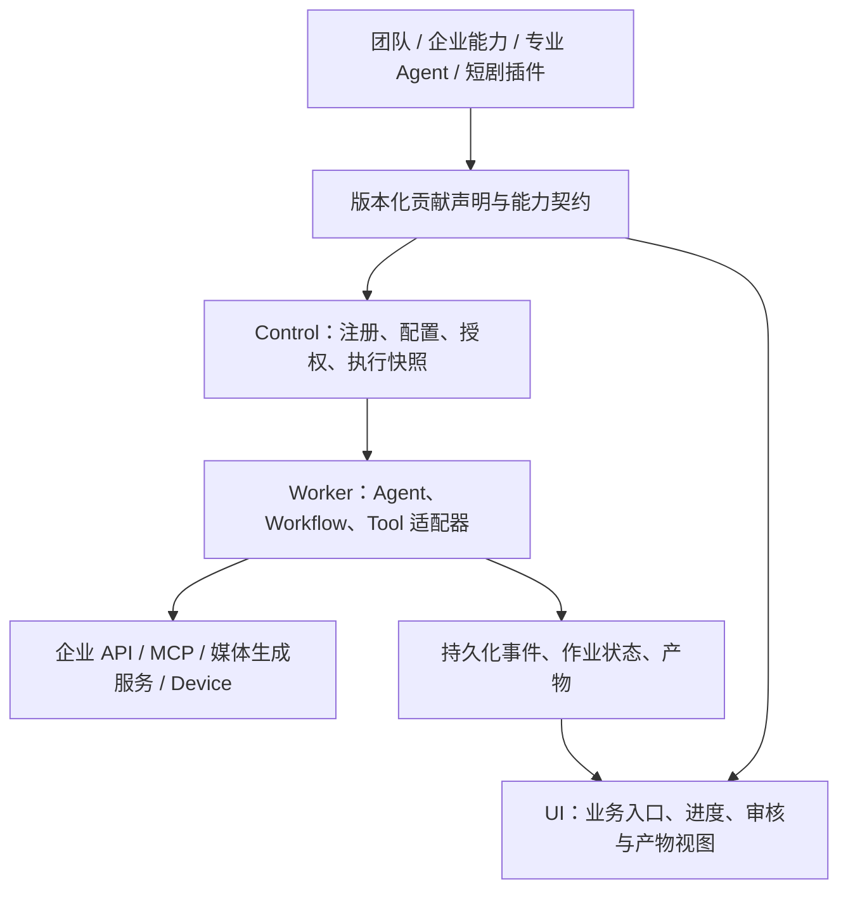

# CrewON 业务能力插件架构提案

状态：提案，尚未实施。日期：2026-09-30。代码基线：当前工作区，分支 HEAD 为 `776484c57`。

目标：团队、企业垂类能力、专业 Agent 和 AI 短剧制作都能作为可组合、可配置、可独立演进的插件接入 CrewON。用户通过对话或业务工作台使用它们；新增业务通常只需增加插件及其适配器。

当前推进边界：采用增量扩展，保留现有聊天、团队和历史任务路径，团队插件化不作为新能力接入的前置条件。用户已明确短剧生成能力全部由外部 API 提供；首期聚焦 API 适配与 Agent 调用，不建设媒体生成或合成引擎。下文完整生命周期是演进目标，不要求首个插件一次实现。

当前实施范围、模块划分、调用路径和验收门槛以 [增量扩展子系统实施方案](./incremental-extension-subsystem-plan.md) 为准。

本文补充 [现有插件分析](./plugin-extensibility.md)，将范围从任务模板扩展到完整业务能力。沿用 [现有架构](../ARCHITECTURE.md) 的 Control、Worker、Device 和 UI 分工；下文新增的契约、注册表及生命周期均为设计建议。

## 从 DeepSeek Harness 借鉴什么

DeepSeek Harness 通过 Cordis 将模型适配、工具、会话和 Agent 循环组合为插件；profile 决定启用的 bundle 与配置层。值得借鉴的是内置能力也遵守插件契约，以及通过组合得到产品形态。[官方架构](https://github.com/deepseek-ai/deepseek-harness/blob/master/docs/architecture.md)。

Cordis 的服务按契约访问、依赖显式声明，注册具有随插件卸载清理的生命周期。CrewON 可以借鉴这些原则，将服务调用、事件订阅和界面贡献点的所有权明确下来。[官方 Cordis 说明](https://github.com/deepseek-ai/deepseek-harness/blob/master/docs/cordis-primer.md)。

以下是针对 CrewON 的设计判断：业务能力统一插件化，任务身份、授权、执行记录和恢复规则由宿主保持一致。模型、存储、工具提供者可继续通过现有端口替换实现；业务插件使用这些能力。暂不引入 Cordis，也不增加另一套 Agent 循环或构建系统。

## 插件是一个业务交付单元

一个插件可以同时提供业务入口、Agent 角色、技能、工具、流程、配置和结果界面；根据业务需要选择其中一部分。

| 概念             | 职责                             | 例子                               |
| ---------------- | -------------------------------- | ---------------------------------- |
| Plugin           | 能力的交付、版本、依赖与启用单元 | 团队协作、企业采购助手、短剧工作室 |
| Skill            | 业务方法与可复用知识             | 剧本改写、采购评审步骤             |
| Tool / Connector | 可执行操作与系统连接             | 查询 ERP、提交视频生成请求         |
| Agent            | 理解目标、选择能力、处理不确定性 | 编剧、采购分析师                   |
| Workflow         | 声明已确定的步骤、依赖与人工审核 | 剧本确认后生成镜头，审核后合成     |
| Artifact / View  | 交付物与业务操作界面             | 采购报告、分镜表、视频预览         |

插件不必创建 Agent；直接查询可以调用工具。需要自主判断时调用 Agent，需要明确步骤时使用流程，也可以在流程节点中运行 Agent。MCP 是连接工具的一种协议，不能单独覆盖完整业务插件的生命周期和界面。

例如短剧插件既可以被用户直接打开，也可以被通用 Agent 发现并调用；它内部可组合编剧 Agent、镜头生成工具和审核流程。插件之间依赖已声明的能力契约，不直接访问彼此的内部文件或数据库。

## 当前代码基础及需要补齐的部分

| 当前事实                                                                                                                                                                                                   | 可复用部分                     | 缺口                                             |
| ---------------------------------------------------------------------------------------------------------------------------------------------------------------------------------------------------------- | ------------------------------ | ------------------------------------------------ |
| [capability-packs](../packages/capability-packs/README.md) 只有随宿主发布的任务模板                                                                                                                        | 有界声明、版本和内容摘要       | 尚无通用插件安装、授权、执行快照                 |
| [ControlOfficeRuntime](../apps/crewon-ui/src/lib/office/controlOfficeRuntime.ts) 连接真实 Office；[专家团](../apps/crewon-ui/src/lib/control-runtime/controlExpertRuntime.ts) 复用 Office 并保存专用元数据 | 团队定义、成员和执行目标       | 产品入口、角色配置和展示尚未通过统一贡献点装配   |
| [OfficeDelegationApplicationService](../packages/application/src/office-delegation-application-service.ts) 验证成员与 WorkflowVersion 并创建执行                                                           | 团队委派、权限、持久化事务     | 团队插件到这些用例的受控调用契约                 |
| [WorkflowVersion](../packages/domain/src/workflow-version.ts) 提供有界 DAG，支持 agent / humanGate / verification                                                                                          | 编排、人工审核、结果验证       | 外部异步作业不能直接假定为已有节点类型           |
| [CompositeToolRuntime](../packages/tool-broker/src/composite-tool-runtime.ts) 组合独立工具适配器                                                                                                           | 工具调用、冲突检测、取消和核验 | 从插件版本解析到适配器实现的绑定                 |
| [AgentVersion](../packages/agent-version/README.md) 固定模型、工具与执行策略                                                                                                                               | 运行版本身份                   | 还需冻结插件依赖、配置和业务输入的身份           |
| [Artifact](../packages/domain/src/artifact.ts) 当前只接受 toolOutput，并约束为 text/plain                                                                                                                  | 产物身份、归属和读取治理       | 结构化业务对象、图片、音频和视频的存储与展示契约 |
| [旧插件交互](../apps/crewon-ui/src/lib/plugin/pluginPanelActions.ts) 依赖 app-server 插件协议                                                                                                              | 可参考产品交互                 | 不能视为 Control 插件宿主已经建成                |

因此，现有任务模板是一个起点；新目标需要覆盖从业务入口到实际交付的完整链路。

## 宿主与贡献点

一个插件可以有分别部署在 Control、Worker 和 UI 的组成部分；它们共享插件身份和兼容性契约，不意味着所有代码加载进同一个进程。服务端控制有效版本和授权，客户端按投影显示可用能力。

首批贡献点从新接入的外部 API 业务中提炼，先实现工具、配置和必要的结果展示；其余贡献点在真实需求出现时增加：

| 贡献点           | 声明内容                                           | 宿主职责                                          |
| ---------------- | -------------------------------------------------- | ------------------------------------------------- |
| 业务入口与动作   | 标题、输入 schema、输出 schema、适用场景、执行绑定 | 表单验证、创建任务、向 Agent 提供可发现的能力描述 |
| Agent 与团队模板 | 角色、技能、成员关系、协作策略                     | 发布 AgentVersion / Office 版本，约束委派与预算   |
| 工具与连接器     | 操作契约、适配器引用、资源与凭据绑定需求           | Tool Broker 执行、授权、回执和恢复                |
| 流程模板         | 阶段、依赖、审核点、验证要求                       | 编译为已支持的 WorkflowVersion，持久化执行        |
| 配置与知识绑定   | 业务设置、知识源引用、适用范围                     | 校验、配置版本、访问控制；秘密值仅保留引用        |
| 工作台与产物视图 | 入口、详情、结果类型和可执行业务动作               | 按当前任务投影数据、执行动作、呈现错误与降级      |

UI 先支持宿主渲染的声明式表单和视图，以及随宿主构建的可信组件注册。团队看板、分镜编辑器等复杂界面可逐步增加专用贡献点。远程自定义 UI 需独立的隔离与通信契约，不能因此把整个 App 状态交给插件。

## 统一调用与生命周期

一次业务调用由宿主解析为：

`用户或 Agent 选择动作 → 校验输入与权限 → 锁定插件和依赖版本 → 绑定 Agent / Workflow / Tool → 创建执行 → 持久化进度与交付物`。

所有入口复用同一调用用例。自然语言推荐、插件表单和定时触发只负责构造输入，不能各自实现独立执行链。Agent 可看到当前获准使用的能力摘要，按任务装配已选能力；安装所有插件不意味着把全部提示词和工具注入每次模型请求。

对于当前不可变 AgentVersion，新增工具或改变执行策略必须生成新版本并在新的执行边界启用。可在既有受控委派边界调用另一个已发布能力；不能在运行中静默替换已有版本的工具定义。上下文继续增量追加、有界加载，单片段不得超过 10K tokens。

当前 providerAgent 模式不接受宿主工具注入；首期插件通过明确选择的 crewonKernel 执行版本接入。缺少该执行路径时标记不可用，不修改原有 providerAgent 或隐式切换模型。

持久化模型至少区分以下对象，具体 schema 在实现阶段评审：

- **插件发布版本**：插件 ID、精确版本、包摘要、宿主契约版本、贡献点及依赖；发布后不可变。
- **安装与启用记录**：租户/空间、来源、选中的版本、授权、配置修订；安装、启用、健康状态分别记录。
- **执行绑定**：实际插件与依赖摘要、配置修订、Agent/Workflow 版本、策略快照及输入引用；从执行可以追溯实际使用了什么。
- **业务数据**：项目、素材、报告等持久化对象；按插件和租户/空间归属，不能依赖 UI localStorage 作为执行权威。

版本选择和依赖解析先支持精确版本，重复贡献 ID、依赖环与不兼容契约拒绝激活。跨服务发布采用先准备、校验，再切换激活指针的方式；Worker 缺少锁定实现时拒绝执行，不能自动换用最新版本。

普通停用阻止新任务，并按既定策略收尾在途任务；紧急权限撤销同时阻止旧任务发起新的受影响调用。移除注册应清理订阅、计时器和资源。历史执行仍引用的版本需保留到退出使用；插件卸载与用户数据删除分开。前端缺少对应视图时仍可显示基础产物信息。

平台维护权限、预算、凭据、事件和恢复规则。内置插件和企业插件通过同一业务契约使用宿主，执行可信度和部署方式则分别管理：首期随宿主发布可信实现，随后支持经过验证的远程服务适配器；不可信执行代码需具备隔离条件后再支持。

## 三类业务如何落在同一架构上

### 团队：保留现有能力，按需适配

团队可以在未来以第一方插件提供团队入口、角色模板、成员配置、协作策略、任务委派动作和团队看板。当前阶段保留原实现，宿主继续提供任务、Agent 执行、预算、授权、事件、产物和恢复。

新插件确实需要团队能力时，通过窄适配层调用当前 Office 与委派用例，保留已有 Office ID、版本和历史任务。只有复用收益明确后，再考虑将团队入口与配置迁至贡献点。新插件的上线不依赖这次迁移。

这里的“团队”指 Agent 协作业务。企业的真实用户、组织成员关系和租户授权仍是平台身份边界，不能随团队插件停用而失效。

短剧可以依赖团队提供的协作能力，但不应被强制要求创建团队：单 Agent 同样可以调用镜头生成动作。团队自身也不能假定所有使用者都需要固定角色数或固定行业。

### 企业垂类：通用领域包与企业配置组合

以采购助手为例，插件提供采购方法、分析 Agent、评审流程、采购报告和 ERP 连接器契约。不同企业配置自己的系统绑定、术语、知识源和审批规则；定制代码通过已声明的适配器契约接入。

优先采用“通用领域插件 + 企业配置”；只有业务逻辑确实不同，才增加企业扩展插件。依赖和可覆盖项必须显式声明，不依赖安装顺序覆盖任意实现。私有插件可仅向指定租户发布，其配置和知识源不得进入其他租户的执行。

强专业能力还需要随版本交付业务评测样例、输入适用范围、结果校验和必要的人工复核点。仅有角色提示词不足以证明其专业效果。

### AI 短剧：Agent 调用外部生成 API

用户已明确生成能力全部来自外部 API。CrewON 中的短剧插件负责把服务封装为可被 Agent 和业务界面调用的能力。Agent 补齐题材、时长、风格、素材等输入，准备参数、组织调用、解释进度，并将外部服务的结果交付给用户。

首期最小过程：需求确认 → 调用生成 API → 获取任务编号 → 查询状态 → 返回成片引用。同步 API 可以直接返回结果。若供应商提供分阶段 API，再组合剧本、分镜、镜头、配音和合成调用；是否支持局部重做、取消和素材导出，以实际 API 为准，不预先承诺完整制作工作台。

| Agent 负责                               | 插件实现负责                                         | 外部服务负责                                         | 平台复用能力                                            |
| ---------------------------------------- | ---------------------------------------------------- | ---------------------------------------------------- | ------------------------------------------------------- |
| 澄清、参数准备、选择与协调调用、解释结果 | API 适配、输入输出校验、任务关联、业务配置和结果展示 | 实际生成、服务端作业处理、媒体存储及其支持的合成操作 | Agent 执行、Tool Broker、授权、凭据、任务事件和恢复边界 |

首期按现有工具调用语义分别封装提交、查询和供应商支持的取消操作：提交操作完成只说明已成功提交，不能将整段短剧任务显示为完成。模型接收有界的任务编号、状态摘要和结果引用，视频本体不进入模型文本。

外部 API 作业状态以供应商可核验响应为依据。插件侧需保存租户/空间、CrewON 任务、插件版本、请求身份和外部任务编号的关联；记录通过服务端持久化端口读写，不能只存在于对话推理或浏览器内存中。新增关联记录属于增量数据设计，需兼容和行为测试，但不要求改写现有任务数据。

收费提交仍需符合现有 mutation 的回执与核验要求。优先使用供应商的幂等键和按请求身份查询机制；提交后丢失响应时先核验，不能直接再生成一次。供应商不提供这些机制时，不宣称具备自动安全重试或完整恢复能力。

首期可由用户或 Agent 显式查询外部任务，交付外部结果引用，无需先扩展 ToolExecutionResolution 为 pending 状态，也无需把视频强行存入当前 text/plain Artifact。访问链接若有有效期，记录可重新查询的任务或素材身份；无法长期保留的结果应如实显示其限制。

后续只有在体验确实需要时再增加平台能力：后台自动查询、回调和主动续跑需要持久化等待与唤醒；自有媒体存储、长期归档和分镜版本编辑需要媒体产物契约。外部服务继续承担生成执行，CrewON 只补齐这些宿主集成能力。后台自动完成不能依赖前端计时器或无限等待的工具调用。

## 落地顺序与验收

| 阶段                 | 实施范围                                                           | 完成条件                                                                                 |
| -------------------- | ------------------------------------------------------------------ | ---------------------------------------------------------------------------------------- |
| 1. 外部 API 插件试点 | 最小声明、静态注册、配置、工具适配；短剧可作为候选，供应商尚待选择 | Agent 能提交、查询并返回真实结果；任务关联可恢复；现有聊天、团队、流式和重连路径保持可用 |
| 2. 第二个业务插件    | 接入一个企业场景，复用工具、配置和结果展示契约                     | 新业务无需修改 Agent 循环；通过租户隔离、业务效果与现有能力回归验证                      |
| 3. 按需增强          | 根据实际需求增加后台续跑、丰富视图或媒体归档；需要时适配团队       | 后台能力有重启、重复通知和取消竞态验证；没有需求的扩展不作为前置条件                     |
| 4. 独立交付          | 插件发布和私有分发、依赖锁定、安装/升级/回滚、远程扩展隔离         | 新任务切换版本，旧任务版本不漂移；坏包不激活；卸载保留用户产物；权限变更可审计           |

阶段 1 先复用现有 ToolRuntimePort 与 CompositeToolRuntime，按需要新增私有 `packages/plugin-contracts` 保存最小声明和校验。业务用例沿用 `packages/application`，持久化沿用 `packages/store`，装配在 Worker，贡献点渲染在 UI。跨层协议仍放在 `packages/contracts`，并遵守现有包依赖规则。只提炼实际出现的共性，不提前搭建完整插件市场或迁移全部现有能力。

涉及公共 HTTP、事件和持久化结构的变化必须有兼容方案与行为测试。现有能力需回归创建到执行的集成路径、流式与重连，UI 延续现有组件/快照覆盖。外部 API 插件需验证提交后丢连接、Worker 重启、重复提交、供应商失败和结果过期；增加回调、取消或后台续跑时，再覆盖相应故障路径。

最终衡量标准：团队、采购和短剧可以各自增加能力、独立验证和演进；通用任务执行仍由同一个平台负责，新增业务不再持续扩大核心编排文件。
