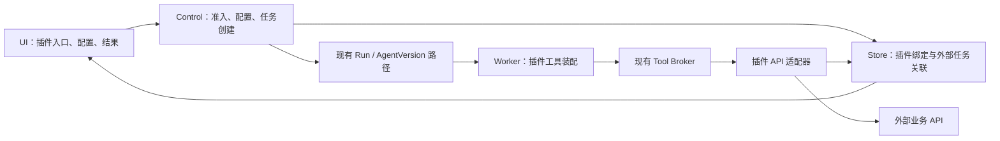

# CrewON 增量扩展子系统实施方案

状态：已开始增量实施，完整目标尚未交付。日期：2026-09-30。设计基线：分支 HEAD 为 `776484c57`。实际代码和验证范围见 [实施进度](./incremental-extension-progress.md)。

本方案落实当前讨论的范围：保留现有能力，为新业务增加插件接入机制；短剧的生成能力全部调用外部 API。首期交付一个能贯穿配置、Agent 调用、外部任务查询和结果展示的扩展子系统。首个真实接入已选定用户提供的 ComfyUI Krea2 生图服务；优先跑通流程，再细化插件产品形态。

本文是当前实施范围的依据；[业务能力插件架构提案](./agent-capability-plugins.md)保留长期方向。下文接口是设计目标，具体已实现部分以实施进度及代码为准。

用户补充的 shuohao-skills 与 Reelbench 参考已整理为[短剧工作台参考结论](./short-drama-workbench-reference.md)。后续按项目、阶段成果与资产修订组织短剧插件；当前实施顺序仍为先跑通正式 API / Agent 流程，再细化产品形态。

当前发布及 standalone 进程入口的配置、启动顺序和明确限制见[进程启动说明](./extension-process-startup.md)；这不代表原生桌面、生产多用户或完整产品界面已经交付。

## 1. 首期边界

**采用现有架构上的增量开发，不迁移团队，不重建 Agent 引擎。** 扩展子系统是一组分布在现有应用和包中的模块，不单独部署一个新的核心服务。

| 首期交付                                       | 后续按需求增加                                           |
| ---------------------------------------------- | -------------------------------------------------------- |
| 随宿主发布的可信插件定义和静态注册             | 远程安装、插件市场、不可信代码执行                       |
| 工作空间范围的启用、业务配置与凭据引用         | 完整发布市场、通用依赖解析和热更新                       |
| 将插件工具装配到明确选择的 Agent 版本          | 向所有 Agent 自动注入能力、替换 providerAgent 的内部工具 |
| 外部 API 提交、查询及可选取消                  | Webhook、后台自动查询和主动续跑                          |
| 外部任务关联和状态查询结果持久化               | 通用长任务调度平台                                       |
| 基础输入表单、任务状态、结果链接或受支持的预览 | 分镜编辑器、第三方自定义页面和媒体资产库                 |
| 普通任务与团队路径的兼容和回归验证             | 将现有团队、专家团等全面迁至插件                         |

首期支持同步 API，也支持“提交后返回任务编号”的异步 API。异步任务由用户或 Agent 显式发起查询；未建设后台续跑前，不承诺页面关闭后自动更新或主动通知。

“保留现有能力”的验收含义是：不选插件时，原有请求、默认 Agent、工具、审批语义、流式显示和历史恢复保持原行为。公共入口允许最小接线；原有记录不要求批量迁移，原有默认执行目标不因插件启用而自动改变。

## 2. 复用基础与已确认限制

| 已有实现                                                                                                       | 本方案如何使用                                                                                       |
| -------------------------------------------------------------------------------------------------------------- | ---------------------------------------------------------------------------------------------------- |
| [ToolRuntimePort](../packages/tool-broker/src/tool-broker-port.ts)                                             | 外部 API 实现 definitions、executionPolicy、execute、reconcile、cancel；业务代码不绕过工具审批和回执 |
| [CompositeToolRuntime](../packages/tool-broker/src/composite-tool-runtime.ts)                                  | 组合既有工具与选定插件工具，拒绝重复工具名；不修改 Agent 循环                                        |
| [AgentVersion](../packages/agent-version/src/agent-version.ts)                                                 | 将插件工具与指令编译到新的不可变版本；旧版本保持不变                                                 |
| [ConfiguredAgentVersionRuntimeFactory](../apps/runtime-worker/src/configured-agent-version-runtime-factory.ts) | 按版本装配实现，扩展 materialization 身份以包含插件版本、实现摘要和配置修订                          |
| [按 AgentVersion 约束工具](../apps/runtime-worker/src/agent-version-tool-runtime.ts)                           | 继续拒绝缺失或定义不匹配的工具实现；另外验证实现摘要，不能仅验证同名工具 schema                      |
| [现有发布组合](../apps/runtime-worker/src/agent-version-release-composition.ts)                                | 复用发布和激活原则，增加插件专用装配入口，保留原发布路径                                             |
| [Artifact](../packages/domain/src/artifact.ts)                                                                 | 当前为受限 text/plain toolOutput；首期结果采用外部资源引用，不假设已有视频 Artifact                  |

当前执行主体有 `crewonKernel` 和 `providerAgent` 两类。[工厂校验](../apps/runtime-worker/src/configured-agent-version-runtime-factory.ts)要求 `providerAgent` 的宿主工具列表为空。因此，首期插件 Agent 使用 `crewonKernel` 路径，单独发布并由用户显式选择。已有 providerAgent 保持原路径；如果部署没有可用的 crewonKernel 模型路由，插件显示不可执行，不能静默切换模型或宣称已接通。

插件声明不直接转换成任意 HTTP 请求。声明中的适配器 ID 只能指向随宿主发布、经过审查的 TypeScript 实现；基址、操作映射和服务能力由适配器及经验证的配置约束。v1 不设计可执行脚本或任意表达式 DSL。

## 3. 模块划分



图中 Store 到 UI 表示经过 Control/BFF 的数据投影，不是浏览器直接访问数据库。插件不建立第二套 Run，也不接管现有 SSE。

| 位置（新增模块名为建议）                           | 职责                                                                        |
| -------------------------------------------------- | --------------------------------------------------------------------------- |
| `packages/contracts/src/extension-*.ts`            | 版本化请求、响应和有界 schema 校验；保持纯协议依赖                          |
| `packages/domain/src/extension-*.ts`               | 插件身份、执行绑定、外部任务状态及转换规则；不导入 Contracts 或运行时       |
| `packages/application/src/extension-*.ts`          | 配置、准入、任务绑定、状态读取用例及存储端口；通过端口使用现有发布/执行能力 |
| `packages/store/src/extension-*.ts`                | SQLite / PostgreSQL 的新增表、唯一约束、事务及版本校验                      |
| `apps/control-api/src/extensions/`                 | 新的插件 API、身份与空间授权、现有 Run 用例接线                             |
| `apps/runtime-worker/src/extensions/`              | 静态注册表、插件版本解析、工具装配、API 适配器及生产 HTTP 边界              |
| `apps/crewon-ui/src/lib/extensions/`、对应组件目录 | 新插件入口和投影，复用现有任务与审批界面                                    |
| `apps/web-bff`、Electron 组合入口                  | 按现有机制转发新增路由、打包模块；仅在确有接线需求时调整                    |

v1 优先沿用现有包，不预建通用 SDK 或新的 plugin-host 进程。UI 使用 Control 返回的可用目录，不直接导入 Worker 实现。不同进程只共享纯契约，通过类型化端口或现有协议协作。新依赖边必须加入现有边界检查并说明原因。

## 4. 最小插件定义

以下是候选字段，不是已发布 schema；实现前需冻结精确枚举、长度上限和未知字段处理规则。

| 字段组   | 必须表达的内容                                                                    |
| -------- | --------------------------------------------------------------------------------- |
| 身份     | `schemaVersion`、命名空间 `pluginId`、精确版本、显示名称、描述、宿主契约版本      |
| 入口     | 业务输入 schema、输入说明、经审查的有界任务指导；声明式表单只支持首个业务所需字段 |
| 工具     | 命名空间 tool ID、适配器 ID、操作 ID、输入/输出 schema；工具执行策略由宿主验证    |
| 配置     | 非秘密业务配置 schema、凭据绑定类型和资源需求；不包含密钥值                       |
| 结果     | 文本、外部任务状态、结果引用等宿主支持的展示类型                                  |
| 构建身份 | 发布清单绑定包内容摘要、适配器实现摘要及宿主构建版本；摘要不作为权限证明          |

静态注册表负责校验重复 ID、版本、工具冲突、缺失适配器和宿主兼容性。首期一个插件包自包含，不支持通用传递依赖解析。未知 schema 或错误定义使该插件不可用，并隔离注册过程中的失败；不得让无关插件失效。

插件目录、已启用状态、配置就绪状态和 Worker 可执行状态分开显示。Worker 没有对应实现、凭据缺失或执行路由不支持时，不能只因为插件“已启用”就允许提交。

## 5. 配置、版本与持久化

工作空间配置采用显式保存和 revision 校验，新增 API 必须校验 tenant / space / actor。新增逻辑表建议如下，物理表名在详细实现时确定：

| 记录         | 关键内容与约束                                                                                                                        |
| ------------ | ------------------------------------------------------------------------------------------------------------------------------------- |
| 插件配置修订 | tenant / space / plugin、不可变配置 revision、非秘密参数、凭据绑定引用、摘要                                                          |
| 插件启用记录 | 所选插件版本、当前配置 revision、权限状态、激活状态；切换需预期 revision                                                              |
| Run 插件绑定 | tenant / space / run、插件版本、代码摘要、配置 revision、AgentVersion 与 materialization digest；创建后不可修改                       |
| 外部调用关联 | 本地 operation ID、来源 run / execution / actionDigest、插件绑定、请求摘要、幂等键、外部 job ID、观察到的业务状态、结果引用和更新时间 |

插件发布定义和实现仍随部署交付，v1 不为它们建设远程安装数据库。配置变更会产生新执行快照；已有任务继续使用已绑定版本。凭据可以在同一受控绑定下轮换，秘密值不进入摘要、提示词或返回结果。

创建插件任务时，Run 和插件绑定必须在同一个存储事务中提交；不能先启动 Run，再补写绑定。可通过新增存储用例复用当前事务能力，保持旧任务提交接口和语义兼容。旧任务没有插件绑定时仍走原解析器。

新旧插件实现若需并存，由精确绑定选择各自运行时实例，不把同名不同版本工具同时塞进一个 CompositeToolRuntime。服务启动/发布时校验仍被任务或外部作业引用的实现是否可用。找不到原实现时报告不可恢复，不用新实现代替旧版本。

## 6. 用户与 Agent 的调用路径

首期支持用户从插件入口创建新的插件任务；新任务通过现有 Run 执行，Agent 根据业务输入调用插件工具。普通任务及运行中的历史任务不自动获得新工具。

1. UI 读取当前空间可用插件，显示实际执行条件；用户填写输入并提交。
2. Control 校验插件启用、输入、配置、权限与已部署版本，解析明确的 crewonKernel 执行目标。
3. Control 冻结插件绑定，事务性创建 Run，再交给现有 Worker。
4. Worker 校验绑定与实现，构造 ToolRuntime 并经过 AgentVersion 工具约束；Agent 发起的操作继续通过原工具执行链。
5. 工具返回有界真实结果。任务进度继续使用现有事件和重连机制；UI 根据插件投影展示外部任务状态与结果。
6. 用户查询生成进度时创建一次关联原 operation 的查询任务，服务端复核归属，沿相同 Run/Tool 路径调用 API。单纯读取已保存状态不触发外部调用。

不要求每次创建任务都重新编译 AgentVersion：相同已验证执行配置复用发布版本；配置或工具定义改变时才产生新版本。新版本部署就绪后才能用于任务准入。

新增 API 的职责范围（路由名称均为提案）：

| 路由                                | 作用                                                                    |
| ----------------------------------- | ----------------------------------------------------------------------- |
| `GET /extensions`                   | 返回有权限看到的插件目录及状态                                          |
| `GET /extensions/:id/configuration` | 读取非秘密配置和 revision                                               |
| `PUT /extensions/:id/configuration` | 保存新配置修订，检查预期 revision；复用已有凭据管理边界                 |
| `PUT /extensions/:id/activation`    | 修改启用/选定版本，校验可执行条件；不把安装当成授权                     |
| `POST /extensions/:id/tasks`        | 接受结构化输入或归属已验证的查询意图，转入现有 Run 创建用例；支持幂等键 |
| `GET /extension-operations/:id`     | 读取已持久化外部状态与结果投影，不直接请求供应商                        |

以上路由继续使用现有认证、BFF 和 ControlClient 约定，不暴露新的公开未认证入口。新增协议需行为与兼容测试；原有严格校验器保持原契约，不能为了方便放宽未知字段校验。

## 7. 外部 API 与异步任务语义

短剧仅作为说明，提交、查询与结果引用同样适用于企业报表、专业分析等外部服务。

```text
插件任务 A：Agent → 提交工具 → 外部 API → job ID
           工具提交成功；UI 显示“生成中”

插件任务 B：Agent → 查询工具 → 根据已保存关联查询 job ID
           外部仍在处理：保存状态
           外部已完成：保存结果引用，展示成片
```

任务 A 可以结束为“已提交”，外部业务仍是运行中。UI 必须同时区分 CrewON 本次调用状态与外部生成状态，不借用 Run 的 completed 来表示成片完成。

关联记录建议区分 `submissionPending`、`submitted`、`running`、`succeeded`、`failed`、`canceled`、`unknownOutcome`。供应商不能提供 queued/running 等细节时保留其可证明状态；本次查询失败另记观察错误，不把已运行的生成任务自动改为 failed。

外部副作用按以下顺序处理：

1. 发送前持久化调用身份、幂等键和请求摘要；并发重复调用不能产生第二条外部提交。
2. 请求通过既有工具授权与回执链路，使用受控凭据和目标地址；成功后持久化外部 job ID，再确认工具结果。
3. 发送后失联或 Worker 崩溃时，reconcile 按供应商幂等键/请求身份查询真实结果。不能仅凭本地没有 job ID 就再次收费提交。
4. 若供应商不提供可核验提交语义，明确停留 unknownOutcome；接入前就标记为不满足首期自动恢复验收，不能依靠进程内缓存宣称可靠。
5. 工具取消与取消已受理的外部业务是两件事。只有供应商支持时才暴露业务取消操作；请求取消并不等于已取消或已退款。

适配器的 HTTP 请求设定超时、并发和输出上限；使用审核过的出站边界和凭据租约，不把密钥交给浏览器或模型。正常业务结果采用现有 ToolResult 的有界输出字段；machine-readable 状态存入新关联记录，不能把对话文本当作唯一业务权威。

首期只保存外部任务/素材 ID、结果链接及有效期等引用，不下载和托管视频。展示链接由已验证的服务响应产生，限制允许的协议和目标；过期时通过已授权的 API 重新查询，供应商不支持则如实显示。媒体预览只在现有宿主支持和访问条件满足时开启。

## 8. 停用、失败与回退

- 普通停用阻止新的生成提交；原有操作允许获授权的查询、核验和供应商支持的取消，不自动改变现有聊天或团队功能。
- 权限/凭据紧急撤销在每次实际调用时检查；历史快照不能绕过当前撤销规则。无法继续访问时保留已有记录和真实未知状态。
- 插件配置错误、适配器失败或缺少部署仅影响该插件；原路径在未选择插件时不加载插件运行时。
- 回退优先关闭新入口或撤回激活版本，保留关联数据和仍需核验的旧实现。数据库采用增量迁移；不以删除新增表或重写历史任务实现回退。
- v1 更新随宿主部署，不能承诺随时热卸载。适配器关闭必须释放所属网络连接、订阅和计时器，同时遵守在途执行的资源生命周期。

## 9. 工作拆分与完成门槛

按依赖顺序推进，每阶段都有可检查的交付物。以下是后续实施任务，不代表本次已开始编码。

| 阶段                    | 交付                                                                                       | 完成门槛                                                                             |
| ----------------------- | ------------------------------------------------------------------------------------------ | ------------------------------------------------------------------------------------ |
| E0 接入验证             | 选定一个真实 API；确认凭据、提交/查询、幂等/核验、结果有效期；验证部署的 crewonKernel 路径 | 列出支持与不支持的能力，有真实连通证据；该阶段需要选定服务与测试凭据                 |
| E1 最小契约与静态注册   | 定义校验、注册表、适配器映射、插件状态投影                                                 | 错误定义和工具冲突被拒绝；无插件配置时原路径不变；确定第二个企业场景用于检查契约复用 |
| E2 配置、准入与版本绑定 | 新表、存储端口、配置 API、发布绑定、事务性任务准入                                         | SQLite/PostgreSQL 契约一致；越权、revision 冲突、幂等冲突、旧任务兼容通过            |
| E3 外部工具闭环         | submit/query 适配器、请求身份与回执、真实外部任务关联                                      | 通过现有 Agent 路径提交并查询真实结果；重复请求和崩溃恢复不产生重复副作用            |
| E4 UI 与集成回归        | 新插件入口、配置/输入表单、外部状态、结果引用                                              | 用户从界面完成配置到结果；刷新、SSE 重连、失败和原有聊天/团队路径验证通过            |
| E5 第二业务复用         | 一项企业 API 插件，沿用已经验证的契约                                                      | 只增加声明和适配器及必要业务展示，不修改核心 Agent 循环；记录必须新增的通用接口理由  |

E1/E2 可以使用明确标注的模拟 API 开发；模拟通过不等于 E0/E3 的真实接通。首次可发布范围为 E0–E4；完成 E5 后再判断是否具备对外推广的通用性。排期和成本在 E0 的 API 与执行路由确认后估算。

## 10. 验证矩阵

| 验证面     | 关键用例                                                                                        |
| ---------- | ----------------------------------------------------------------------------------------------- |
| 原有能力   | 插件未启用时普通聊天、团队创建/委派、工具审批、历史任务、流式与重连无行为变化                   |
| 执行主体   | crewonKernel 可调用；providerAgent 不被注入工具、不被静默切换；不可执行目录状态与服务端准入一致 |
| 版本       | 新配置只影响新任务；旧实现缺失明确失败；相同工具名/schema 不掩盖实现版本变化                    |
| 权限与配置 | 跨租户/空间访问、伪造 operation ID、权限撤销、凭据缺失、并发保存冲突被正确处理                  |
| 外部副作用 | 并发重复提交、响应丢失、提交后重启、查询超时、供应商失败、取消竞态、结果过期                    |
| UI 真实性  | 已提交与已生成区分；旧状态显示观察时间；不能从 Agent 文字推断成功；外部链接可用性如实反映       |
| 生命周期   | 插件停用后阻止新提交；旧操作按权限继续核验；注册失败及回退不破坏原有能力                        |

实现阶段使用 Node.js 24、pnpm 10，先运行新增模块的窄测试，再运行涉及的 Contracts、Domain、Application、Store、Worker、Control API、UI 检查和 `pnpm crewon:boundary:check`。公共契约需兼容测试；Agent 路径需流式/恢复集成覆盖；UI 使用现有组件和快照覆盖。真实外部 API 验收与模拟证据分别记录。文档执行 `pnpm format`。

## 11. 待实现前确认的信息

当前不影响方案成立，但决定首个真实插件能否发布：首个业务与 API 文档、测试账号及测试额度、供应商的幂等/核验能力和结果保留期限、目标部署中的 crewonKernel 模型路由与凭据设施。

目前可以确定的架构决定是：可信静态插件先行、外部 API 工具接入、插件专用执行版本、增量数据关联、显式查询、外部结果引用、旧能力保持原路径。后台自动化、媒体托管和动态安装在有业务需求时另行立项。
