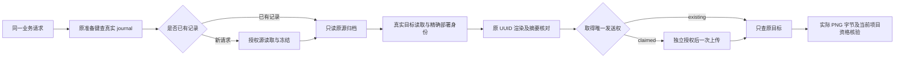

# 真实项目素材准备的服务组合

2026-10-06。状态：宿主内部的准备服务已组合实际项目来源、加密源归档、真实目标读取、独立准备记录和受控传输，并通过双库集成检查。**公开入口、Main 的实际批准与归档配置、版本化媒体输入、生成 Run 和页面/Agent 接线仍待实施。** 本项没有新增独立插件；它供统一短剧插件的手动流程和 Agent 媒体步骤共同使用。完整目标保持 ACTIVE。

## 一条业务链

`ProjectMaterialPreparer.prepareSelectedReference`只接收宿主取得的真实调用者，以及项目/资产/参考修订、源冻结键、目标 profile/plugin/config 修订和独立准备键。UI/Agent不能传入来源记录、地址、供应商路径、字节或请求摘要。当前没有注册新 HTTP、插件公开服务或 Agent 工具。

代码执行新请求时先解析目标，再冻结源，避免目标不可用时读取源图。图中的目标步骤表示发送前再次核验。已有请求查 journal 必须早于任何可能冻结的操作：整个归档目录丢失，也不能把已登记的准备当作新请求重新 GET 源图。

源服务绑定真正 `ProjectReferenceMaterialFreezer` 的原型实现。准备 journal 仅接受实际 SQLite/Postgres 实例并绑定其原实现；伪造内存 journal 或覆盖实例方法不能制造发送回执。源字节继续通过真实加密文件保存、关闭重开、PNG 解码及摘要核验，不把元数据 DTO 当作字节。

`observePreparedReference`用于冷恢复和重连，只处理已登记的原请求。未找到记录时拒绝；reserved时返回待处理，不冻结、分配新 UUID 或取得发送权。dispatching/unknownOutcome只 GET 原路径，404、网络错误或不可读都不能证明没有上传。

## 实际目标与三种独立权限

`ProjectMaterialTargetApplicationService`绑定原安装和配置应用服务的真实实现，由宿主 profile 解析当前选择，沿原读取授权取得实际包和指定历史配置。它检查启用状态、profile、版本和完整快照，再次读取选择与配置检测变化。调用者提供的 profile 是待核对选择，不是任意切换宿主身份的权限。

准备服务另要求明确的部署审查清单，逐一核对 plugin、版本、publisher、packageDigest、manifestDigest 和 implementationDigest。清单最多32项，捕获后不随调用者修改；拒绝 getter、Proxy、重复 package 身份和未知包。不能仅凭配置的 baseUrl 推断任意包支持 ComfyUI。生产清单须来自已审查的实际部署；集成测试清单是明确标注的包内容夹具，不宣称实际部署审查。

| 目的                   | 必须独立取得的权限        | 范围                                          |
| ---------------------- | ------------------------- | --------------------------------------------- |
| 查记录、保留及提交状态 | `projectMaterial:prepare` | 完整调用者、项目、源修订、目标选择和原请求键  |
| 唯一 claim 后发送      | `projectMaterial:upload`  | 同一请求、原记录摘要及确切 multipart 请求摘要 |
| 查询原供应商路径       | `projectMaterial:observe` | 同一原请求及确切传输身份                      |

项目访问、原字节读取、源冻结、安装/配置读取各自仍需原权限。没有允许默认值；旧文字计划或普通聊天权限不能代替准备权限。必需的同步 `assertActive` 在异步前后及真实 SQL 步骤内核验宿主 owner/profile；异步 active 回调视为无效，不以 Promise 充当同步资格。

journal 的事务资格仅调用外部准备 PDP 和同步活动 fence。实际项目、采用来源、来源 Run、配置及安装由 journal 在同一个父连接内复核。事务回调不得借该父 pool，也不得执行文件、DNS 或 HTTP；源归档与目标应用读取都在事务外进行。Postgres 单连接父 pool 的集成路径通过。

## 一次发送与恢复

新请求以宿主 UUIDv4 纯渲染上传正文并保留记录。并发请求若得到另一调用者已经保存的记录，重新用返回的原 UUID 和实际源字节渲染，必须匹配原请求摘要和目标路径。随后解析目标公网 HTTPS，复核源归档、实际目标及独立上传授权；只有真实 CAS 的 claimed 调用者可以 POST。其他调用者查询原路径。

dispatching在发送前提交。之后的取消、权限撤销、进程退出或失去响应都不能回到 reserved；即使无法保存 unknownOutcome，原 dispatching 也能阻止重传。明确改名回执拒绝；无效或丢失回执保存未知结果，下一次只查询。HTTP 不执行隐含重试或跟随供应商回执中的地址。

成功回执之后 GET 原目标，逐项核验 PNG、实际字节摘要、长度和尺寸；在保存 verified前再次核验源/目标/观察权限及真实 journal 事务资格。源或安装在网络过程中变化时不返回可用素材，也不删除发送记录。DNS与transport各有明确的异常边界，原生ESERVFAIL等查询异常保持待确认；授权与来源检查在这些边界之外，不能被降格成网络错误。观察与状态写入并发时，仅对原记录做有界两次 CAS 协调，不创建替代请求。

verified仍是历史状态。再次使用服务必须重新 GET，当前观察与过去记录分开返回；原文件丢失或变化时返回 pending、当前观察为空，保留原不可变历史。过去 verified不能自动修复外部文件，更不能变成未来媒体 Run 的准入证明。时钟或宿主资格错误也不能被归类成供应商图片损坏。

## 验证范围与下一步

相关检查共231项、零失败/跳过；新增44项准备服务双库检查是其中子集。后续DNS异常边界调整再次通过这44项专项，是原总数的复跑子集。实际 SQLite/Postgres 使用真实项目、采用来源、原 Run/准入/资金证明、目标安装/配置、准备迁移和 SQL；实际源 PNG 经真实加密归档保存及重新打开。外部 PDP/profile/部署清单、DNS 和供应商 socket 响应是具名夹具。已有真实 HTTP/TLS/传输组件检查一并运行，但本项未执行新的远端供应商请求，不宣称 Main、真实模型或正式 App 媒体执行。

覆盖双实例单 UUID/单 POST、实际父句柄关闭后原未知请求恢复、发送前资格变化、已发送后撤权/上游变化、源归档缺失/损坏、目标变化、原配置固定、跨 owner/请求键冲突、请求捕获、实例覆盖和真实 SQL 写入撤活动后的完整回滚。原 Run、消息、资产、operation 和资金计数保持；不预支未来生成 Run。证据位于 `output/extensions/checks/project-material-preparer-20261006/`。

下一步将当前观察加入版本化媒体输入，逐项冻结 T10 角色参考和 D18 场景/两个有序角色的确切来源；原 Run 准入继续在事务内重核实际采用依赖。先完成真实项目手动生成与采用，再让有界 Agent 媒体步骤调用同一业务命令。原前端布局、账户、工作空间、SDK、原完整包及用户 App 保持。积分继续后置。
