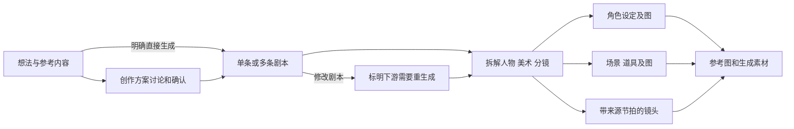
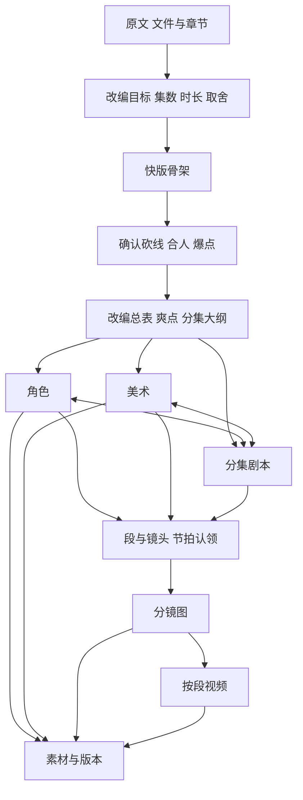
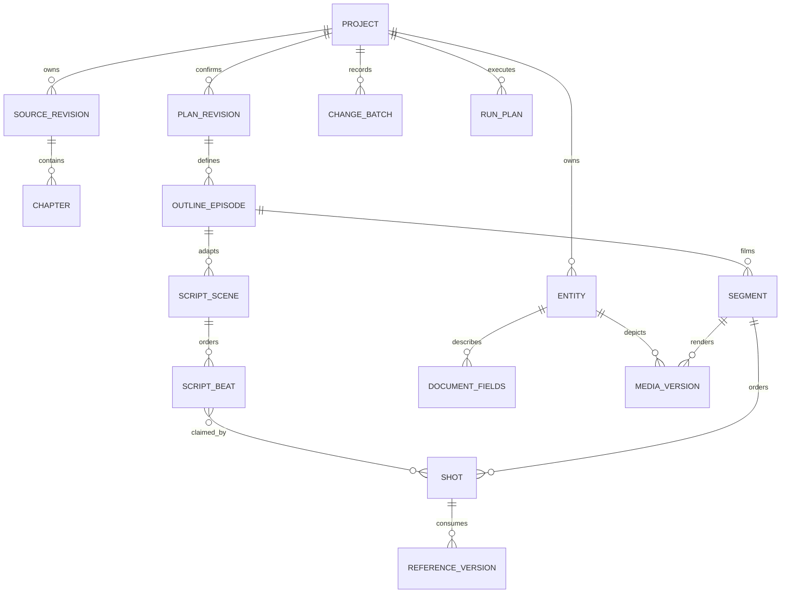

# ReelBench 完整产品拆解与 CrewON 复刻规格

日期：2026-10-08。目标是复刻产品的功能、使用逻辑、对象关系和操作结果，视觉使用 CrewON 风格。本文件替代此前“参考页面后调整布局”的实施依据；旧文档保留为历史记录。验收对应 [逐项验收清单](./reelbench-replication-acceptance.md)。

下一阶段的协议、事务和迁移依据见 [P1兼容扩展](./reelbench-replication-p1-compatibility.md)。本轮交付分析和合同，不将文档检查通过记为产品功能通过。

## 1. 结论与范围

ReelBench 有两条独立入口。**创意项目以想法和剧本为中心，小说项目以原文和改编大纲为中心。**两者共享角色、美术、分镜等制作概念，但导航、前置确认、数据细度、编辑方式和恢复能力并不相同。不能用一个短创意输入框、几个通用阶段页来宣称完整复刻。

当前 CrewON 已有项目持久化、原 Agent 会话关联、文字候选与采用、资产版本以及部分 ComfyUI 适配；仍缺小说原文管理、改编方案、完整人物和美术结构、节拍到镜头的引用、生成段、视频、字段变更与批次撤回等关键能力。Short37/38 的布局和测试通过记录只证明那次已有能力调整，不证明复刻完成。

范围包括首页与项目管理、两类项目创建、方案确认、剧本/角色/美术/分镜制作、AI 与手动编辑、引用和上游变化、图片编辑和版本、视频生成与素材、变更历史、跨项目资产复用、分批任务恢复及真实服务结果。参考站模板入口当前显示未开放，须如实呈现状态。

用户已确定的适配条件：保留 CrewON 原版基础功能和宿主样式；插件可安装、停用、卸载；内容主题只作用于插件；进入插件先到首页；所有 Agent 对话复用主页能力；Krea2 和其他工作流集成在 AI 短剧插件中；积分后置。参考站账户、购买入口沿用 CrewON 账户与权限体系，不另建账户系统。

## 2. 证据与验证边界

本轮在已登录的参考站实际导航，使用现存的两个创意项目和两个小说项目，打开/关闭编辑、引用及图片历史弹窗。没有提交模型生成、保存新内容、上传文件、恢复图片、撤销批次、导入或删除资产。下表记录的是当前页面证据，不复制用户小说正文作为测试数据。

验证级别：**观察**表示页面/控件/现存结果已看到；**交互**表示进入和退出编辑或切换状态已操作；**说明**表示页面明示的结果语义，尚未执行交易；**待验证**表示没有操作前后结果。原站出现历史成果，只能证明有该成果，不能证明现在供应商仍可用。

| 证据 | 实际页面与状态                                                                                                                                                            | 本轮确认内容                                                                       | 级别               |
| ---- | ------------------------------------------------------------------------------------------------------------------------------------------------------------------------- | ---------------------------------------------------------------------------------- | ------------------ |
| E01  | [首页](https://reelbench.79px.com/dashboard)                                                                                                                              | 创意输入、参考内容、比例、角色/美术选项、小说入口、最近项目类型、未开放模板        | 观察               |
| E02  | 首页“创建小说短剧”弹窗                                                                                                                                                    | 文件格式/大小、项目参数、改编与画风选项、初始化顺序说明                            | 交互、说明         |
| E03  | [创意待剧本页](https://reelbench.79px.com/c/1/script)                                                                                                                     | 明确直接生成时跳过方案；没有剧本前不能拆解下游；讨论入口仍保留                     | 观察、说明         |
| E04  | [创意剧本页](https://reelbench.79px.com/c/2/script)                                                                                                                       | 分集/场/节拍、项目改名弹窗、讨论/修改切换、修改直接替换及下游重生成提示            | 交互、说明         |
| E05  | [创意角色](https://reelbench.79px.com/c/2/characters)、[美术](https://reelbench.79px.com/c/2/art)、[分镜](https://reelbench.79px.com/c/2/storyboard)                      | 从剧本拆解的人物、场景、道具和镜头；出现位置；当前待图状态与批量出图入口           | 观察               |
| E06  | [创意历史](https://reelbench.79px.com/c/2/history)、[项目资产库](https://reelbench.79px.com/c/2/asset-library)                                                            | 创建/剧本/拆解事件；本次没有撤回按钮；参考和生成图归属当前项目                     | 观察               |
| E07  | [小说概览](https://reelbench.79px.com/p/1)                                                                                                                                | 大纲在前，角色/美术/剧本为收敛层，分镜在后；五类成果入口                           | 观察               |
| E08  | [小说大纲](https://reelbench.79px.com/p/1/outline)、[爽点](https://reelbench.79px.com/p/1/outline/beats)、[第一集大纲](https://reelbench.79px.com/p/1/outline/episodes/1) | 改编取舍、实体表、爽点分布、梗概/钩子/悬念、关联资产；双击梗概进入编辑显示离开保存 | 交互、说明         |
| E09  | [小说角色](https://reelbench.79px.com/p/1/cast)、[人物详情](https://reelbench.79px.com/p/1/cast/%E6%B2%88%E7%9F%A5%E5%BE%AE)                                              | 身份/画像/弧光/关系/原文证据/形象/音色；cast 与 outline 弧光独立，身份相同         | 观察、说明         |
| E10  | [小说美术](https://reelbench.79px.com/p/1/art)、[场景详情](https://reelbench.79px.com/p/1/art/scenes/S01)、[道具详情](https://reelbench.79px.com/p/1/art/props/P01)       | 场景/道具筛选、锚点、状态、提示词/负面词/版面、使用位置；新增美术弹窗              | 交互、说明         |
| E11  | [第一集剧本](https://reelbench.79px.com/p/1/script/1)                                                                                                                     | 有序动作/对白节拍、语气、预计时长、场景/人物/道具与大纲/分镜跳转                   | 观察               |
| E12  | [分镜总表](https://reelbench.79px.com/p/1/storyboard)、[第一集](https://reelbench.79px.com/p/1/storyboard/1)、[第一段](https://reelbench.79px.com/p/1/storyboard/1/1)     | 集→段→镜、时间与节拍派生、H3、视频历史、逐镜编辑、长期资产引用、上游换图处理       | 观察、说明         |
| E13  | 第一段“编辑图片”“图片历史记录”“添加引用”弹窗                                                                                                                              | 原图+最多8张附加图；编辑不改正式提示词/引用；恢复只切当前图并保留后来版本          | 交互、说明         |
| E14  | [小说历史](https://reelbench.79px.com/p/1/history)                                                                                                                        | 字段前后值/图、原因、按操作分批、撤销这批、复制给 Agent                            | 观察、说明         |
| E15  | [小说素材库](https://reelbench.79px.com/p/1/library)                                                                                                                      | 图片/提示词/视频页签；在用与被替换图；提示词翻译/编辑；视频历次参数与时间          | 交互、说明         |
| E16  | [全局资产库](https://reelbench.79px.com/asset-library?projectId=1)                                                                                                        | 项目之外的角色/场景/道具副本，导入目标选择；复制而非共享可变引用                   | 观察、说明         |
| E17  | [长篇小说概览](https://reelbench.79px.com/p/3)、[剧本中断页](https://reelbench.79px.com/p/3/script)                                                                       | 389章、120集；角色/美术/剧本分步；剧本按3集一批；中断原因、已完成计数、检查点继续  | 观察、说明         |
| E18  | 第一段“生成服务→切换”链接                                                                                                                                                 | `/p/1/settings#queue` 实际跳回首页，没有可核查设置表单                             | 交互；可用性待验证 |

发现的原站差异和问题也不能被当成设计规则：概览角色数来自大纲，角色设定页数量更少；大纲场景表与美术墙数量不同；长篇概览零剧本与任务已完成分批的计数并存；一次素材库导航留下旧页正文，刷新后才显示正确内容。复刻时统计必须说明统计对象、来源和状态；路由更新必须与正文一致。

## 3. 首页和项目管理

首页以一个创意输入和继续项目为主，另设小说导入。最近项目清楚区分“创意”“小说”，并显示条数或类型状态；项目页标题可切换到其他项目。创意支持单条或多条，默认横屏16:9，另有竖屏9:16；“需要角色”“需要美术”默认勾选。参考内容进入项目参考资产库。空想法禁用创建；支持快捷提交。默认先确认创作方案，明确直接生成剧本可以跳过方案确认。[E01–E04]

CrewON 必须保存这些选项并让实际执行读取它们，不能只添加 UI 开关。首页只显示想法、小说入口与项目列表；资产保存诊断、连接信息、旧生成提示不能长期置顶。进入插件优先首页；用户点击已有项目再进入成果页。浏览器/桌面重新进入规则需验收，不能由全局遗留选中项目强制跳入。

项目创建、改名、归档/恢复与删除需要区分；原站“删除项目”最终恢复性未验证，不直接用永久删除实现。CrewON 现有归档恢复保留。模板未开放不做虚假可用入口。项目切换不能混入另一项目的会话、草稿、任务或历史。

## 4. 创意项目：输入到制作

导航为剧本、角色、美术、分镜、变更、项目资产库，没有观察到小说的大纲页。[E03–E06]

| 页面       | 用户首先看到什么                                                           | 操作与实际语义                                                                             |
| ---------- | -------------------------------------------------------------------------- | ------------------------------------------------------------------------------------------ |
| 剧本空状态 | 原始想法、比例/资产需要、等待第一版                                        | 生成剧本；下游依赖说明；顾问讨论持续可用                                                   |
| 已有剧本   | 分集标题、概要、时长、开头钩子/结尾、场景和有序节拍                        | 重新生成剧本；重新拆解角色/美术/分镜；页首“编辑”实际只改项目名称                           |
| 创作顾问   | 当前剧本状态、讨论/修改模式                                                | 讨论只给建议；修改经校验直接替换当前剧本，提示下游重生成。方案未确认状态的完整往返尚未实测 |
| 角色       | 名字、角色用途、形象提示词、音色、出现集/场                                | 批量生成未有图的角色设定图。本次项目没有单角色详情/内联编辑控件，不能宣称与小说完全一致    |
| 美术       | 场景/道具合并的资产墙、用途、提示词、出现位置                              | 按全部/场景/道具筛选，批量生成当前筛选范围中的图                                           |
| 分镜       | 按剧本分集的镜头卡；镜号、时长、景别、运镜、画面、角色/场景/道具、来源节拍 | 一键出图；本次镜头没有小说的段详情或视频按钮，不能臆造该功能已存在                         |
| 历史       | 项目创建、剧本生成、拆解事件及数量/选项                                    | 本次仅观察事件记录，没有小说的批次撤销动作                                                 |
| 项目资产库 | 上传参考图和本项目生成图；项目归属                                         | 不能当作用户级资产库。当前项目为空，丰富状态待验证                                         |

该分支的最小完整闭环是：想法→确认方案→剧本→拆解→逐类素材→修改剧本→明确更新范围→更新下游，并从同一个项目继续。只生成正文、不建立人物和镜头来源关系不算完成。

## 5. 小说项目：原文到改编

### 5.1 原文导入和参数

创建弹窗接受 TXT、Markdown、HTML，最大20MB；项目名；可选题材和总集数；单集时长范围默认2–5分钟；改编幅度“忠实/抽核/借壳”，默认抽核；比例16:9默认或9:16；画风半写实默认或手绘动画；可选必留角色/场戏，逗号或换行分隔。弹窗说明创建后先做快版骨架，砍线、合人和爆点未拍板前不提前产出分集及下游。[E02]

原文章节是上游材料，剧集是改编成果，两者不能共用一个编号或把章数当集数。长篇样本有389章、120集，证明原文和分集需要分页、按范围读取及分批运行；当前 brief 8KiB/大纲16集的限制不能承载这个入口。[E17]

原文阅读/替换、章节选择与重新选改编范围的完整 UI 本轮尚未验证：概览中的“小说原文”“素材来源”是文本，没有可操作入口。实施必须支持原文版本和可定位证据，具体章范围选择交互作为待补核查项，不能虚称原站存在章节选择器。

### 5.2 阶段关系

箭头表示输入与迭代关系，不表示访问页面必须依序。原站概览把角色、美术、剧本归为同一收敛层；长篇剧本页说明三者消费已确认大纲，一次组织生成并保持引用一致。分镜严格消费已有剧本，不在分镜步骤重写剧情和台词。[E07、E12、E17]

### 5.3 页面树与成果

| 层级          | 页面内容                                                                | 编辑与跳转                                                        |
| ------------- | ----------------------------------------------------------------------- | ----------------------------------------------------------------- |
| 概览          | 原文初始化摘要、目标参数、五阶段数量与关系                              | 进入具体成果，不用独立“任务与连接”栏挤占首屏                      |
| 大纲总表      | 体裁、集数/时长、模式、内核；保留/砍掉/合并/风险；角色表、场景表、分集  | 内核双击；取舍列表新增/上下移动/删除；实体和分集跳转              |
| 爽点表        | 集轴分布、类型/权重/所在集、铺垫/兑现、间隔质量检查                     | 铺垫/兑现双击；跳到对应分集大纲                                   |
| 分集大纲      | 梗概、钩子、悬念、人群方案、本集爽点、场景/角色引用                     | 内联编辑；跳该集剧本及实际资产                                    |
| 角色列表/详情 | 设定图与提示词；画像、弧光、关系、证据、形象和音色                      | 内联字段编辑/复制；图编辑/历史/重生成；加入用户资产库             |
| 美术墙/详情   | 全部/场景/道具；意图、锚点、状态、提示词及使用关系                      | 筛选；新增美术；内联编辑；列表维护；图操作；使用位置跳转          |
| 剧本总表/分集 | 集数、预计/目标时长、场数/节拍/对白；钩子/断点/爽点；场次与有序节拍     | 节拍正文双击；回大纲、到分镜、到场景；中断任务继续                |
| 分镜总表      | 分集统计、均镜时长、段上限、尚未做分镜的集、未认领节拍                  | 缺失分镜文本、单集分镜文本、缺失分镜图、全项目图片后视频          |
| 分集分镜      | 段时长、镜数、场次/光照、切点；可进入段                                 | 本集缺失图、本集图片和视频、回剧本                                |
| 单段分镜      | H3、多镜时间轴、视频及历史、逐镜图片/提示词/引用/秒数/景别/运镜、节拍表 | 局部/缺失/段级生成；提示词编辑/中文转义；引用更新或保留           |
| 素材库        | 图片、提示词、视频；在用/被替换图；生成参数和时间                       | 原图查看、提示词编辑/翻译、生成、历次视频；旧图清理需独立保护历史 |
| 变更          | 字段前后、原因、操作批次、图片前后预览                                  | 批次撤销；复制变化给 Agent；最终撤销结果待验证                    |

## 6. 编辑与产物联动合同

### 6.1 当前正文与字段

小说正文默认可读，双击进入字段编辑，页面提示离开就保存；本轮只打开编辑而未改值。该行为与 CrewON 当前“保存候选→采用→锁定”不同。完整复刻时日常手动编辑应在校验后保存当前字段并记录历史，不能强迫每次编辑都走多层候选表单。Agent 讨论不写成果；要求修改时输出结构化变更，校验后应用到明确对象，与手动编辑使用同一保存与历史服务。重生成媒体仍保留旧结果。[E04、E08、E14]

采用/锁定继续可以作为高级保护能力，但必须真实区分“尚未应用的建议”和“当前成果”；不是参考站每个字段的必经步骤。冲突、保存失败、来源变化在相关对象旁呈现，不用全页技术栏。

### 6.2 身份与文档字段

角色有一个稳定实体身份，但 cast 画像/弧光与 outline 角色定位/弧光是独立文档字段，两者可以不同，不自动互相覆盖。C/S/B 显示编号不充当主键；改名/重编号不破坏剧本、爽点和分镜的引用。[E08–E10]

场景光照与道具形态是共同状态结构；各自保存一致性锚点、正式提示词、负面词、设定图版面。道具有尺度、经手人、关联场景及出现镜头；场景有母场景/变体、主场景与复用意图。不能用单段 setting 和 visualPrompt 抹掉这些含义。[E10]

### 6.3 三种参考必须区分

| 参考                            | 生命周期                       | 操作结果                                                               |
| ------------------------------- | ------------------------------ | ---------------------------------------------------------------------- |
| 项目画风/内容参考               | 项目级保存                     | 后续制作读取项目约定；创建首页有参考内容入口                           |
| 镜头引用角色/场景/道具          | 长期关联到稳定实体及指定图版本 | 下次出图输入使用这些图；上游图变更提示受影响镜头                       |
| 单次图片编辑/美术首次生成附加图 | 仅本任务，最多8张的弹窗选择    | 不建立永久引用；图片编辑要求不改正式提示词；普通重生成不暗用上次附加图 |

镜头上游换图后显示旧版/待重出，并提供“同步并重新生成”“保留当前版本”。保留意味着本镜输入/产物继续绑定旧版，不暗换为最新图；同步操作需要记录实际引用的新版本和新任务。[E12–E13]

### 6.4 图片、视频与版本

图片历史包含重生成、编辑和恢复版本；当前版本不可重复恢复；恢复切换当前图，后续历史保留。素材库说明图按内容保存，重生成不覆盖旧文件。单段视频显示最新/历次、生成服务、比例、分辨率、Step；视频素材页保存时长、实际尺寸、参数、大小与生成时间。[E13、E15]

任务接受不能显示成“图片已生成”。结果必须有可读取文件、所属对象、版本、输入快照与供应商任务来源；视频必须能播放真实内容。图片后视频的批量动作串行到相应段；部分失败不抹掉已有成果，重试不能重复已完成步骤。原站这些最终事务未执行，CrewON 要以自有测试与真实供应商任务证明。[E12、E17]

## 7. 核心数据关系：复刻所需，尚非现有实现

这是从页面关系及 Skill schema 得出的目标模型，不声称是原站数据库表结构。

必须分离：项目来源类型；原文/章/证据位置；创作或改编方案及确认版本；角色身份与不同文档字段；爽点；集/场/有序节拍；段/镜/节拍认领；正式提示词与一次性修改要求；当前图与不可变历史；媒体输入快照；操作批次；分批运行检查点。总时长、切点和视频对齐行从镜头顺序和秒数推导，不能在三处独立保存导致互相不一致。[E08–E17]

原站页面示例段上限15秒、建议镜长2–5秒、同框人数等依赖当前工作流口径。目标保存为工作流/模型能力约束，不变成通用插件协议硬限制。不得把概览固定数字、英文 H3 模板或特定镜头分段写死。

原文可大规模持久化，但 Agent 每次只读取任务相关章节、提要和证据；分页/增量读取，每个注入片段不超过10K tokens，不回写整段会话历史。

## 8. Agent、手动操作与 Skill

网站创意页内顾问在 CrewON 中映射到**原主页 Agent 会话和原对话框**，保留模型、工具、附件、技能、流式消息、停止、重连和历史能力。插件只传递项目、页面和当前对象上下文，跳转到确切原会话；不增加第二套 chat/run/workspace 存储。用户只聊天也可完成制作；切回成果页能看到实际正式产物并继续手动处理。

| 用户意图          | Agent 行为                                             | 页面结果                                         |
| ----------------- | ------------------------------------------------------ | ------------------------------------------------ |
| 讨论想法/改编策略 | 读取当前输入、提问缺少的关键条件，给建议               | 不覆盖成果；方案在确认前明确待确认               |
| 制作某阶段/某范围 | 读取确切上游版本，调用对应 Skill，生成结构化成果并校验 | 已保存成果可直接查看；输入不足时定位上游         |
| 修改现有对象      | 读取当前字段与依赖，输出有范围的变更并校验             | 应用后更新同一对象、历史及下游影响               |
| 生图/改图/出视频  | 选择有能力的工作流、冻结输入/参考版本、执行真实任务    | 对象内进度和实际结果，失败可从原任务恢复         |
| 继续中断项目      | 读取检查点、确认上游仍匹配，执行尚未完成步骤           | 已完成成果保留；上游变化时指出影响并修订剩余计划 |

已只读核查官方 [shuohao-skills 固定提交](https://github.com/eternityspring/shuohao-skills/tree/ef4ac0c313c7eeb1f918db5f0f0eb319745900bc)。它是制作方法、schema、质量门和报告工具集，不是 ReelBench 网站源码。没有安装或执行上游脚本。

| Skill                                                                                                                                               | 输入/确认                                                      | 对应产物与校验                                                                         |
| --------------------------------------------------------------------------------------------------------------------------------------------------- | -------------------------------------------------------------- | -------------------------------------------------------------------------------------- |
| [novel-outline](https://github.com/eternityspring/shuohao-skills/blob/ef4ac0c313c7eeb1f918db5f0f0eb319745900bc/skills/novel-outline/SKILL.md)       | 原文+目标；先骨架确认取舍，再分集；可体检已有大纲              | 改编、角色分档、场景、爽点、分集、道具；14道门                                         |
| [novel-characters](https://github.com/eternityspring/shuohao-skills/blob/ef4ac0c313c7eeb1f918db5f0f0eb319745900bc/skills/novel-characters/SKILL.md) | 继承大纲身份，扫描原文；也支持独立人物拆解                     | 画像/关系/原文证据/形象和音色；产提示词，当前不出图                                    |
| [novel-art](https://github.com/eternityspring/shuohao-skills/blob/ef4ac0c313c7eeb1f918db5f0f0eb319745900bc/skills/novel-art/SKILL.md)               | 大纲优先，可原文或人工清单                                     | 年代、锚点、母场景与变体、光照/形态、尺度；10道门；不出图                              |
| [novel-script](https://github.com/eternityspring/shuohao-skills/blob/ef4ac0c313c7eeb1f918db5f0f0eb319745900bc/skills/novel-script/SKILL.md)         | 消费大纲，附角色/美术；直接写时明确跳过范围；默认每批不超过3集 | 有序动作/对白、语气、钩子节拍、时长、爽点/资产引用；10道门                             |
| [novel-storyboard](https://github.com/eternityspring/shuohao-skills/blob/ef4ac0c313c7eeb1f918db5f0f0eb319745900bc/skills/novel-storyboard/SKILL.md) | 剧本是硬前提，不在此改剧情台词                                 | 集→段→镜，认领节拍、秒数/景别/运镜/构图、声音/视频提示；18道门，第18道可选；不生成媒体 |
| [character-refs](https://github.com/eternityspring/shuohao-skills/blob/ef4ac0c313c7eeb1f918db5f0f0eb319745900bc/skills/character-refs/SKILL.md)     | 描述确认→正面全身根锚点确认→派生视图                           | 实际PNG和提示/模型/参考/版本/检查/确认信息；当前仓库唯一实际出图 Skill                 |

各目录 `references/schema.md` 是字段依据。当前 CrewON 仅接入六份有界阶段指导，并未采用全部结构或运行全部质量门；不能声称 Skill 配合已完整实现。适配必须映射完整产物、运行确定性检查，清楚记录跳过的可选门。Krea2 为我们的外部模型适配，不是上游已原生支持的后端。

## 9. 服务集成与可用性

工作流服务是制作阶段的后端适配，不独立成为另一个插件。Krea2 负责适合它的概念/设定图与多视图；参考驱动画面、图片编辑和视频各自声明输入/输出能力。不得用一个生图工作流冒充剧本、分镜结构、改图、配音或视频服务。

每个能力需要：真实服务地址与所选工作流版本、输入字段/参考语义、媒体输出类型、排队/查询/取消语义、错误恢复、输入快照和实际结果读取。前端只展示用户决策需要的状态；技术信息收起。服务不可用显示具体能力和重试入口，不整页“模块暂不可用”。

已提供的 ComfyUI 地址仍须在正式 Node 适配和桌面权限下验证，不能用另一个语言的 HTTP 200 或元数据读取代替真实生成验收。现有 DNS/代理假IP引发的出口校验问题须按真实网络配置解决，保留私网/身份/租户边界；不关闭安全检查获得假成功。

## 10. 与当前仓库的差距

| 能力       | 现有真实实现                                                                | 复刻缺口                                                                         |
| ---------- | --------------------------------------------------------------------------- | -------------------------------------------------------------------------------- |
| 两类项目   | `CreativeProject.kind = short-drama`；title/status/latest brief             | 缺明确来源类型、对应创建参数与流程；不能只改标签                                 |
| 原文与方案 | brief单段8KiB；原主页有创建/关联/执行确认、手动或来源未变时采用、原请求恢复 | 缺文件/章节/来源版本/证据位置和独立创作/改编方案对象；现有启动确认不等于骨架确认 |
| 大纲       | 稳定episodeId、title/summary，最多16集                                      | 缺改编取舍、分档角色/场景/道具、爽点、钩子/悬念及原文映射；长篇分页              |
| 剧本       | 分集、场、动作/对白；来源版本；32场/32KiB限制                               | 缺有序节拍身份/对白引用、语气/时长/钩子认领、跨资产稳定引用                      |
| 角色/美术  | assetId、name/setting/visualPrompt、版本与参考图；最多一份剧本来源          | 缺多文档字段、画像/关系/证据/音色、锚点/状态/母场景/多处使用关系                 |
| 分镜       | 按episodeId保存画面探索输入、提示和参考版本                                 | 缺scene/beat/segment/shot模型、认领覆盖、时长派生、分镜版本和镜级操作            |
| 媒体       | Krea2部分预设、Flux2三参考输入与候选协议                                    | Flux2固定一场景两角色；缺真实多种改图/视频/声音链路；协议存在不等于服务通过      |
| 联动与运行 | stale检查；文字计划brief→outline→script可暂停/续跑                          | 缺字段影响范围、媒体阶段计划、分批大规模生产和输入变化后的局部重算               |
| 版本与撤回 | 历史不可变、可重新采用有效旧候选                                            | 缺按操作的字段变更、媒体恢复合同、撤销到空、批次撤回；会话回滚不能撤销项目结果   |

核查来源为 [项目模型](../packages/domain/src/creative-project.ts)、[文字模型](../packages/domain/src/project-text-types.ts)、[资产模型](../packages/domain/src/project-asset-types.ts)、[媒体输入](../packages/application/src/project-media-input-port.ts)、[文字计划](../packages/domain/src/project-text-plan-types.ts)。本表描述源码能力，不证明生产服务可用。

长篇约束需要整条链路一起迁移：当前文字计划的 `planEpisodeIds` 最多16集、`step.ordinal` 最多18步，主页规划能力 `maximumEpisodes` 也为16。只放宽大纲条数或前端输入不会使120集任务可执行。P1/P2/P5必须分别验收持久化、分页读取、计划规模和分批派发，保留每个模型输入的有界限制。

原文还不能塞进现有插件调用：SDK v1 invoke 的 JSON 上限为24KiB，已有Node结果为8KiB量级。20MB原文需要单独的上传/分块读取协议和来源引用，不能放宽所有调用上限或将全书写进brief。现有主页方案属于Run产出的启动建议，旧文字产物只允许outline/script；改编方案应有独立的关联记录，复用原启动确认而不冒用旧产物类型。

## 11. 落地顺序和影响范围

| 顺序 | 交付                                                             | 主要影响                                           | 完成条件                                                               |
| ---- | ---------------------------------------------------------------- | -------------------------------------------------- | ---------------------------------------------------------------------- |
| P0   | 本分析、验收清单、待验证登记；取消之前的“同一入口即可等价”假设   | 文档；不继续安装布局候选包                         | 两类路径独立、事实/推断/决定分开、每项有验收结果要求                   |
| P1   | 两类来源、目标参数、原文/章节、方案与确认；兼容读取既有项目      | domain/application/control-api及公开协议、插件首页 | 旧项目/会话不丢失；新创意/小说各自进入正确第一步；长篇分页有界         |
| P2   | 完整大纲/角色/美术/剧本结构及稳定身份引用；当前字段编辑/变更批次 | schema、持久化迁移、服务与插件成果页               | 官方结构可往返；AI和手动同数据；改名不坏引用；旧成果可查看             |
| P3   | 段/镜/节拍认领、覆盖/时长/H3派生、局部修改和引用图版本           | 分镜领域与页面、Skill校验                          | 一个镜长修改使切点/对齐/统计一致；未认领可定位；局部不改剧情           |
| P4   | 图片生成/编辑/版本、视频、素材库、用户资产复制                   | 工作流适配、任务/文件服务、插件素材交互            | 正式桌面真实出图/视频、可读可播、来源正确、失败续跑不重复              |
| P5   | 原 Agent 双向接力、完整制作计划、分批检查点、变更与撤回          | 原Run工具/上下文、计划服务、原UI接线               | 只聊天能执行，手动后继续能读最新；流式/停止/重连；批次恢复保护后续修改 |
| P6   | 全路径验收、部署和桌面一致更新                                   | 生产API/插件包、宿主回归                           | 两类端到端、真实服务、无假按钮；原侧栏/账户/设置/绑定/窗口按钮不回归   |

这是增量实施，不要求替换宿主运行时或构建系统。功能 UI 在 `examples/plugins/short-drama` 和 `apps/crewon-ui` 原接线；HTTP/会话在 control-api/web-bff；模型工具运行在 runtime-worker/可复用packages；设备派发在 device-gateway。公共协议/持久化形状需兼容审查及行为测试。

P1–P4每个阶段同时交付主页Agent和手动入口，走同一服务与持久化，不能先做孤立页面最后才补Agent。P5负责跨阶段完整编排、规模化分批与冷恢复验收，继续复用现有主页项目确认/创建/关联/执行路径，不重新创建一套方案启动器。

迁移不能自动把所有旧项目判成小说或用新的选中指针覆盖已采用版本。既有projectId、assetId、会话、工作空间、模型选择与历史保留；新的创建明确类型，旧记录保持可读并显式记录旧来源未知状态。Agent模型上下文只追加有界项目片段。

当前 `CreativeProject` v0 与 v1 创建动作有严格字段校验。P1不能在旧返回对象里直接加来源或参数使旧插件失效，也不能把 `kind: short-drama` 改成创意/小说而破坏现有校验。兼容扩展须先确定新版本动作或独立附属规格的映射，继续引用同一projectId和提交权限；原文、创建参数与项目应在可恢复事务中关联，不能形成第二套项目身份。

SQLite旧项目schema版本也有严格检查；保留旧表版本和旧record，来源/方案使用同库、关联原projectId的附属表。现有提交许可和回执固定六类mutation及v1动作，新动作不能借旧createProject许可越权写入：需独立动作、回执和事务资格，复用原principal、PDP及真实安装包身份。桌面派发的已提交结果元数据与生产适配器一起接入，保证提交后撤权/响应丢失仍能恢复原结果，不重复创建。

插件主题通过宿主变量，CSS/弹窗/滚动限定owner，按可用内容宽度响应；宿主左右栏打开时主区动态变窄，不覆盖。侧栏插件目录可收起，选中项和插件归属清楚。插件停用不改变宿主基础能力，卸载不删用户业务数据。

## 12. 待验证登记及复刻验收原则

| 未实测项                                   | 已知依据                                       | 后续怎么补                                                                 |
| ------------------------------------------ | ---------------------------------------------- | -------------------------------------------------------------------------- |
| 创意默认方案确认的完整对话/确认/再修改     | 首页说明，当前样本走直接生成                   | 使用独立合成测试项目核查，不能操作用户现有项目验证覆盖                     |
| 小说上传解析、骨架确认、章节范围与原文替换 | 创建弹窗及长篇现存摘要；范围选择UI未见         | 独立原文样本核查，记录输入/确认前后及引用变化                              |
| AI生成、修改和媒体排队的最终结果           | 已有成果/历史、模式说明                        | 自有实现先测试确定性合同，再做实际供应商闭环；旧成果不作当前连通证明       |
| 正文离开保存后的冲突/失败/刷新             | 编辑状态提示；未保存新值                       | 测试成功、断网、并发修改、重连和重新进入，确保不丢草稿、不假保存           |
| 图片恢复与批次撤销对后续变化的处理         | 弹窗与历史说明，未执行                         | 独立数据验收当前指针、历史保留、影响范围和冲突；不撤回用户真实成果         |
| 跨项目导入的复制内容/删除影响              | 全局库说明为副本，当前空                       | 两个合成项目实测，源/目标身份分离，删除或改图不串改                        |
| 服务切换/工作流参数设置                    | 原站设置链接跳回首页                           | 记录原站可用性问题；CrewON用自身配置与真实能力表，不复制失效链接           |
| 视频播放、批量依赖、取消与断点恢复         | 历史视频存在；长篇中断页                       | 真实视频任务与进程重启验收，不用控件或固定进度冒充完成                     |
| 导出、配音、剪辑/成片的原站完整入口        | 本轮只看到按段视频和素材，没有验证这些独立入口 | 不把规划中的功能宣称成原站现有能力；按实际入口补证，用户要求的制作扩展另列 |

待验证不用于隐瞒或缩小完整复刻范围，也不用于推迟已有充分依据的实现。每个功能必须在清单中有输入、操作、持久化成果、错误恢复及重新进入结果。页面存在、快照通过、任务被受理都不能替代真实结果。复刻完成只能在两类完整路径和原版基础功能回归全部通过后宣布。
