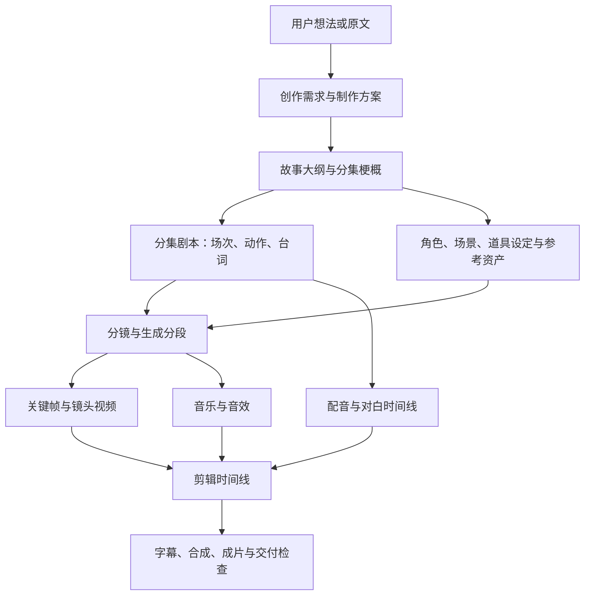

# AI 短剧：Agent 与工作流协同方案

日期：2026-10-06。状态：完整产品与架构设计；[共享大纲/剧本底座](./project-text-artifact-protocol.md)已实现，[真实 Agent 项目工具](./plugin-project-tools-protocol.md)已接到原 Worker；[手动文字页](./plugin-project-texts-ui-protocol.md)、[文字请求冷恢复](./plugin-project-text-recovery-protocol.md)、[项目对话与阶段范围](./plugin-project-conversations-protocol.md)和[有界持久文字计划](./plugin-project-text-plans-protocol.md)已实现。Short18 的原聊天项目建议与历史查询已完成隔离正式桌面验收；Short19 增加[共享角色/场景/道具与独立资产阶段](./plugin-project-assets-protocol.md)，源代码及独立包已验收，19.0.1与正式桌面0.1.18的隔离安装、执行准备、连续操作及冷读取已验收。分镜、视频、声音和成片继续实施。此方案补充[当前 S0 实施方案](./short-drama-workbench-product-plan.md)，按用户最新要求覆盖完整短剧项目、Agent 自动推进和手动探索。现有能力与实际验收范围仍以[实施进度](./incremental-extension-progress.md)为准。

## 产品决定

用户能直接阅读的页面结构、八阶段内容、Agent对话示例和手动接力见[产品交互](./short-drama-product-experience.md)。Short22已提供[参考素材与确认输入页面](./project-media-input-page-protocol.md)，生成与Agent媒体命令仍按各自资格继续接入。

具体的八阶段产出、工作流匹配、对话工具职责、手动操作、依赖计划和实施验收见[双入口与跨阶段自动执行规格](./short-drama-orchestration-spec.md)。该规格区分现有文字计划与待实现的跨阶段计划，不扩张旧协议权限。

交付一个可安装的 `crewon.short-drama` 插件。它包含项目工作台、阶段规则、Agent 工具、成果校验和多个生成工作流适配器。Krea2 是其中的生图能力，不是整个产品，也不另建独立工作流插件包。

用户有两个平等入口：

- **Agent 对话**：说出想法、修改要求或执行目标，Agent 结合当前项目提出方案，生成内容并执行获准的阶段。
- **项目工作台**：查看和编辑成果，选择工作流与参数，单独执行或批量执行，比较候选、选用结果，再交给 Agent 继续。

两个入口共用项目、修订、工作流配置、执行计划和任务记录。聊天不会建立另一份项目；手动生成与查询沿同一 Run 执行和恢复机制；单纯编辑、保存和选用文字成果使用独立项目服务，不要求先创建 Agent Run。两端都能看见对方刚产生的成果。

用户也可以从已有剧本、一个角色或单个镜头开始，不强制把所有前置环节重新跑一遍。进入某阶段时检查该工作流的必需输入；现有素材可以保存为明确的输入成果，再补缺失的设定或引用。缺少必需输入时由用户填写或让 Agent 补齐，不能把未做过的阶段标成已完成。

宿主首页、原对话页、左右侧栏、账户及设置保持原样。插件工作台挂在原内容区；对话只增加有用的项目关联和阶段结果卡片。

当前宿主已让原聊天的项目建议直接创建项目、关联同一个原会话，并启动需求/大纲/剧本范围内的已有文字计划。建议显示在对话正文，工具过程折叠后仍可操作；用户可保留手动采用或明确选择自动采用规则。创建和关联不会产生 Run，执行复用原服务端计划。页面重开只读取原状态，未确认回执由用户继续原请求，不自动发起新制作。0.1.20与Short20已完成隔离正式桌面验收：只创建，以及确认一集大纲→实际项目工具保存→自动采用→手动工作台读取→冷启动恢复。模型响应使用具名本地模拟器，实际业务工具与保存沿原产品执行；这不证明外部模型推理、Agent无交互创建或八阶段全自动制作已交付。

### 从一句想法到混合制作

目标交互：“做三集雨夜悬疑，先完成大纲和第一集剧本，再探索女主形象，视频暂不做。”

Agent 在原对话里整理出制作范围：三集大纲、第一集剧本、女主设定及形象候选，终点是角色探索。用户已经明确要求执行的部分直接进入相应流程；只要求“出方案”时保存建议，不启动制作。涉及尚未指定的媒体数量、必须的参考图或实际服务时，只补问影响执行的缺口，不要求用户重复输入故事。

项目建立和对话关联完成后，原对话持续显示当前项目及阶段进度。用户打开同一项目的剧本，改一句台词并采用；回到对话说“继续”，Agent 重读已采用修订，只处理受影响的部分。用户也可以在角色页保存设定、探索两张候选图、选用其中一张并锁定。后续分镜沿确切参考版本执行，另一次形象探索不会替换这个锚点。

原对话关联不改变 Thread 的工作空间。已有项目关联时先复用；需要切换项目时明确切换。新项目、关联及计划各有原回执，恢复时继续未完成的衔接，不能把一次按钮包装成实际上不存在的跨事务原子创建。主对话保留用户的创作讨论，阶段任务的独立 Thread/Run 只在实际需要时建立并标明归属。

**这是目标交互，不是当前全链路的交付声明。** 原普通聊天建议中的直接创建、原会话关联与明确确认文字计划，复用 Short20 的[原会话关联协议](./plugin-project-conversation-association-protocol.md)，已按上述范围完成0.1.20隔离正式桌面验收；用户实际安装尚未升级到新入口。20.0.1 已提供已选设定到概念输入的手动探索入口，独立包及布局验证通过；这只是精确复制画面描述的本地草稿，不建立持久资产依赖，也不启动媒体自动计划。真实参考关联仍须明确建立和采用。已保存操作顺畅化已通过19.0.1隔离正式桌面验收；接下来按“确切参考素材到实际工作流 → 分镜及后续阶段”推进，已有文字计划和原工作空间绑定继续复用。

## 完整生产流程

各阶段的必需输入、AI/工作流职责、完成依据和双入口接力进一步细化在[阶段执行契约](./short-drama-stage-execution-contract.md)。它同时明确镜头与生成分段的区别、D18适用范围及手动采用对自动计划的影响。[确认媒体输入](./project-media-input-protocol.md)已固定提示词、工作流及T10/D18逐角色来源，保存和素材准备分开；[原Run事务准入](./project-media-generation-run-protocol.md)、[实际Worker工具](./project-media-worker-composition-protocol.md)及[结果候选](./project-media-result-candidate-protocol.md)分别已通过宿主双库检查。Short22确认输入页面已接入；公开媒体制作入口、Agent输入命令、采用和联合验收继续实施。

参考 [shuohao-skills](https://github.com/eternityspring/shuohao-skills) 的结构化创作产物与确定性检查，以及其链接的 [Reelbench](https://reelbench.79px.com/) 以项目管理资产、分镜和生成记录的方式。以下是 CrewON 的设计决定，不将参考产品的实现、秒数或部署方式直接作为我们的协议。

剧本与资产可以并行迭代。分镜引用确切剧本和资产版本；视频、声音与剪辑按依赖推进。故事变更后，只处理受影响的部分。

| 环节             | AI 负责的内容                                                     | 配合的工作流                                                 | 保存的成果与用户操作                                           |
| ---------------- | ----------------------------------------------------------------- | ------------------------------------------------------------ | -------------------------------------------------------------- |
| 想法与制作方案   | 理解主题、受众、风格、人物、集数/时长意图；发现矛盾，补充关键缺口 | 需求提炼、原文有界提取、制作计划、能力匹配                   | 需求修订、制作约束、阶段计划；用户可补充、改写或选择执行终点   |
| 大纲与分集       | 情节、人物关系、主线、分集节奏与悬念                              | 大纲生成、分集拆解、结构和覆盖检查                           | 大纲/分集修订；可局部重写某集，保留已确认内容                  |
| 分集剧本         | 场次、动作、台词、情绪、表演提示和对白清单                        | 剧本生成、角色/场景引用校验、时长估算、台词提取              | 结构化剧本与可读正文；逐场编辑、重写、对比和确认               |
| 角色与美术       | 人物设定、服装、场景、道具、风格和图像提示词                      | 设定文本、概念生图、三视图、参考图派生/局部编辑、一致性检查  | 稳定资产及多个参考版本；探索候选、建立锚点、选用或锁定某个版本 |
| 分镜             | 剧本转镜头，构图、动作、运镜、对白位置和声音意图                  | 分镜生成、剧本覆盖/引用检查、镜头与供应商分段转换            | 镜头表、分段和资产引用；增删/拆并镜头、调整时长、单镜重做      |
| 关键帧与镜头视频 | 生成提示词，匹配所需人物/场景参考，分析失败与候选差异             | 文生图、参考图生图、图生视频、文生视频、首尾帧视频等实际 API | 确切图像/视频结果、任务和输入版本；单镜或批量生成、比较、选用  |
| 配音与声音       | 角色音色方案、情绪和语速、对白对齐、音乐/音效需求                 | TTS、音色配置、对白对齐、音乐/音效生成或素材选用             | 音轨与对白时间线；逐句试听、更换声音、调整位置                 |
| 剪辑与交付       | 按故事节奏组织镜头，识别缺失素材、字幕或音画问题                  | 时间线编排、字幕、转场、外部合成、技术检查                   | 时间线修订、成片引用、交付报告；预览、调整、重新合成、导出     |

每一环节都有明确输入、输出、校验和执行记录。确定性检查负责字段、引用、覆盖、时长范围和媒体规格；AI 可以评价叙事与画面，最终的创作取舍可由用户确认。程序不能把“结构校验通过”解释成“人物长相或成片质量已经合格”。

AI 的画面/声音评价也要求已接通相应的多模态输入能力；没有该能力时只做结构与技术检查，并交给用户查看/试听，不生成虚构的视觉评审结论。

## 工作流不是一个生图按钮

插件内部提供工作流目录，按用途组织。一个阶段可使用多个工作流，一个工作流也可以服务多个阶段。创作文本调用现有模型/Agent 能力；ComfyUI 和其他外部 API 负责相应媒体生成；检查和编排使用确定性工具。

| 工作流用途                      | 首批/后续接入                                        | 输入要求与边界                                                   |
| ------------------------------- | ---------------------------------------------------- | ---------------------------------------------------------------- |
| 需求、大纲、剧本、分镜文本      | 现有模型提供者 + 插件阶段指导 + 输出 schema + 检查器 | 输入选定项目修订；模型输出校验后保存为候选，不能直接覆盖正式成果 |
| 概念图、写实人物探索            | 已集成的 T01 Krea2                                   | 当前只有文本输入，不承诺人物一致性                               |
| 角色设定三视图                  | 已集成的 T04 Krea2                                   | 当前是一次文本生成的设定图，不等于从已选锚点派生                 |
| 锚点、人物/场景派生、镜头关键帧 | 后续选定支持参考图的 ComfyUI/API                     | 必须支持已保存资产引用、明确上传/输入规则并实测一致性            |
| 镜头视频                        | 后续选定实际视频工作流/API                           | 根据服务能力选择文本、参考图或首尾帧输入；镜头与生成分段分开     |
| 配音、音乐、音效                | 后续选定实际声音 API                                 | 冻结台词版本、音色配置和参数；返回音轨及可靠时长信息             |
| 时间线与合成                    | 时间线规则 + 后续外部合成 API                        | 只能使用用户选用的确切媒体与时间线修订，保存成片任务和结果       |

每个工作流定义至少包含：稳定 ID、版本与摘要、用途、输入/输出 schema、所需能力、可配置参数、确定性校验、执行适配器和恢复方式。组合工作流声明子步骤及依赖，不能任意执行用户上传的脚本。

服务的2026-10-05本地快照已读取340份保存图、导出10份实际 API 图。同包已接入 T01/T04，以及 T10 图像四视图和 D18 三素材画面的适配器、确认输入与Worker执行底座；公开制作入口与采用继续接线。T10/D18分别面向已选资产的派生与镜头参考。T11 的实际输出是图像，不能按“短剧生产”的名称当作视频。G02 首尾帧、P01 动作迁移、N06 声音、M10 超分的导出缺少节点类，H31 LTX 导演台还有音频 VAE 引用及字段类型问题；这些入口保持待配置/待验证。这个快照仅提供能力选择依据，实际节点、模型、素材与服务状态仍在接入时核验。具体导出及诊断位于本地 `output/extensions/comfy-workflow-library-20261005/`。

执行前，适配器把规范化业务输入转换为供应商请求，并冻结工作流、包、配置、输入与资产版本。Agent 可根据用途推荐工作流；匹配必须经过能力和授权检查，不能临时编造 API 或把不存在的能力展示为可执行。

后续媒体阶段区分“让 AI 完善生成描述”和“执行已确认输入”。手动执行冻结用户确认的提示词、素材引用与参数，适配器按已核验槽位组装请求，不在后台再让 Agent 任意改写它们。自动计划可以在获准范围内由 AI 产生这些内容，再按计划的选用规则冻结执行。两种方式调用同一业务执行命令，任务详情可回看实际输入；这项是后续媒体阶段的接入要求，不改变当前 T01/T04 的既有请求形状。

配置区按“文本创作、概念图、参考资产、视频、声音、合成”选择已接入服务和默认工作流。阶段页只显示用户需要的工作流、参数与缺失条件；开发用的摘要、端口和凭据不放进日常创作表单。更换默认工作流只影响新执行，旧任务沿原绑定恢复。

### 下一项：共享资产与参考素材

下一项先建立角色、场景、道具的共享资产档案。每项有稳定身份、不可变设定修订、真实需求来源及可空的剧本来源，以及独立的采用指针与锁定状态。用户可以从角色或已有素材切入，也可以继续保存候选，锁定只阻止替换正式采用。剧本里的角色名和地点当前只是文字，不能自动当作资产身份；关联时必须选择或建立真实档案。

Agent 和手动页面通过新增的具名资产服务调用同一业务命令。Agent 写入需要独立资产阶段准入；手动写入使用真实挂载页面的事务资格，不要求先建立 Run。不扩张原讨论、大纲、剧本或普通聊天建议的权限，也不把资产塞进已有文字计划的请求。当前文字计划保持原行为，后续再为资产与分镜建立明确的计划步骤。

图片参考只能来自已核验成功、同项目归属的实际结果。参考版本保存原输入修订、工作流/配置身份、Run、operation、结果位置和结果引用摘要；摘要不是图片字节摘要。生成新候选不替换当前锚点。下游执行冻结确切参考版本，迟到结果仍属于旧输入，不能改用执行期间新选用的图片。

| 工作流         | 当前输入与结果                         | 接入资产阶段的边界                                     |
| -------------- | -------------------------------------- | ------------------------------------------------------ |
| T01 Krea2      | 文本提示词；结果节点29                 | 已有概念探索，不能承诺角色一致性                       |
| T04 Krea2      | 文本设定；结果节点29                   | 一张设定图，不自动拆成三个独立视图，不从现有锚点派生   |
| T10 四视图     | 提示词及真实参考图；结果节点129        | 先补素材准备和按工作流读取结果；名称不代表四个独立文件 |
| D18 三素材分镜 | 提示词、场景与两个角色参考；结果节点17 | 冻结三项确切参考版本；三素材不等于三个镜头             |

上述映射来自2026-10-05本地 API 图与节点快照。2026-10-06再次核验当前服务，T10/D18所需26类节点均返回200，两份保存图字节未变。20.0.2同包适配器已用工作流自带示例素材完成两项真实生成与确切输出读取；这证明供应商适配器和素材路径可运行，仍不证明正式项目选用来源、Agent媒体计划或人物一致性已验收。详见[参考图工作流与素材接线](./short-drama-reference-workflows.md)。

D18 另外两个关闭的图像节点也提供有效场景引用。实际部署的自定义节点关闭时跳过存在性校验，但仍继承文件哈希读取；开启时沿核心函数读取。SSH只读源码及真实生成已核验显式`[output]`目录注解可用，裸输出文件名或`/view`地址仍不能代替图像输入。实际部署源码与此前同名公开候选不同，后续升级继续核验，不能仅凭自报版本推断相同实现。[官方路径解析](https://github.com/Comfy-Org/ComfyUI/blob/v0.38.0/folder_paths.py#L229-L243)

T10/D18 的素材准备统一从真实已选参考版本派生来源，冻结目标配置与工作流。优先验证同服务复用；目标节点不支持或素材来自其他服务时，才使用受批准的读取/上传路径。两条路径都需要真实可读性与材料身份记录，发生传输时另保存字节摘要和传输回执；插件不能绕过宿主自行上传或让 Agent 编造文件名。工作流槽位按实际连线确定：T10 的采样器142从143取得正向提示、从133取得负向提示，不能按第一个 `prompt` 字段修改任务意图。此项先交付可编辑、采用、锁定和冷读取的资产页面，继续复用 T01/T04 的生成链，再开放实际验证过的参考图工作流。

## Agent 对话如何处理一个想法

例：“做一部都市悬疑短剧，女主是修复师，先帮我做三集方案和角色设定。”

1. 普通 Agent 对话识别可用的短剧能力。没有当前项目时新建项目或让用户选择已有项目；新建项目只是保存业务资料，不触发媒体生成。
2. Agent 将想法整理为需求草稿，保留用户原话，并说明目前采用的假设。只有影响剧情、范围或实际执行的关键缺口才提问；可先完成独立的文本工作。
3. Agent 读取已安装插件的真实能力，提出阶段计划和预计产物，例如需求、大纲、三集剧本草稿、角色设定文本。未接通的视频能力明确列为后续条件。
4. 用户可要求“只出方案”“推进到分镜”或“按这个计划执行”。Agent 按授权范围自动生成、校验、保存成果并推进依赖，持续返回阶段结果卡片。
5. 用户说“第二集结尾改成反转，女主外形不要变”，Agent 锁定已选角色资产，只创建新的第二集剧本和受影响分镜候选，解释影响范围。
6. 用户可从卡片打开工作台编辑，再返回同一项目对话继续。Agent 下次行动先读取当前选用修订，不把旧聊天摘要当最新项目权威。

项目可以关联多个实际 Thread，例如项目主对话和某集制作对话。每条执行明确属于哪个项目、阶段、业务项及源修订；现有 workspace/Thread.cwd 绑定保持原规则。项目不是新的工作空间，也不更改历史会话的执行目录。

对话结果卡片显示：完成了什么、当前版本、采用/待确认状态、受影响下游、运行状态，以及“查看、修改、采用、继续到下一阶段”的可用动作。失败或结果未知时提供查看原任务与查询入口，不显示一个会重复生成的通用“重试”。

Agent 使用具名业务工具读取项目、提出/保存成果、建立计划、提交阶段任务、查看运行状态和选用结果。产品工具名称可按 `project.read / stage.propose / stage.execute / stage.status / result.select` 分类；这里只确定职责，公共协议在对应实施阶段单独版本化，不偷偷扩展当前 SDK v1 请求。

模型上下文按阶段有界读取：当前需求摘要、相关场次、确切引用资产和待执行步骤。整部小说、所有历史版本与全部工作流不能常驻注入。单个注入片段不超过 10K tokens；大纲、剧本和分镜按业务项分页读取。

聊天路径必须补齐项目对话启动与能力发现。原 Short12 的 Node 只有 `image.generate / image.query`；Short13 已新增12个真实项目工具，通过独立 `crewon.project-tools@1` 服务处理需求、大纲和剧本，并保留原工具。Short16 将真实项目 Thread 接到原 Composer，每轮显式选择讨论/需求/大纲/分集剧本并冻结范围；Short17 已接通实际关联项目内的有界持久文字计划。Short18 增加原普通聊天的能力发现与项目建议卡片：查看只预填，用户明确创建后预填该项目的计划，再选择实际项目对话并确认执行。普通建议工具自身不直接创建或执行项目。不能只加一段提示词，也不能让 Agent 借用 UI invocationRef 或点击工作台来冒充已授权命令。

新服务由宿主为当前调用者派生项目访问范围，插件工具只能调用其公开业务端口。参数中的 projectId 不构成权限；新建、读取、修订、执行与选用都逐次检查项目权限、当前包和修订。阶段 Run 的输入冻结 project/stage/item 与依赖版本。主对话负责讨论、计划和简短进度；需要并行时用明确关联的阶段 Thread/Run，避免多个步骤竞争同一个 Thread 的 active Run，继续保留原工作空间绑定。

## 自动执行的范围与控制

自动化首先是**用户目标 → 阶段计划 → 已授权步骤 → 可验证成果**，而不是 Agent 在聊天里无限自我循环。

| 执行方式       | 用户控制                                           | Agent/调度职责                                                   |
| -------------- | -------------------------------------------------- | ---------------------------------------------------------------- |
| 单步           | 执行当前阶段或某个业务项                           | 生成候选、校验、保存并返回，随后停止                             |
| 推进到指定阶段 | 指定起点、终点、锁定项和是否自动选用通过检查的候选 | 按依赖执行；无需每一步重新提问，遇到必需输入、权限或质量问题暂停 |
| 批量制作       | 选择分集/镜头范围、每项候选数量和允许的工作流      | 有界并行、逐项状态、局部失败恢复，不重做成功项                   |

计划保存：目标、步骤、依赖、输入修订、锁定资产、允许工作流、候选上限、并发上限、选用规则、用户确认点及当前进度。积分先按用户要求后置；以后接入预算时在同一准入链增加明确限额，不在本轮虚构价格。

阶段委托由宿主持久保存，绑定当前调用者、项目、计划版本、允许步骤/工作流和数量范围。安装或信任 Node 代码不代替这项委托。派发及恢复前复核当前权限与委托；暂停或撤销后不再创建新的执行。

纯文本草稿可在已授权目标内连续生成与保存。自动选用是计划中的明确规则；未授权自动选用时，成果进入待确认并暂停依赖它的步骤。生成收费媒体前按实际授权范围核验允许项和数量；授权不得扩大到供应商权限之外。

Agent 决定创作内容和下一步建议；确定性调度器核验依赖、权限与修订，复用现有 Run/Tool/operation 创建和观察执行。计划及检查点持久化在项目服务，不依赖聊天窗口保持打开。不要新增另一套 Agent runtime、插件 cron 或任意 DAG 运行系统；复用宿主已有任务/恢复能力，缺少的项目步骤状态通过增量业务服务补齐。

暂停阻止后续新任务，不宣称外部已提交作业被取消。继续执行先核验输入与权限；失败只针对未完成项创建明确的新尝试。`unknownOutcome` 只查询和核验原 operation，绝不自动重新 POST。App/Worker 重启后沿原计划和任务身份恢复，UI 重连不能重新创建步骤。

### 下一项的最小自动化闭环

先实现固定的“需求→大纲→指定分集剧本”计划，最多16集、并发1、每步一个保存结果，明确起点和终点。它复用 Short16 的阶段 Run；新增项目计划头、持久步骤槽和独立计划委托，不建立通用 DAG。Short17 已按[独立文字计划协议](./plugin-project-text-plans-protocol.md)落地此段；Short16 的历史单阶段 Run 不因此获得选用或跨阶段执行权。

“只出方案”只生成计划建议；“自动做到三集剧本”或明确工作台执行动作可以建立相应的有界委托。委托保存实际原用户消息/操作引用和指令摘要，模型的工具参数不能扩大终点、分集或自动选用范围。现有项目内先实现这条闭环；原未关联对话的一句想法创建项目及对话，沿公开创建回执单独接入，不能提前宣称项目、Thread、计划一次原子创建。

默认 `manual` 选用：需求阶段按实际 CAS 追加当前需求修订，大纲/剧本保存候选后等待采用。需求不是候选模型，追加会推进项目当前需求，计划须明确允许该动作。用户选择 `whenUnchanged` 时，自动采用仅针对该步骤真实保存回执指向的确切候选；来源、当前选用指针、成果 head 和锁定都未变化才执行。不能寻找“最新候选”替代本步骤结果。手动已选并锁定的成果可以作为显式起点复用；直接导入的剧本可以保留 outline:null，不伪造大纲完成。

步骤领取、原 Turn/Run/队列准入和步骤关联同提交；候选与步骤结果引用同文字提交；自动采用与步骤推进同选择提交。计划和步骤都持久保存原输入、原键、实际 Run/阶段摘要和真实成果回执。Agent 与工作台先领取同一服务器步骤槽，重连、切入口或重启都读取它；已准入只观察原 Run，未知结果不新建 key。Run 结束但没有合格成果不能算步骤完成。

暂停挡住新步骤和自动采用，已受理任务保持原身份可观察；撤销在后续写入前检查，不删除已确认成果或把未知说成取消。来源、锁定、选用、关联或安装变化时暂停，用户明确恢复后建立新的计划修订。冷恢复通过原 outbox/Worker 的业务处理继续观察与推进，不依赖工作台始终打开。这条闭环验收后再扩展资产与分镜步骤。

## 用户手动探索与 Agent 协作

工作台不是只读 Agent 报告，而是可以独立工作的编辑器。

- 用户可直接创建需求、编辑大纲/场次/角色/分镜/时间线，或选择某个工作流生成一个业务项。
- “探索候选”在原成果旁追加候选版本；用户选择采用后才更新当前指针。未采用的试验不使下游正式成果失效。
- 用户可锁定某个人物外观、场次或镜头，Agent 后续计划必须保留锁定项，冲突时说明原因。
- 用户修改正式输入后，界面列出受影响的下游项；可以保持旧结果、局部更新或交给 Agent 按影响清单修复。
- 用户在 Agent 执行期间编辑同一项时，新编辑成为新修订；在途结果仍归旧输入，不覆盖新编辑或新的选用指针。
- 同一请求从两个入口到达，按同一业务命令键返回原受理回执；不同输入、工作流或明确新候选使用新的执行意图。

两个入口领取/重读同一持久执行意图及其任务槽位，才能共享幂等键；不能各自生成随机 key 后承诺跨入口去重。用户明确要求再做一个候选时建立新的意图，文本相同不构成合并依据。并发领取通过服务端 CAS 和原任务准入事务协调，回执与项目执行关联保持一致。

手动入口和 Agent 工具调用同一业务命令及权限检查。不存在一条 UI 直连 ComfyUI、另一条 Agent 走 Worker 的分叉实现。

## 工作台页面

项目内部导航包含“概览、故事/剧本、资产、分镜、生成、剪辑/交付”。这是模块内部导航，不替换 CrewON 全局侧栏。

| 区域      | 显示与动作                                                                       |
| --------- | -------------------------------------------------------------------------------- |
| 概览      | 当前制作目标、阶段成果、待确认项和阻塞；进入项目对话、单步执行、推进到指定阶段   |
| 故事/剧本 | 大纲、分集、场次与台词；编辑、局部AI重写、修订对比、采用和锁定                   |
| 资产      | 角色/场景/道具、已选锚点、候选与使用关系；文本设定、生图/派生、替换和锁定        |
| 分镜      | 按集/场次的镜头表、资产引用、生成分段；拆并镜头、调整时长、AI补全、单镜/批量执行 |
| 生成      | 按业务项分组的候选、原任务状态与观察时间；查询、比较、选用、跳转原对话           |
| 剪辑/交付 | 已选镜头与声音、时间线、缺失项、字幕和成片版本；编排、预览、合成与导出           |

阶段详情保留“输入、产出、工作流、版本/依赖、执行记录”五类信息。宽屏可并列编辑与结果；窄屏单栏切换，低高度滚动，不裁切主要动作。沿用原组件与主题，CSS/DOM 作用域限定在插件根。

每个阶段使用相同的操作语义：**编辑、让 AI 补全、探索候选、采用、锁定、执行本步、继续到指定阶段**，具体按钮仅在实际能力满足时出现。“让 AI 补全”针对当前选中项；“探索候选”不替换采用版本；“继续”明确显示将处理的项目范围、终点与需要确认的成果。用户不用理解 Run、journal 或摘要才能完成创作。

阶段完成依据实际产物：大纲要有所需分集，剧本要有对应场次与台词，分镜要覆盖所选剧本并引用有效资产，媒体要有已核验的结果，交付要有可访问成片及技术检查。保存草稿、任务受理、模型回复结束各显示自己的状态，不能提前点亮后续完成。部分镜头成功时保留成功项，项目概览列出具体缺失项，允许只补做这些项。

尚未接通的能力显示准确的缺失条件和配置入口。阶段可以先编辑文本/结构，但不能给出可点击的假生成操作。实际 API 就绪之后才开放对应执行。

## 共享数据和状态

在已有项目/概念图模型上增量扩展，不一次替换现有 schema。以下对象是设计职责，名称和 DTO 在实施时审查兼容性：

| 对象                 | 作用                                                                              |
| -------------------- | --------------------------------------------------------------------------------- |
| 项目与需求修订       | 项目身份、用户想法、制作约束和范围；追加修订，权限来自宿主                        |
| 成果及成果修订       | 大纲、分集剧本、人物/美术设定、分镜、声音和时间线；有稳定业务 ID 和不可变输入引用 |
| 候选与当前选用指针   | 每个业务项的多个产物；独立 CAS 选用，不覆盖历史                                   |
| 依赖与锁定           | 确切修订依赖、失效原因、用户锁定范围；按依赖定位影响                              |
| 工作流定义与配置修订 | 包内规则/适配器版本、参数与服务绑定；新任务冻结确切版本                           |
| 执行计划与步骤       | 用户授权范围、终点、依赖、检查点和有界重试/并发；可暂停、继续与局部恢复           |
| 阶段执行关联         | 项目/阶段/业务项/输入与原 Thread、Run、operation、结果的关联；原准入事务中建立    |

至少分别表示四类状态：创作成果（草稿/候选/已选用/过期）、步骤调度（待执行/执行中/待确认/暂停/部分完成/失败）、CrewON Run、供应商 operation。步骤完成必须有合格的成果与对应执行证据；Run 结束不自动表示视频或声音成功。

模型产出先校验，再写候选修订；结构不合法返回具体错误，允许在有界次数内让 Agent 修复文本，不能把修复逻辑变成无限调用。媒体引用由真实供应商观察和持久结果投影产生，不能把模型编造的 URL 当作资产。

## 插件与宿主的责任

| 插件负责                                                                                 | 宿主负责                                                                                                    |
| ---------------------------------------------------------------------------------------- | ----------------------------------------------------------------------------------------------------------- |
| 创作阶段、提示指导、成果 schema、质量规则、工作流目录、输入转换、项目页面和Agent业务工具 | 当前身份与项目权限、版本化存储服务、安装与完整包核验、发布执行绑定、任务准入、Run/Tool、受控I/O、事件与恢复 |

插件通过公开服务操作自己的命名空间，不取得整个数据库、任意文件目录、模型凭据或无限网络权限。阶段能力按需加载；安装/停用/升级保留原包与历史任务绑定。Krea2、视频和声音都属于同一个短剧包中的适配器，业务内容不能反向耦合到宿主核心 Agent 循环。

现有 SDK/HTTP/持久形状维持兼容。新阶段服务通过新增具名版本服务、增量迁移和明确测试接入；不能塞进现有 `prompt` 或偷偷添加 v1 请求字段。插件升级只影响新任务，旧原 Krea2 operation 继续使用原身份和配置查询。

插件的发行版本与服务协议版本分开管理。宿主按已支持的服务版本及工具声明检查兼容性，不维护某个插件发行版本的白名单；插件修补版本可以独立安装、配置和准备。安装来源、发布者、完整包摘要、配置修订、用户批准及历史任务仍逐项核验，新包不能继承旧包的批准或未知操作。尚未支持的必需服务拒绝准备，可选服务未接通也不产生执行权限。

2026-10-06隔离正式0.1.17桌面验收发现其本机执行准备只接受19.0.0，安装19.0.1后准备预览失败。因此19.0.1的正式联合验收尚未通过。源码已改为按现有服务协议和实际工具声明核验，保留原包与配置身份检查；兼容修复的相关151项检查通过。正式桌面包仍需重建并重新验收，不能把源码检查当作已安装App通过。

上述0.1.17问题随后已通过隔离正式0.1.18重建与19.0.1联合验收。新的原会话关联及聊天直接创建改动尚未包含在该已冻结 App 中，应另建正式候选包验收，不能覆盖原包或借用旧结果。

## 实施顺序与可验收结果

1. **安装兼容与已有成果验收**：先修复独立插件修补版本的执行准备，重建隔离正式桌面包；验收同一项目连续保存、采用、锁定及冷重开。沿原身份保留已有生图任务，未知受理不重新生成。
2. **原对话的项目与执行入口**：复用已实现的Node项目工具、阶段范围和文字计划，将原对话的一句想法衔接到真实项目、需求、大纲与分集剧本。首条产品验收为“想法 → 三集大纲 → 一集剧本 → 手动改台词并采用 → Agent继续修订”，同时核对工作空间绑定和流式重连。这一步不等待视频API。
3. **资产设定与多个生图工作流**：把已实现的角色/场景/道具档案与T01/T04直接衔接，再核验T10/D18的参考素材准备及实际结果。验收单项探索、选用和确切锚点引用，不能用T04代替人物一致性实测。
4. **分镜与有限自动推进**：接结构化分镜、剧本覆盖/资产依赖检查、镜头↔生成分段转换；计划可推进到分镜，支持单镜/批量关键帧。验收修改某场戏只使相关镜头过期，锁定角色继续沿原参考版本。
5. **真实视频、声音、合成逐项接入**：分别验证实际API的提交、查询、结果及失败语义，再开放对应阶段；交付一集从镜头到配音、时间线及成片的真实结果。
6. **跨阶段自动化完整验收**：对指定范围连续执行，等待用户确认后继续、暂停与重启恢复；并发手动编辑/双入口提交不会覆盖新版本或重复调用供应商。关闭工作台后，已经受理的步骤仍沿原任务观察和恢复。

每一步交付可操作页面和真实成果。分层/夹具测试、真实桌面验收、真实外部生成分别记录；不能以完成一项推断全链可用。阶段验收覆盖权限、流式展示/重连、配置变更、并发编辑、局部失败与冷恢复。积分按用户要求继续后置。

现有实验性 Workflow production routing 保持关闭；不能打开一个开关就宣称跨阶段自动化完成。阶段协调器首先实现有界、持久、可观察的依赖推进和原任务关联，再按上述恢复场景验证。

## 决策场景验收

- 用户只说想法：Agent能创建项目、整理需求并产出结构化文本成果，不要求先学习工作台或填写供应商参数。
- 用户指定“做到分镜”：自动推进到终点后停止，不擅自开始视频或合成。
- 用户手动选用角色图：Agent后续分镜引用该确切版本，关闭再打开仍一致。
- 用户正在生成时改台词：旧任务归旧修订，新台词保留，并能看见受影响的配音/镜头。
- 用户两次点击、聊天重连或App重启：读取同一原受理和检查点，供应商提交不重复。
- 某个镜头失败或受理未知：成功镜头保持，失败项可明确新尝试，未知项先核验原任务。
- 视频服务未接入：文本和资产仍可制作，视频执行显示实际缺失条件，成片按钮不假装可用。
