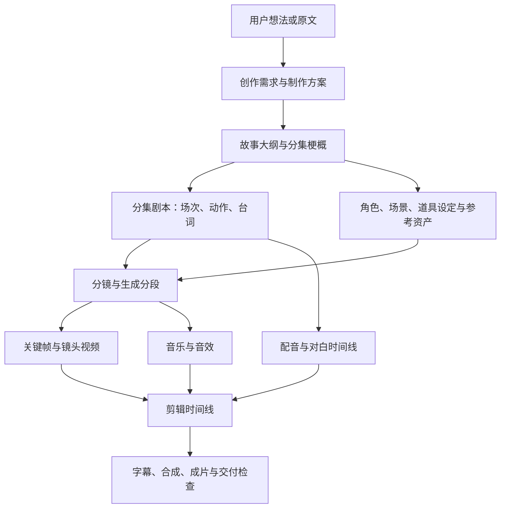

# AI 短剧：Agent 与工作流协同方案

日期：2026-10-05。状态：产品与架构设计，新增内容尚未实现。此方案补充[当前 S0 实施方案](./short-drama-workbench-product-plan.md)，按用户最新要求覆盖完整短剧项目、Agent 自动推进和手动探索。现有能力与实际验收范围仍以[实施进度](./incremental-extension-progress.md)为准。

## 产品决定

交付一个可安装的 `crewon.short-drama` 插件。它包含项目工作台、阶段规则、Agent 工具、成果校验和多个生成工作流适配器。Krea2 是其中的生图能力，不是整个产品，也不另建独立工作流插件包。

用户有两个平等入口：

- **Agent 对话**：说出想法、修改要求或执行目标，Agent 结合当前项目提出方案，生成内容并执行获准的阶段。
- **项目工作台**：查看和编辑成果，选择工作流与参数，单独执行或批量执行，比较候选、选用结果，再交给 Agent 继续。

两个入口共用项目、修订、工作流配置、执行计划和任务记录。聊天不会建立另一份项目；手动点击也不会绕过 Agent/Run 的执行与恢复机制。两端都能看见对方刚产生的成果。

用户也可以从已有剧本、一个角色或单个镜头开始，不强制把所有前置环节重新跑一遍。进入某阶段时检查该工作流的必需输入；现有素材可以保存为明确的输入成果，再补缺失的设定或引用。缺少必需输入时由用户填写或让 Agent 补齐，不能把未做过的阶段标成已完成。

宿主首页、原对话页、左右侧栏、账户及设置保持原样。插件工作台挂在原内容区；对话只增加有用的项目关联和阶段结果卡片。

## 完整生产流程

参考 [shuohao-skills](https://github.com/eternityspring/shuohao-skills) 的结构化创作产物与确定性检查，以及其链接的 [Reelbench](https://reelbench.79px.com/) 以项目管理资产、分镜和生成记录的方式。以下是 CrewON 的设计决定，不将参考产品的实现、秒数或部署方式直接作为我们的协议。

剧本与资产可以并行迭代。分镜引用确切剧本和资产版本；视频、声音与剪辑按依赖推进。故事变更后，只处理受影响的部分。

| 环节             | AI 负责的内容                                                     | 配合的工作流                                                 | 保存的成果与用户操作                                           |
| ---------------- | ----------------------------------------------------------------- | ------------------------------------------------------------ | -------------------------------------------------------------- |
| 想法与制作方案   | 理解主题、受众、风格、人物、集数/时长意图；发现矛盾，补充关键缺口 | 需求提炼、原文有界提取、制作计划、能力匹配                   | 需求修订、制作约束、阶段计划；用户可补充、改写或选择执行终点   |
| 大纲与分集       | 情节、人物关系、主线、分集节奏与悬念                              | 大纲生成、分集拆解、结构和覆盖检查                           | 大纲/分集修订；可局部重写某集，保留已确认内容                  |
| 分集剧本         | 场次、动作、台词、情绪、表演提示和对白清单                        | 剧本生成、角色/场景引用校验、时长估算、台词提取              | 结构化剧本与可读正文；逐场编辑、重写、对比和确认               |
| 角色与美术       | 人物设定、服装、场景、道具、风格和图像提示词                      | 设定文本、概念生图、三视图、参考图派生/局部编辑、一致性检查  | 稳定资产及多个参考版本；探索候选、建立锚点、选用或锁定某个版本 |
| 分镜             | 剧本转镜头，构图、动作、运镜、对白位置和声音意图                  | 分镜生成、剧本覆盖/引用检查、镜头与供应商分段转换            | 镜头表、分段和资产引用；增删/拆并镜头、调整时长、单镜重做      |
| 关键帧与镜头视频 | 生成提示词，匹配所需人物/场景参考，分析失败与候选差异             | 文生图、参考图生图、图生视频、文生视频、首尾帧视频等实际 API | 确切图像/视频结果、任务和输入版本；单镜或批量生成、比较、选用  |
| 配音与声音       | 角色音色方案、情绪和语速、对白对齐、音乐/音效需求                 | TTS、音色配置、对白对齐、音乐/音效生成或素材选用             | 音轨与对白时间线；逐句试听、更换声音、调整位置                 |
| 剪辑与交付       | 按故事节奏组织镜头，识别缺失素材、字幕或音画问题                  | 时间线编排、字幕、转场、外部合成、技术检查                   | 时间线修订、成片引用、交付报告；预览、调整、重新合成、导出     |

每一环节都有明确输入、输出、校验和执行记录。确定性检查负责字段、引用、覆盖、时长范围和媒体规格；AI 可以评价叙事与画面，最终的创作取舍可由用户确认。程序不能把“结构校验通过”解释成“人物长相或成片质量已经合格”。

AI 的画面/声音评价也要求已接通相应的多模态输入能力；没有该能力时只做结构与技术检查，并交给用户查看/试听，不生成虚构的视觉评审结论。

## 工作流不是一个生图按钮

插件内部提供工作流目录，按用途组织。一个阶段可使用多个工作流，一个工作流也可以服务多个阶段。创作文本调用现有模型/Agent 能力；ComfyUI 和其他外部 API 负责相应媒体生成；检查和编排使用确定性工具。

| 工作流用途                      | 首批/后续接入                                        | 输入要求与边界                                                   |
| ------------------------------- | ---------------------------------------------------- | ---------------------------------------------------------------- |
| 需求、大纲、剧本、分镜文本      | 现有模型提供者 + 插件阶段指导 + 输出 schema + 检查器 | 输入选定项目修订；模型输出校验后保存为候选，不能直接覆盖正式成果 |
| 概念图、写实人物探索            | 已集成的 T01 Krea2                                   | 当前只有文本输入，不承诺人物一致性                               |
| 角色设定三视图                  | 已集成的 T04 Krea2                                   | 当前是一次文本生成的设定图，不等于从已选锚点派生                 |
| 锚点、人物/场景派生、镜头关键帧 | 后续选定支持参考图的 ComfyUI/API                     | 必须支持已保存资产引用、明确上传/输入规则并实测一致性            |
| 镜头视频                        | 后续选定实际视频工作流/API                           | 根据服务能力选择文本、参考图或首尾帧输入；镜头与生成分段分开     |
| 配音、音乐、音效                | 后续选定实际声音 API                                 | 冻结台词版本、音色配置和参数；返回音轨及可靠时长信息             |
| 时间线与合成                    | 时间线规则 + 后续外部合成 API                        | 只能使用用户选用的确切媒体与时间线修订，保存成片任务和结果       |

每个工作流定义至少包含：稳定 ID、版本与摘要、用途、输入/输出 schema、所需能力、可配置参数、确定性校验、执行适配器和恢复方式。组合工作流声明子步骤及依赖，不能任意执行用户上传的脚本。

执行前，适配器把规范化业务输入转换为供应商请求，并冻结工作流、包、配置、输入与资产版本。Agent 可根据用途推荐工作流；匹配必须经过能力和授权检查，不能临时编造 API 或把不存在的能力展示为可执行。

配置区按“文本创作、概念图、参考资产、视频、声音、合成”选择已接入服务和默认工作流。阶段页只显示用户需要的工作流、参数与缺失条件；开发用的摘要、端口和凭据不放进日常创作表单。更换默认工作流只影响新执行，旧任务沿原绑定恢复。

## Agent 对话如何处理一个想法

例：“做一部都市悬疑短剧，女主是修复师，先帮我做三集方案和角色设定。”

1. 普通 Agent 对话识别可用的短剧能力。没有当前项目时新建项目或让用户选择已有项目；新建项目只是保存业务资料，不触发媒体生成。
2. Agent 将想法整理为需求草稿，保留用户原话，并说明目前采用的假设。只有影响剧情、范围或实际执行的关键缺口才提问；可先完成独立的文本工作。
3. Agent 读取已安装插件的真实能力，提出阶段计划和预计产物，例如需求、大纲、三集剧本草稿、角色设定文本。未接通的视频能力明确列为后续条件。
4. 用户可要求“只出方案”“推进到分镜”或“按这个计划执行”。Agent 按授权范围自动生成、校验、保存成果并推进依赖，持续返回阶段结果卡片。
5. 用户说“第二集结尾改成反转，女主外形不要变”，Agent 锁定已选角色资产，只创建新的第二集剧本和受影响分镜候选，解释影响范围。
6. 用户可从卡片打开工作台编辑，再返回同一项目对话继续。Agent 下次行动先读取当前选用修订，不把旧聊天摘要当最新项目权威。

项目可以关联多个实际 Thread，例如项目主对话和某集制作对话。每条执行明确属于哪个项目、阶段、业务项及源修订；现有 workspace/Thread.cwd 绑定保持原规则。项目不是新的工作空间，也不更改历史会话的执行目录。

对话结果卡片显示：完成了什么、当前版本、采用/待确认状态、受影响下游、运行状态，以及“查看、修改、采用、继续到下一阶段”的可用动作。失败或结果未知时提供查看原任务与查询入口，不显示一个会重复生成的通用“重试”。

Agent 使用具名业务工具读取项目、提出/保存成果、建立计划、提交阶段任务、查看运行状态和选用结果。产品工具名称可按 `project.read / stage.propose / stage.execute / stage.status / result.select` 分类；这里只确定职责，公共协议在对应实施阶段单独版本化，不偷偷扩展当前 SDK v1 请求。

模型上下文按阶段有界读取：当前需求摘要、相关场次、确切引用资产和待执行步骤。整部小说、所有历史版本与全部工作流不能常驻注入。单个注入片段不超过 10K tokens；大纲、剧本和分镜按业务项分页读取。

聊天路径必须补齐真实的 Node/Agent 项目服务。目前 Short12 的 Node 只有 `image.generate / image.query`；项目操作主要在 UI 动作桥中，不是 Agent 工具。不能只加一段提示词，也不能让 Agent 借用 UI invocationRef 或点击工作台来冒充已授权命令。

新服务由宿主为当前调用者派生项目访问范围，插件工具只能调用其公开业务端口。参数中的 projectId 不构成权限；新建、读取、修订、执行与选用都逐次检查项目权限、当前包和修订。阶段 Run 的输入冻结 project/stage/item 与依赖版本。主对话负责讨论、计划和简短进度；需要并行时用明确关联的阶段 Thread/Run，避免多个步骤竞争同一个 Thread 的 active Run，继续保留原工作空间绑定。

## 自动执行的范围与控制

自动化首先是**用户目标 → 阶段计划 → 已授权步骤 → 可验证成果**，而不是 Agent 在聊天里无限自我循环。

| 执行方式       | 用户控制                                           | Agent/调度职责                                                   |
| -------------- | -------------------------------------------------- | ---------------------------------------------------------------- |
| 单步           | 执行当前阶段或某个业务项                           | 生成候选、校验、保存并返回，随后停止                             |
| 推进到指定阶段 | 指定起点、终点、锁定项和是否自动选用通过检查的候选 | 按依赖执行；无需每一步重新提问，遇到必需输入、权限或质量问题暂停 |
| 批量制作       | 选择分集/镜头范围、每项候选数量和允许的工作流      | 有界并行、逐项状态、局部失败恢复，不重做成功项                   |

计划保存：目标、步骤、依赖、输入修订、锁定资产、允许工作流、候选上限、并发上限、选用规则、用户确认点及当前进度。积分先按用户要求后置；以后接入预算时在同一准入链增加明确限额，不在本轮虚构价格。

阶段委托由宿主持久保存，绑定当前调用者、项目、计划版本、允许步骤/工作流和数量范围。安装或信任 Node 代码不代替这项委托。派发及恢复前复核当前权限与委托；暂停或撤销后不再创建新的执行。

纯文本草稿可在已授权目标内连续生成与保存。自动选用是计划中的明确规则；未授权自动选用时，成果进入待确认并暂停依赖它的步骤。生成收费媒体前按实际授权范围核验允许项和数量；授权不得扩大到供应商权限之外。

Agent 决定创作内容和下一步建议；确定性调度器核验依赖、权限与修订，复用现有 Run/Tool/operation 创建和观察执行。计划及检查点持久化在项目服务，不依赖聊天窗口保持打开。不要新增另一套 Agent runtime、插件 cron 或任意 DAG 运行系统；复用宿主已有任务/恢复能力，缺少的项目步骤状态通过增量业务服务补齐。

暂停阻止后续新任务，不宣称外部已提交作业被取消。继续执行先核验输入与权限；失败只针对未完成项创建明确的新尝试。`unknownOutcome` 只查询和核验原 operation，绝不自动重新 POST。App/Worker 重启后沿原计划和任务身份恢复，UI 重连不能重新创建步骤。

## 用户手动探索与 Agent 协作

工作台不是只读 Agent 报告，而是可以独立工作的编辑器。

- 用户可直接创建需求、编辑大纲/场次/角色/分镜/时间线，或选择某个工作流生成一个业务项。
- “探索候选”在原成果旁追加候选版本；用户选择采用后才更新当前指针。未采用的试验不使下游正式成果失效。
- 用户可锁定某个人物外观、场次或镜头，Agent 后续计划必须保留锁定项，冲突时说明原因。
- 用户修改正式输入后，界面列出受影响的下游项；可以保持旧结果、局部更新或交给 Agent 按影响清单修复。
- 用户在 Agent 执行期间编辑同一项时，新编辑成为新修订；在途结果仍归旧输入，不覆盖新编辑或新的选用指针。
- 同一请求从两个入口到达，按同一业务命令键返回原受理回执；不同输入、工作流或明确新候选使用新的执行意图。

两个入口领取/重读同一持久执行意图及其任务槽位，才能共享幂等键；不能各自生成随机 key 后承诺跨入口去重。用户明确要求再做一个候选时建立新的意图，文本相同不构成合并依据。并发领取通过服务端 CAS 和原任务准入事务协调，回执与项目执行关联保持一致。

手动入口和 Agent 工具调用同一业务命令及权限检查。不存在一条 UI 直连 ComfyUI、另一条 Agent 走 Worker 的分叉实现。

## 工作台页面

项目内部导航包含“概览、故事/剧本、资产、分镜、生成、剪辑/交付”。这是模块内部导航，不替换 CrewON 全局侧栏。

| 区域      | 显示与动作                                                                       |
| --------- | -------------------------------------------------------------------------------- |
| 概览      | 当前制作目标、阶段成果、待确认项和阻塞；进入项目对话、单步执行、推进到指定阶段   |
| 故事/剧本 | 大纲、分集、场次与台词；编辑、局部AI重写、修订对比、采用和锁定                   |
| 资产      | 角色/场景/道具、已选锚点、候选与使用关系；文本设定、生图/派生、替换和锁定        |
| 分镜      | 按集/场次的镜头表、资产引用、生成分段；拆并镜头、调整时长、AI补全、单镜/批量执行 |
| 生成      | 按业务项分组的候选、原任务状态与观察时间；查询、比较、选用、跳转原对话           |
| 剪辑/交付 | 已选镜头与声音、时间线、缺失项、字幕和成片版本；编排、预览、合成与导出           |

阶段详情保留“输入、产出、工作流、版本/依赖、执行记录”五类信息。宽屏可并列编辑与结果；窄屏单栏切换，低高度滚动，不裁切主要动作。沿用原组件与主题，CSS/DOM 作用域限定在插件根。

尚未接通的能力显示准确的缺失条件和配置入口。阶段可以先编辑文本/结构，但不能给出可点击的假生成操作。实际 API 就绪之后才开放对应执行。

## 共享数据和状态

在已有项目/概念图模型上增量扩展，不一次替换现有 schema。以下对象是设计职责，名称和 DTO 在实施时审查兼容性：

| 对象                 | 作用                                                                              |
| -------------------- | --------------------------------------------------------------------------------- |
| 项目与需求修订       | 项目身份、用户想法、制作约束和范围；追加修订，权限来自宿主                        |
| 成果及成果修订       | 大纲、分集剧本、人物/美术设定、分镜、声音和时间线；有稳定业务 ID 和不可变输入引用 |
| 候选与当前选用指针   | 每个业务项的多个产物；独立 CAS 选用，不覆盖历史                                   |
| 依赖与锁定           | 确切修订依赖、失效原因、用户锁定范围；按依赖定位影响                              |
| 工作流定义与配置修订 | 包内规则/适配器版本、参数与服务绑定；新任务冻结确切版本                           |
| 执行计划与步骤       | 用户授权范围、终点、依赖、检查点和有界重试/并发；可暂停、继续与局部恢复           |
| 阶段执行关联         | 项目/阶段/业务项/输入与原 Thread、Run、operation、结果的关联；原准入事务中建立    |

至少分别表示四类状态：创作成果（草稿/候选/已选用/过期）、步骤调度（待执行/执行中/待确认/暂停/部分完成/失败）、CrewON Run、供应商 operation。步骤完成必须有合格的成果与对应执行证据；Run 结束不自动表示视频或声音成功。

模型产出先校验，再写候选修订；结构不合法返回具体错误，允许在有界次数内让 Agent 修复文本，不能把修复逻辑变成无限调用。媒体引用由真实供应商观察和持久结果投影产生，不能把模型编造的 URL 当作资产。

## 插件与宿主的责任

| 插件负责                                                                                 | 宿主负责                                                                                                    |
| ---------------------------------------------------------------------------------------- | ----------------------------------------------------------------------------------------------------------- |
| 创作阶段、提示指导、成果 schema、质量规则、工作流目录、输入转换、项目页面和Agent业务工具 | 当前身份与项目权限、版本化存储服务、安装与完整包核验、发布执行绑定、任务准入、Run/Tool、受控I/O、事件与恢复 |

插件通过公开服务操作自己的命名空间，不取得整个数据库、任意文件目录、模型凭据或无限网络权限。阶段能力按需加载；安装/停用/升级保留原包与历史任务绑定。Krea2、视频和声音都属于同一个短剧包中的适配器，业务内容不能反向耦合到宿主核心 Agent 循环。

现有 SDK/HTTP/持久形状维持兼容。新阶段服务通过新增具名版本服务、增量迁移和明确测试接入；不能塞进现有 `prompt` 或偷偷添加 v1 请求字段。插件升级只影响新任务，旧原 Krea2 operation 继续使用原身份和配置查询。

## 实施顺序与可验收结果

1. **已有生图基础继续验收**：完成 Short12 原 Settings 准备与原任务的实际连通验收。保留原请求，未知受理不重新生成。这项正在进行，与下述文本阶段并行，不能因媒体服务尚未连通就阻塞对话入口。
2. **下一项产品开发优先交付 Agent 项目入口和文本阶段**：补真实 Node 项目服务与带阶段范围的工具，复用 UI 与 Agent 的共享命令；从原对话的一句想法创建/关联项目，生成需求、大纲与分集剧本；工作台能编辑、采用、锁定，Agent读到手动修改。首条新增验收为“想法 → 三集大纲 → 一集剧本 → 手动改台词 → Agent继续修订”。这一步不等待视频 API。
3. **工作流目录与资产阶段**：T01/T04 在同包目录可选择；再接真实参考图工作流，交付角色/场景/道具及锚点版本。验收单项探索与选用，不能用T04代替人物一致性实测。
4. **分镜与有限自动推进**：分镜、覆盖/依赖检查、镜头↔生成分段转换；计划可推进到分镜，支持单镜/批量关键帧。验收修改某场戏只使相关镜头过期。
5. **真实视频、声音、合成逐项接入**：分别验证提交、查询、结果、取消能力及失败语义，再开放对应阶段；交付一集从镜头到成片的实际结果。
6. **跨阶段自动化完整验收**：对指定范围连续执行，等待用户确认后继续、暂停与重启恢复；并发手动编辑/双入口提交不会覆盖新版本或重复调用供应商。

每一步交付可操作页面和真实成果。分层/夹具测试、真实桌面验收、真实外部生成分别记录；不能以完成一项推断全链可用。阶段验收覆盖权限、流式展示/重连、配置变更、并发编辑、局部失败与冷恢复。积分按用户要求继续后置。

现有实验性 Workflow production routing 保持关闭；不能打开一个开关就宣称跨阶段自动化完成。阶段协调器首先实现有界、持久、可观察的依赖推进和原任务关联，再按上述恢复场景验证。

## 决策场景验收

- 用户只说想法：Agent能创建项目、整理需求并产出结构化文本成果，不要求先学习工作台或填写供应商参数。
- 用户指定“做到分镜”：自动推进到终点后停止，不擅自开始视频或合成。
- 用户手动选用角色图：Agent后续分镜引用该确切版本，关闭再打开仍一致。
- 用户正在生成时改台词：旧任务归旧修订，新台词保留，并能看见受影响的配音/镜头。
- 用户两次点击、聊天重连或App重启：读取同一原受理和检查点，供应商提交不重复。
- 某个镜头失败或受理未知：成功镜头保持，失败项可明确新尝试，未知项先核验原任务。
- 视频服务未接入：文本和资产仍可制作，视频执行显示实际缺失条件，成片按钮不假装可用。
