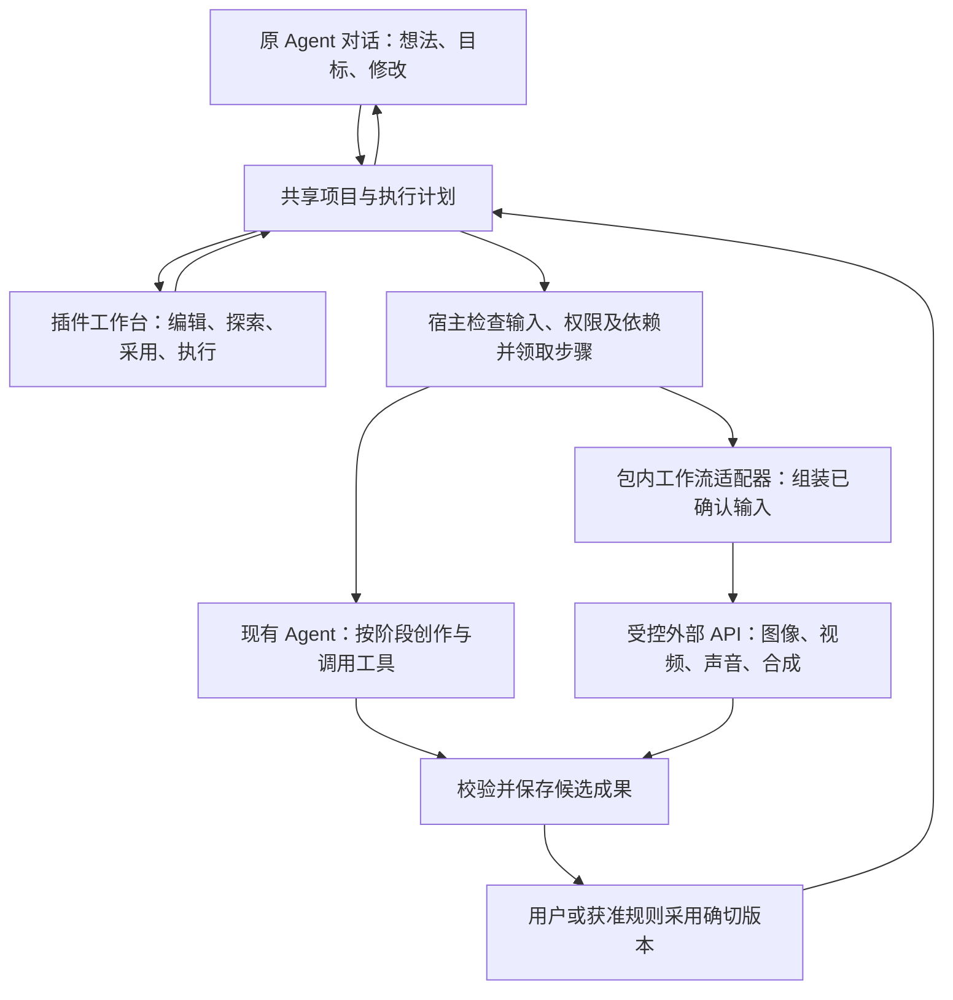

# AI 短剧：双入口与跨阶段自动执行规格

2026-10-06。状态：产品和实施规格，新增跨阶段协议尚未交付。本文细化[整体设计](./short-drama-agent-workflow-design.md)和[阶段契约](./short-drama-stage-execution-contract.md)，实施状态见[进度](./incremental-extension-progress.md)。

## 产品结构

一个可安装的 `crewon.short-drama` 插件提供完整制作模块：阶段指导、结构化成果、确定性检查、工作流目录、Agent 业务工具和项目工作台。Krea2、参考图派生、视频、声音与合成属于包内的不同适配器。

两个入口操作同一项目：

- **原 Agent 对话**：理解想法，读取项目，提出制作范围，执行用户要求的阶段，汇报成果和待确认项。
- **短剧工作台**：编辑内容，调用 AI 补全，选择工作流，探索候选，采用和锁定结果，单项执行或推进指定范围。

原聊天、导航、左右侧栏、账户和设置沿用现有界面。插件新增内容限于自身模块；原会话的项目卡片跳转同一项目，不另建一套聊天或工作空间。

AI 的职责覆盖策划、编剧、美术、分镜、声音设计和剪辑建议。这些专业角色首先作为同一个实际 Agent 按步骤加载的指导和工具范围，不要求新建多个会话，也不引入第二个 Agent 运行时。

## 各阶段具体怎样产出

每个阶段都支持 AI 和工作流协作，也支持人工编辑已有产物。工作流包括文本创作、结构检查、素材准备、媒体 API 和确定性编排；不要求每次保存都调用模型或 ComfyUI。

| 阶段         | AI 内容工作                                                              | 执行链与检查                                                            | 必须保存的成果                                     | 手动入口                                              |
| ------------ | ------------------------------------------------------------------------ | ----------------------------------------------------------------------- | -------------------------------------------------- | ----------------------------------------------------- |
| 创作需求     | 将一句想法或原文整理成主题、受众、风格、故事目标和制作约束，发现关键缺口 | 有界提取资料 → 需求结构检查 → 匹配实际能力 → 生成制作方案               | 原始想法、需求修订、明确的制作范围和假设           | 填写/导入需求，AI整理，编辑方案，选择执行终点         |
| 大纲与分集   | 人物关系、故事主线、分集情节、转折与悬念                                 | 大纲创作 → 分集拆解 → 分集覆盖及结构检查                                | 大纲修订、分集身份及候选/采用版本                  | 编辑大纲，重写某集，比较候选，采用/锁定               |
| 分集剧本     | 场次、动作、台词、情绪、表演提示                                         | 剧本创作 → 场次/人物引用检查 → 对白提取 → 时长估算                      | 场次和对白有稳定身份的剧本修订；正文由同一修订呈现 | 改台词，AI改写选中场次，导入剧本，局部采用            |
| 角色与美术   | 角色设定、场景、道具、服装、视觉风格、图像描述                           | 设定创作 → 需求/剧本引用检查 → 概念图生成 → 用户建立锚点 → 参考派生     | 稳定资产、设定修订、参考候选、采用锚点及锁定       | 自建资产，AI完善描述，探索多张图，采用/派生参考       |
| 分镜         | 将已采用剧本拆成镜头，补构图、动作、运镜、对白位置与声音意图             | 镜头拆解 → 剧情/对白覆盖检查 → 资产引用检查 → 转成供应商生成分段        | 场次/镜头/分段身份、镜头表、确切剧本及资产版本引用 | 增删/拆并镜头，调整时长，AI补全单镜，检查缺口         |
| 关键帧与视频 | 根据镜头和参考准备生成描述；具备多模态能力时辅助比较候选                 | 冻结媒体输入 → 准备真实素材 → 图像/视频 API → 观察原任务 → 媒体规格检查 | 每镜/每段的输入、实际任务、候选、采用结果及来源    | 编辑提示词，选择可用工作流，单镜/批量生成，比较和采用 |
| 配音与声音   | 角色音色、语气、语速、音乐和音效方案                                     | 台词提取 → TTS/音乐/音效 API → 实际时长读取 → 对白与镜头对齐            | 带台词修订来源的音轨、音色配置、对齐数据和采用指针 | 逐句试听/重做，更换声音，移动音轨，采用素材           |
| 剪辑与交付   | 建议节奏、镜头顺序和转场，指出缺失项                                     | 选用素材 → 时间线编排 → 字幕 → 实际合成 API → 技术检查                  | 时间线修订、成片任务、可读取成片和交付报告         | 编辑时间线，预览，修正字幕，合成/导出                 |

大纲、剧本、角色和美术可以迭代；剧本和资产在满足各自输入时并行准备。分镜以已采用剧本和资产为输入，发现剧情缺口时提出上游修改候选，不能悄悄改故事。视频和配音可在依赖允许时并行；合成等待所需素材确切采用。

“分镜表完成”与“关键帧已生成/采用”分别表示。结构化分镜可以先引用角色和场景设定；图像参考是否必需由所选媒体工作流决定。缺图不阻止可独立完成的镜头设计，也不能把没有图的镜头标为关键帧完成。

允许从已有剧本、角色或单镜头进入。导入结果需成为项目内的可检查成果，满足相应工作流输入即可制作下游；没有做过的大纲或其他前置阶段不标成已完成。

## 工作流目录和适用范围

目录按**用途和输入契约**匹配，不只列供应商名称。一个阶段可以组合多个工作流，同一工作流也可以服务不同阶段。

| 工作流组             | 对应业务用途                               | 当前依据                                                  | 下一项接线或缺口                                             |
| -------------------- | ------------------------------------------ | --------------------------------------------------------- | ------------------------------------------------------------ |
| 需求、大纲、剧本文本 | 提炼、创作、局部重写、检查                 | 已有项目文本服务、Agent工具和有界文字计划                 | 继续复用，结构化分镜另增协议                                 |
| T01 Krea2            | 文本概念生图、写实形象探索                 | 同包生成路径                                              | 纳入资产候选与后续有界媒体计划；不承诺参考一致性             |
| T04 Krea2            | 文本生成三视图设定图                       | 同包预设                                                  | 一次结果仍是一张设定图，不当作锚点派生                       |
| T10 Krea2参考四视图  | 从一个确切角色参考生成设定视图             | 20.0.2包内适配器与示例素材真实生成；宿主确认输入/准备底座 | 接实际项目Run、手动页面和Agent步骤；输出不虚构成四个独立文件 |
| D18 三素材画面       | 一个场景和两个有顺序的角色共同参与画面探索 | 20.0.2包内适配器与示例素材真实生成；宿主确认输入/准备底座 | 接实际项目执行；结构化分镜完成后才能建立每镜生成关联         |
| 视频                 | 文生视频、图生视频、首尾帧等               | 尚无全链验收通过的产品入口                                | 选择实际API，核输入/时长/参考人数/提交和查询契约后开放       |
| 声音                 | TTS、音乐、音效                            | 待接真实API                                               | 先核逐句输入、音色、音轨时长和结果读取                       |
| 合成                 | 时间线、字幕、转场、成片                   | 待接真实合成执行                                          | 先完成确定性时间线与实际输出检查                             |

D18不能用于所有镜头：单人镜头不能复制一个角色凑两个输入；缺少场景时不能偷偷换图。系统寻找其他实际可用工作流，或保留镜头并说明缺失条件。

每个目录项声明稳定ID、版本、用途、输入/输出schema、槽位及顺序、支持规格、参数、适配器、确定性校验与恢复方式。目标服务、工作流图摘要、实际包及配置身份在新任务时固定。镜头时长和生成分段由实际API能力决定，不能把某供应商的秒数限制变成所有插件的规则。

“导入ComfyUI图”不等于“安装即可执行”。外部图先审查节点、必需模型和真实I/O，再配明确的业务输入转换及恢复适配器。插件可以独立升级增加工作流；宿主仅核验所需协议与能力，旧任务保持原包和原配置。

## Agent 对话的工作方式

用户说：“做三集雨夜悬疑，先完成大纲和第一集剧本，探索女主形象，视频暂不做。”

1. Agent读取当前原会话关联，复用项目，或创建并关联新项目。会话的工作空间不因项目关联而改变。
2. 将用户目标保存为需求和有限制作范围：三集大纲、第一集剧本、女主设定与约定数量的形象候选，终点是女主形象探索。
3. 根据能力和依赖安排文本步骤、资产步骤及媒体步骤。用户只要方案时，到方案停止；用户已要求执行时推进明确的部分。候选数量、必需参考或选用规则确实影响执行且无法推断时，再补充这些缺口。
4. AI读取当前采用版本，创作并通过业务工具保存结构化候选；对话文字只作摘要，不能把“我已经写好了”当作项目写入成功。
5. 按规则等待采用或采用自身合格成果，再继续下游。用户只授权探索时，不自动建立正式角色锚点。
6. 原对话显示实际完成项、待确认项、失败项和下一步，链接进入相应成果。终点达到即停止，不能继续生成视频。

聊天不携带完整小说、全部媒体或整个项目历史。按阶段、业务项和依赖分页读取；同一阶段只加载所需专业指导和工具，单个上下文片段不超过10K tokens。

### 对话所需的业务工具

以下是设计职责分组，不是已发布的新SDK方法名。已存在的工具继续复用；新增媒体、分镜和跨阶段控制必须以独立版本协议实施和验收。

| 工具职责   | Agent可做什么                                        | 宿主必须控制什么                                        |
| ---------- | ---------------------------------------------------- | ------------------------------------------------------- |
| 项目上下文 | 读取阶段进度、采用成果、锁定项、缺口、实际可用工作流 | 当前身份、项目范围、有界输出；来源内容不成为授权        |
| 成果创作   | 保存需求/大纲/剧本/资产/分镜候选，读取确切修订       | schema、业务引用、来源修订及写入权限                    |
| 制作计划   | 提出范围、查看进度，在实际用户授权范围内领取下一步骤 | 启动/扩权资格、数量与并发限制、终点、暂停和冲突         |
| 媒体输入   | 保存提示词/参数与业务素材引用，准备实际已选素材      | 真实来源、版本和受控I/O；模型不能提供文件路径或执行身份 |
| 媒体执行   | 执行已确认输入，查询原任务，读取真实候选             | 与手动入口同一业务执行命令、Run准入、原任务恢复         |
| 采用与检查 | 请求采用确切结果，查看失败和依赖影响                 | 用户或明确的自动采用规则；模型建议不自授采用权限        |

## 手动工作台的工作方式

项目内部保持“概览、故事/剧本、资产、分镜、生成、剪辑/交付”导航。阶段导航在插件根内，不替换全局侧栏。

每个业务项显示输入、成果、候选、工作流、依赖和执行记录。常用动作是“编辑”“AI补全”“探索候选”“采用”“锁定”“执行本步”“继续到指定阶段”；只有实际可执行的能力显示对应执行动作。

- **AI补全**：针对选中场次、角色或镜头生成候选；保留用户的正文和已采用版本。
- **探索候选**：明确数量与工作流，生成新候选；不替换锚点或正式镜头。
- **执行本步**：冻结当前确认内容，按所选工作流提交；后台不再随意改写提示词。
- **继续到指定阶段**：先展示处理范围、终点、沿用的锁定项和选用规则，创建有界计划。
- **采用和锁定**：操作确切候选/修订；锁定限制替换正式选择，仍可探索新候选。

用户改第一集台词并采用，再选一张女主图作为锚点；回到原对话说“继续做第一集分镜”，Agent读取这两项当前成果。手动和Agent都不能把自己的内存草稿冒充共享的当前版本。

生成页面以角色、场景或镜头分组显示结果，点击能回看使用哪版输入、哪个工作流和原任务。项目概览展示业务进度，用户无需理解Run或供应商operation才能操作。

## 一份跨阶段计划怎样执行

现有 `crewon.project-text-plans@1` 只覆盖 `brief / outline / script`，固定有界步骤、并发1。以下为新增跨阶段计划的设计，不能把新字段或媒体权限直接塞入旧v1。

计划至少固定：项目、原关联会话、需求目标、分集/资产/镜头范围、起点、终点、允许工作流、每项候选数量、锁定项、人工检查点、采用规则、修复次数、并发上限和已接受步骤。

新增跨阶段协议的首版限额如下；这是新协议设计，不修改已有文字v1。宿主实际授权可以更窄，计划必须取两者交集。超限时明确分批和每批终点，不能静默截断用户目标。

| 范围             | 首版规则                                                                                   |
| ---------------- | ------------------------------------------------------------------------------------------ |
| 分集、资产、镜头 | 每计划最多16集、32项资产、64个镜头，均固定具体业务身份；分段属于镜头，不重复计镜头         |
| 步骤总数         | 最多512个，创建前展开并检查依赖；不允许运行中无界追加                                      |
| 媒体候选         | 默认每项1个，用户可选1–4个；所有媒体生成最多128次，视频、声音及合成都计入                  |
| 文本模型尝试     | 每计划最多128次，包含修复；单次结构修复最多2次，仍失败则暂停该项                           |
| 媒体新尝试       | 默认不自动重做；用户明确授权时每项最多1次确定失败后的新尝试，计入128次限额；受理未知不重做 |
| 执行并发         | 默认1，明确选择后最多2个独立步骤；依赖、同一业务意图和串行工具规则仍须满足                 |
| 自动推进期限     | 默认最多24小时且不长于真实宿主授权期限；到期停止新派发/自动采用，用户明确继续后核剩余范围  |

上述数值需要在新协议解析、存储和行为测试中一致实现。观察已受理任务不会创建新候选；其查询期限和频率继续受原执行策略约束，不获得无限轮询权限。

| 步骤          | 输入和执行依据                              | 产出及推进条件                                         |
| ------------- | ------------------------------------------- | ------------------------------------------------------ |
| 内容准备      | 当前采用的上游成果和本步要求；实际Agent调用 | 合法候选已保存，并具有原执行关联                       |
| 校验          | 确切候选、schema、引用、覆盖与规格          | 输出具体通过项/错误项；文本修复次数有界                |
| 采用检查点    | 确切候选与原采用基线；人工或已授权规则      | 采用事实成立；只探索时不擅自采用                       |
| 素材准备      | 确切参考、确认媒体输入和实际服务            | 原字节与目标副本核验完成；未知准备只恢复原请求         |
| 媒体提交/观察 | 同一持久执行意图与冻结输入                  | 原任务受理后持续观察，取得真实结果；响应未知不新建请求 |
| 下游推进      | 上游完成依据、当前来源、锁定与计划范围      | 未过期且仍获准时领取下一项；否则暂停相应项             |

计划是依赖图，不是必须从头跑到尾的进度条。节点为明确的业务项，边引用确切产物。首次版本只允许插件声明的有限步骤和依赖，不开放任意脚本、循环或通用编程DSL；执行继续复用现有Control、Run、Worker和Tool。

手动执行和Agent执行领取同一个持久步骤/执行意图，并通过原Run事务关联；两个入口各造一个随机请求键不能实现业务去重。双击、重连、重启返回或观察原受理；用户明确“再生成一个候选”才建立新的执行意图。

媒体准备与生成分别持久记录。准备成功不表示生成受理；Run结束不表示媒体合格；媒体可读不表示已采用；采用了所需产物才允许相应下游继续。

步骤调度状态为：待依赖、可执行、执行中、等待外部结果、待采用、完成、失败、暂停。来源是否过期单独记录及显示；历史完成事实保留，过期不把旧结果改成执行失败。任务受理回执未知也单独记录，进入原请求核验，不能被解释为“尚未开始”。

### 示例的实际步骤

前述“三集大纲、第一集剧本、女主形象探索”可以生成以下依赖。候选数量先明确为2张，文本采用方式明确为来源未变时自动采用，女主图由用户挑选；未指定这些规则时不代替用户授予它们。

| 步骤           | 依赖                     | 执行与停止依据                                                 |
| -------------- | ------------------------ | -------------------------------------------------------------- |
| 需求整理       | 用户原始想法             | 保存需求和范围                                                 |
| 三集大纲       | 采用需求                 | AI保存合格大纲，按获准规则采用                                 |
| 第一集剧本     | 采用大纲                 | AI保存第一集剧本，按获准规则采用                               |
| 女主设定       | 采用需求和已明确角色来源 | AI保存设定，按获准规则采用；缺少角色身份时先从当前成果补齐     |
| 女主描述准备   | 采用设定                 | AI保存可回看的图像描述与确认输入                               |
| 两张形象探索   | 确认输入、实际可用T01    | 两个明确候选意图，各受理一次；真实结果形成候选                 |
| 结果检查和结束 | 两项原任务的真实候选     | 展示两张候选，到“探索”终点停止；不启动视频，不要求建立正式锚点 |

用户选图并建立、锁定正式参考后，可以另启“派生四视图”的T10步骤。分镜计划引用当前剧本和资产设定；只有选择满足条件的媒体步骤时才准备该工作流需要的确切参考。没有第二角色的镜头不调用D18。

### 采用、变更和恢复规则

默认在创作取舍点由用户采用。用户可明确授权某范围“来源未变时自动采用合格的本步骤成果”；系统检查原基线、来源、锁定及确切结果，不随意选择最新候选。没有多模态能力时，不能假装已经做完视觉/听觉质量评审。

| 情况                   | 系统行为                                                             |
| ---------------------- | -------------------------------------------------------------------- |
| 手动采用新剧本/参考    | 标记真实依赖受影响；暂停尚未执行的相关步骤，保留其他独立步骤         |
| 上游只保存未采用草稿   | 正式下游继续引用原采用版本，不提前失效                               |
| 生成过程中用户修改输入 | 已受理任务归原输入；新结果作为原修订候选，不覆盖新的采用指针         |
| 一部分镜头失败         | 保留成功项，列出具体失败项；计划允许时继续独立项，下游仍等待缺失素材 |
| 供应商受理未知         | 保留原请求和任务身份，只做可核验恢复；不得自动再次生成               |
| 用户暂停               | 停止新任务和自动采用；已经受理的任务继续沿原记录观察                 |
| 关闭页面/聊天断线/重启 | 从保存的计划、原Run和原operation读取恢复；不靠页面定时器维持制作     |
| 插件停用或缺少当前批准 | 停止新执行；历史成果保留，历史任务观察仍按原身份和独立权限判断       |
| 用户明确继续           | 重读当前成果和剩余范围，调整受影响的未执行步骤；不重写已受理任务     |

恢复与重做是不同动作：恢复原任务沿原身份观察；确认原任务已失败后，用户或已授权的有限重试规则才能建立新尝试。受理未知永远不进入自动新尝试。

## 可插拔协议的范围

插件声明和实现阶段规则、成果schema、指导、检查器、工作流适配器、页面及业务工具。宿主提供版本化项目服务、身份/权限、不可变执行绑定、Run、受控I/O、持久步骤领取和恢复。

阶段与工作流在已核验插件包内注册，使用插件命名空间；用户数据不是可执行代码。新增适配器只需升级该插件和配置实际服务；需要新的宿主能力时显式声明对应服务版本，不在核心Agent循环中加入某一行业的故事逻辑。

阶段描述至少提供ID/版本、业务项种类、所需输入选择器、依赖、成果schema、确定性检查、允许工具、采用检查点及完成依据。工作流描述提供实际输入槽位、参数schema、输出契约和适配器。阶段规则由插件决定；持久步骤领取、输入冻结、授权和任务事务由宿主执行。描述的公开协议须独立评审，不把这些字段暗加到冻结SDK或现有v1请求。

安装不自动等于启用、配置或执行授权。升级固定新任务的包和配置，旧任务保持原身份；移除模块入口不删除原项目成果。后续企业专业插件可使用同一套宿主执行服务，并提供自己的阶段和成果契约。

积分继续后置。自动计划仍必须有候选数量、范围、并发和修复次数限制，避免一句想法被解释为无限制作。

## 实施顺序与验收

| 顺序 | 交付范围                                                                | 验收证据                                                                     |
| ---- | ----------------------------------------------------------------------- | ---------------------------------------------------------------------------- |
| 1    | 保持已有原对话、项目关联、文字计划和手动成果；补实际参考媒体的原Run接线 | 一个真实项目：采用角色参考 → T10生成 → 查询 → 候选；工作台和对话看到同一记录 |
| 2    | 同一媒体业务命令接手动入口与Agent资产步骤，提供有限探索/采用检查点      | Agent生成候选 → 手动采用/锁定 → Agent继续；双入口并发与冷恢复不重复请求      |
| 3    | 结构化分镜、镜头/分段身份、覆盖及资产依赖                               | 第一集剧本 → 分镜 → 手动改单镜 → 局部关键帧；D18仅用于满足三素材契约的项     |
| 4    | 新版本有限跨阶段计划，整合文字、资产、分镜和已接通图像工作流            | 一句想法推进到指定终点，待确认后继续；来源变更只暂停相关项                   |
| 5    | 逐项核验真实视频、声音、合成API后接入同一计划                           | 一集：镜头视频、对白音轨、时间线、可读取成片；未接能力如实阻塞               |
| 6    | 正式桌面与完整插件联合验收                                              | 原界面/工作空间不回归；流式重连、退出重开、局部失败与未知受理恢复            |

当前文字和项目底座、同包T01/T04、T10/D18适配器、宿主媒体输入/素材准备分别已有验收；不能据此宣称原项目媒体Run或八阶段自动制作已完成。当前在建的媒体Run准入代码也不能当作正式可用入口。

首条验收不等待全部视频API：用户在原对话提出想法，完成指定大纲和剧本，探索角色候选；在工作台改台词、采用参考并锁定；Agent按这些确切成果继续生成分镜，到约定终点停止。

## 参考的使用方式

[shuohao-skills](https://github.com/eternityspring/shuohao-skills)按大纲、角色、美术、剧本和分镜组织结构化产物，并提供确定性检查；其角色参考思路强调锚点和单项派生。这里借鉴阶段分工与成果约束，具体状态和执行协议是CrewON的设计。

[Reelbench公开页](https://reelbench.79px.com/)将创作编排、ComfyUI生成和项目资产组织在一起。这里借鉴以项目组织内容与任务的方式，不据公开介绍推断其内部恢复或授权实现，也不采用其部署要求作为宿主限制。
