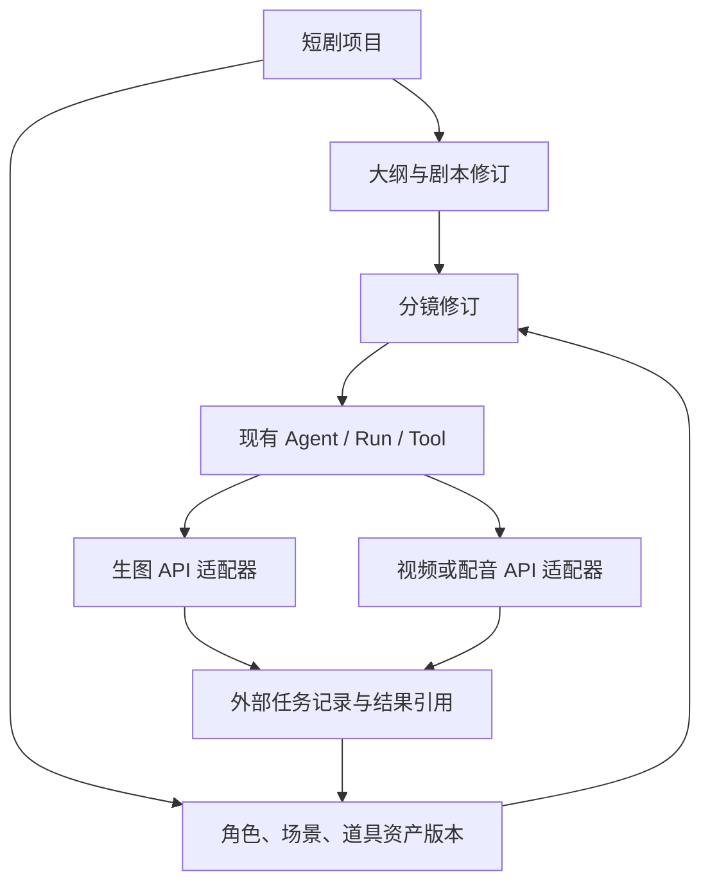

# AI 短剧工作台：参考结论与接入顺序

用户最新要求的全阶段 AI/工作流、Agent 对话与手动工作台协作，已整理为[完整产品设计](./short-drama-agent-workflow-design.md)，以共享项目状态和有界阶段执行为基础，不止接一个生图工作流。

日期：2026-10-05。重新核对用户提供的 [shuohao-skills 当前说明](https://github.com/eternityspring/shuohao-skills)与其关联的 [Reelbench](https://reelbench.79px.com/)。早期研究依据用户提供的 [shuohao-skills](https://github.com/eternityspring/shuohao-skills)，研究版本 `ef4ac0c313c7eeb1f918db5f0f0eb319745900bc`。本文记录参考结论和后续实施约束；不是已经实现的产品功能，也不提前冻结工作台页面设计。当前仍按[增量扩展方案](./incremental-extension-subsystem-plan.md)先完成 ComfyUI 的正式调用链。

2026-10-02：生图调用、升级恢复及同一次 UI 到实际 Worker 的闭环已取得执行证据，下一步的[工作台产品方案](./short-drama-workbench-product-plan.md)已具体划分 S0 项目/概念图、页面操作、修订与原任务关联及验收顺序。该方案仍未实现项目存储或页面，也不代替生产身份及第二企业 API 的原计划。

2026-10-05：按用户要求改为一个可安装的 `crewon.short-drama` 12.0.0 包，集成 T01 生图和 T04 角色三视图。仓外离线构建、152 项插件行为检查、52 项宿主身份/审批检查、真实隔离安装与 Node 加载均通过。与旧 11.0.0 UI 比较，仅三行 SDK 安装路径注释不同，页面执行代码与 CSS 完全一致。未替换用户桌面安装，未提交新的供应商生成请求；当前线上流程仍待连接路径确定。前述日期段落保留为历史实施记录。

随后补齐原 Settings 的本机执行准备接线：安装与保存参数之后，用户预览确切配置、包版本及生成服务范围，明确批准，再由原 Main 准备执行版本和同包项目映射。准备与插件启用选择、实际生成各自独立，不依赖手写私有 policy；不因此改变原短剧页面或开放尚未接通的创作阶段。验证范围与交付状态见[实施进度](./incremental-extension-progress.md)。

## 参考中值得采用的部分

仓库把创作拆成大纲、角色、美术、剧本、分镜，各阶段有独立的结构化成果和检查工具。对 CrewON 的启发是：让 Agent 按阶段完成可继续编辑的成果，业务状态保存于项目，而不是只留在聊天文字中。[仓库说明](https://github.com/eternityspring/shuohao-skills/blob/ef4ac0c313c7eeb1f918db5f0f0eb319745900bc/README.md)

| 参考做法                                                         | CrewON 的采用方向                                                      |
| ---------------------------------------------------------------- | ---------------------------------------------------------------------- |
| 剧本保存场次、动作与台词；镜头拆分放在下游                       | 剧本修订与分镜修订分别保存，引用确切版本；修改台词时标明受影响镜头     |
| 角色图保存参考图版本、描述与画风指纹；依赖变化标记过期并保留旧图 | 资产有稳定 ID 和追加版本；单张重生成产生新任务，恢复旧任务仍使用原输入 |
| 分镜同时表达创作镜头与供应商的一次生成分段                       | 业务镜头与外部 operation 分开；由适配器按实际视频 API 能力编排请求     |
| 时长、角色/场景引用和覆盖关系用程序检查                          | 确定性校验返回具体错误；创意质量、长相和画面一致性由用户查看确认       |

对应依据：[剧本说明](https://github.com/eternityspring/shuohao-skills/blob/ef4ac0c313c7eeb1f918db5f0f0eb319745900bc/skills/novel-script/README.md)、[角色资产结构](https://github.com/eternityspring/shuohao-skills/blob/ef4ac0c313c7eeb1f918db5f0f0eb319745900bc/skills/character-refs/references/schema.md)、[分镜结构](https://github.com/eternityspring/shuohao-skills/blob/ef4ac0c313c7eeb1f918db5f0f0eb319745900bc/skills/novel-storyboard/references/schema.md)。其中镜头秒数、同框人数、提示词协议属于该参考的创作规则或模型约束；CrewON 不把这些数值写死为通用插件规则。

仓库链接的网站是 [Reelbench](https://reelbench.79px.com/)。其公开页面将创作编排、ComfyUI 生成、项目资产与版本放在同一工作台。CrewON 可借鉴这种围绕项目组织工作的方式，执行主体继续使用现有 Agent / Run / Tool，生成继续走外部 API。网站强调的本地 Codex、离线部署和本机媒体保存不构成我们的部署要求。官网演示入口重定向到登录页；本次未登录，也未验证其内部实现或实际生成效果。

## 插件组织决策

按用户最新要求，所有短剧能力统一放入 `crewon.short-drama` 的可安装插件：原工作台 UI、阶段指导、确定性校验、工作流模板和执行入口属于同一个包。Krea2 是该插件内部的生成适配器，不新增独立 Krea2 或工作流预设插件。宿主继续提供有界项目服务、授权、Run、operation、配置版本和受控外部 I/O；核心执行循环不需要理解剧情规则。

首批同包能力是 T01 Krea2 概念生图与 T04 Krea2 角色三视图。执行预设保存在服务端配置修订中，生成 Run 冻结该修订；暂不向旧 SDK v1 请求偷偷增加 workflow 字段。T04 是文本生成的一张三视图设定图，不等于已经实现参考图锚点派生或跨镜头人物一致性。

旧 `crewon.comfyui-krea2` 安装及原任务保留原身份、配置和安装 pin，不能迁移成新插件任务。新 Short 包只承担新任务；旧记录仍按原绑定读取。主动查询旧任务继续需要原 Krea target 的明确批准，不能用新 Short 配置替代旧运行。

参考中的创作阶段采用“大纲 → 剧本/角色/美术同步迭代 → 分镜输出”的依赖关系。角色参考图可借鉴其“确认描述、建立锚点、按需派生、单项重出、依赖变化标记过期”的方式；相应数据和参考图上传能力尚未接通，不把三视图工作流当作该闭环已经完成。[来源说明](https://github.com/eternityspring/shuohao-skills)

图表示业务依赖，不表示已经增加运行时插件依赖解析器。安装时对完整包和业务能力显式批准；同包 UI 与 Node 各自核验服务及执行权限。插件仅挂入原内容区，样式、DOM 查询及资源都限制在自身范围，保持宿主左右栏、用户栏和设置页。

后续业务数据至少需要区分三种身份：项目内资产/分镜及其修订、执行一次工作的 Run、供应商任务 operation。项目关联只作为已有执行记录的业务索引；不能用项目 ID 代替租户/空间/Run 的权限检查。修订关联会冻结输入与依赖，旧任务的结果归属原修订；新修订可以显示旧结果已过期，但不能覆盖它或自动产生新收费请求。

## 对当前实施的直接影响

1. 继续完成保存配置、发布明确执行版本、创建带不可变绑定的任务、Agent 提交/查询、恢复和结果返回。无需等待短剧工作台的页面设计。
2. 当前纳入的 T01/T04 只有文本输入，分别用于概念生图和三视图设定图。不能将其标为已经支持参考图、跨图角色一致性、图生视频或成片合成。角色锚点的派生图需另接支持参考图输入的工作流/API，并验证真实效果。
3. 为后续项目关联保留真实 Run、operation、配置及实现摘要。供应商 URL 是结果引用，不能充当永久资产 ID；过期时如实显示，首期不因此扩大到媒体托管。
4. 先验证一个阶段的小闭环，例如一段描述生成一张概念图并关联到项目修订，再增加角色/场景资产与分镜。每阶段只加载相关有界资料；不将整部小说和全部技能常驻注入 Agent 上下文。
5. 视频、配音和合成在选定实际 API 后按同一提交/查询/恢复约束接入。网站上的生成演示、仓库的投产包导出，均不能证明我们已经接通这些服务。

## 正式流程验收后的工作台设计输入

届时围绕“项目 → 分集剧本 → 资产 → 分镜 → 生成结果”明确页面及操作。应能定位某个结果使用了哪版剧本、哪些资产、哪次生成；允许局部修订和单项重生成，继续复用现有审批、任务状态与流式重连。

这会形成三类分别展示的状态：创作成果是否待确认或过期、CrewON 调用是否结束、外部媒体是否生成成功。具体组件、批量操作、剪辑与导出形式留待真实流程验收后设计。第二个企业垂类插件的复用验证仍保留在原计划中，短剧参考不替代该项要求。
