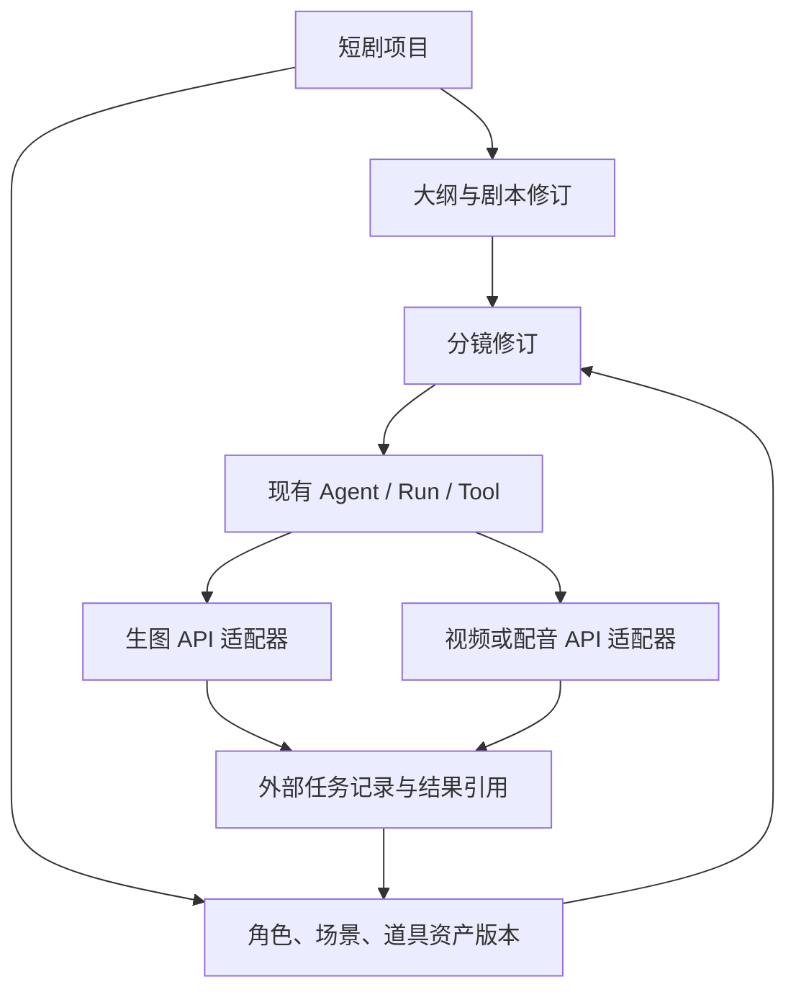

# AI 短剧工作台：参考结论与接入顺序

日期：2026-10-01。依据用户提供的 [shuohao-skills](https://github.com/eternityspring/shuohao-skills)，研究版本 `ef4ac0c313c7eeb1f918db5f0f0eb319745900bc`。本文记录参考结论和后续实施约束；不是已经实现的产品功能，也不提前冻结工作台页面设计。当前仍按[增量扩展方案](./incremental-extension-subsystem-plan.md)先完成 ComfyUI 的正式调用链。

## 参考中值得采用的部分

仓库把创作拆成大纲、角色、美术、剧本、分镜，各阶段有独立的结构化成果和检查工具。对 CrewON 的启发是：让 Agent 按阶段完成可继续编辑的成果，业务状态保存于项目，而不是只留在聊天文字中。[仓库说明](https://github.com/eternityspring/shuohao-skills/blob/ef4ac0c313c7eeb1f918db5f0f0eb319745900bc/README.md)

| 参考做法                                                         | CrewON 的采用方向                                                      |
| ---------------------------------------------------------------- | ---------------------------------------------------------------------- |
| 剧本保存场次、动作与台词；镜头拆分放在下游                       | 剧本修订与分镜修订分别保存，引用确切版本；修改台词时标明受影响镜头     |
| 角色图保存参考图版本、描述与画风指纹；依赖变化标记过期并保留旧图 | 资产有稳定 ID 和追加版本；单张重生成产生新任务，恢复旧任务仍使用原输入 |
| 分镜同时表达创作镜头与供应商的一次生成分段                       | 业务镜头与外部 operation 分开；由适配器按实际视频 API 能力编排请求     |
| 时长、角色/场景引用和覆盖关系用程序检查                          | 确定性校验返回具体错误；创意质量、长相和画面一致性由用户查看确认       |

对应依据：[剧本说明](https://github.com/eternityspring/shuohao-skills/blob/ef4ac0c313c7eeb1f918db5f0f0eb319745900bc/skills/novel-script/README.md)、[角色资产结构](https://github.com/eternityspring/shuohao-skills/blob/ef4ac0c313c7eeb1f918db5f0f0eb319745900bc/skills/character-refs/references/schema.md)、[分镜结构](https://github.com/eternityspring/shuohao-skills/blob/ef4ac0c313c7eeb1f918db5f0f0eb319745900bc/skills/novel-storyboard/references/schema.md)。其中镜头秒数、同框人数、提示词协议属于该参考的创作规则或模型约束；CrewON 不把这些数值写死为通用插件规则。

仓库链接的网站是 [Reelbench](https://reelbench.79px.com/)。其公开页面将创作编排、ComfyUI 生成、项目资产与版本放在同一工作台。CrewON 可借鉴这种围绕项目组织工作的方式，执行主体继续使用现有 Agent / Run / Tool，生成继续走外部 API。网站强调的本地 Codex、离线部署和本机媒体保存不构成我们的部署要求。官网演示入口重定向到登录页；本次未登录，也未验证其内部实现或实际生成效果。

## 插件组织建议

短剧工作台作为一个业务插件，负责项目、创作阶段、资产关系和相应视图。生图、视频、配音等是可复用的外部能力适配器，由宿主显式装配。创作方法可整理成经审查的阶段指导及校验器；不会把外部仓库的安装脚本、任意命令模板或全文提示词直接当作生产权限。

图表示业务依赖，不表示已经增加运行时插件依赖解析器。首期仍采用随宿主发布的可信静态装配。核心执行循环不需要了解角色、剧集、镜头或剧情规则。

后续业务数据至少需要区分三种身份：项目内资产/分镜及其修订、执行一次工作的 Run、供应商任务 operation。项目关联只作为已有执行记录的业务索引；不能用项目 ID 代替租户/空间/Run 的权限检查。修订关联会冻结输入与依赖，旧任务的结果归属原修订；新修订可以显示旧结果已过期，但不能覆盖它或自动产生新收费请求。

## 对当前实施的直接影响

1. 继续完成保存配置、发布明确执行版本、创建带不可变绑定的任务、Agent 提交/查询、恢复和结果返回。无需等待短剧工作台的页面设计。
2. 当前用户提供的 Krea2 图只有文本输入，能验证文生图和概念图。不能将其标为已经支持参考图、多视图角色一致性、图生视频或成片合成。角色锚点的派生图需另接支持参考图输入的工作流/API，并验证真实效果。
3. 为后续项目关联保留真实 Run、operation、配置及实现摘要。供应商 URL 是结果引用，不能充当永久资产 ID；过期时如实显示，首期不因此扩大到媒体托管。
4. 先验证一个阶段的小闭环，例如一段描述生成一张概念图并关联到项目修订，再增加角色/场景资产与分镜。每阶段只加载相关有界资料；不将整部小说和全部技能常驻注入 Agent 上下文。
5. 视频、配音和合成在选定实际 API 后按同一提交/查询/恢复约束接入。网站上的生成演示、仓库的投产包导出，均不能证明我们已经接通这些服务。

## 正式流程验收后的工作台设计输入

届时围绕“项目 → 分集剧本 → 资产 → 分镜 → 生成结果”明确页面及操作。应能定位某个结果使用了哪版剧本、哪些资产、哪次生成；允许局部修订和单项重生成，继续复用现有审批、任务状态与流式重连。

这会形成三类分别展示的状态：创作成果是否待确认或过期、CrewON 调用是否结束、外部媒体是否生成成功。具体组件、批量操作、剪辑与导出形式留待真实流程验收后设计。第二个企业垂类插件的复用验证仍保留在原计划中，短剧参考不替代该项要求。
