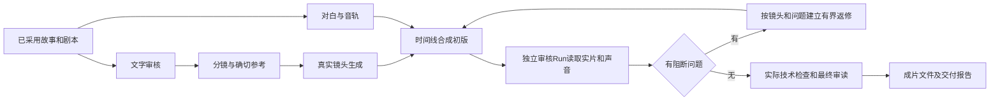

# 《重录》完整生命周期实施与验收

目标保持为：通过 CrewON 的 Agent、项目服务及实际媒体工作流完成一个短剧项目，修复途中问题，交付可播放、可发布、具备商业使用依据的完整视频，并具备主动审核与返修能力。本文是当前证据和待实施契约，不是视频或 AI 审核已经完成的证明。

## 当前事实

2026-10-16 页面切换排查：用户确认没有手动切页。新增组件回归实际复现“宿主选中角色页，延迟剧本文字恢复把本地 page 改为 script”；现仅独立工作台保留原自动恢复导航，宿主工作台由当前阶段控制，用户明确读取恢复结果且成功后才导航。恢复读取失败不再使用旧记录触发导航。另补齐角色资产的宿主变更提示、终态兜底与只读刷新，脏草稿期间延后刷新。44项宿主/接入回归、40项插件回归通过；此前角色 Run 实际已 completed，两份候选经原请求回执恢复后显示，数据库确认没有新增 Run。原始 transport 错误的底层网络原因尚未证实，不能把这次手动恢复当成已修复网络。

新插件50.2.8两次真实导入均失败，未写审批。只读重放完整审批组合定位：原审批125866字节，添加项目/Foundation/工具权限后分别为130850/131156/131309/131462字节，超过原Main 131072字节上限。已统一Main、Control、Worker审批/引导文档为256KiB，原权限文档、策略和单包限制保持独立；保留全部旧来源及版本，未删除数据或提升执行授权。大目录导入、冷启动、跨运行时文件权限及撤回测试和原生180项回归、Control/契约33项回归通过。新原生包与7份运行时已构建安装、签名验证通过；本段写入时新客户端冷启动和50.2.8真实升级尚在验收，不能标为完成。

2026-10-16 后续真实升级：同一50.2.8摘要已通过原生界面添加来源，审批131492字节，旧25个来源全部保留。首次启动在Worker Foundation声明中捕获明确的 installed_plugin_native_authority_file_invalid；增补三个回归均先失败，修复Foundation/Outline声明及Control额外引导读取后24项通过。新7份运行时已安装并校验完整摘要，冷启动已恢复完整界面；50.2.8安装、配置21、执行准备、启用通过，原三项目与十轮对话可重开。角色候选各v1已在真实界面审读采用，来源为需求2/剧本2。真实美术Run已完成：59.933秒，4次模型HTTP合计36.9秒、无模型失败，保存唯一场景候选1。工具完成后工作台自动出现候选，未点击刷新；全过程保持美术页，最终回执和输入框恢复正常。审读后采用场景1，刷新Renderer仍恢复原美术页、原对话、已采用场景和来源。此验收仅覆盖页面、加载、升级与文本资产闭环，不代表视频、音轨或商业成片已交付。

声音工作流仅完成源码作者校验：依据实际服务SaveAudio节点定义输出FLAC，增加明确音频图验证与渲染；相关图验证28项通过，尚未注册为可执行制作阶段、未提交TTS、未产生音轨或成片。

2026-10-16 本轮真实客户端更新：macOS 钥匙串处理后，客户端及 Control/Worker 已恢复。配置19采用服务根 URL 的规范末尾斜杠，真实预览、执行准备和插件启用均成功；原3个项目、对话及剧本历史正常加载。需求已通过原界面追加为修订2，保留需求1；Agent 实际保存方案3，审读后在界面确认，当前 Foundation5/parameters3。大纲3、剧本2已在真实界面审读采用；二者正文分别与原大纲2、剧本1完全一致，只更新来源至需求2及大纲3，全部历史保留。

新方案 Run `plugin-HVgpnstxv4S7_L_ZX8kliRFVHU71znSTYdh2hCcny_M` 实际 completed，用时516秒，其中10次模型 HTTP 共460秒，7个工具共25秒；4次失败请求占约250秒。完整诊断见 `foundation-production-plan3-timing-20261016.json`。这不是受控性能对比；不能把完整工具项当成整个 Responses 已终止，也不能声称线上转发断流已修复。

本轮另复现并修复“保存候选后后台更新切回旧采用版本”；同时将原本藏在历史区的来源复核操作放到编辑警告旁，保持原 CAS 保存及显式采用流程。不可变插件50.2.7已构建，49项针对回归、类型检查、boundary与格式通过；已通过正常界面升级、配置20、执行准备和启用。真实剧本候选2保存后保持打开，仍需显式采用；确认前采用指针仍为1、确认后为2，正文未变。Native执行准备重启期间的进度提示另有58项源码回归及lint通过，现已与Native回执修复一并构建、安装并通过签名；实际重启进度提示及最终“执行环境已准备”均已复测通过。以下早期实施段落保留当时证据，当前事实以本段及带时间的独立证明为准。

| 目标要求                   | 当前权威证据                                                                                                                        | 状态                 |
| -------------------------- | ----------------------------------------------------------------------------------------------------------------------------------- | -------------------- |
| 完整项目生命周期           | 实际已确认方案3、需求2；已采用大纲3/剧本2，正文及旧历史保留；视频、声音、合成尚未接通                                               | 未完成               |
| Agent 自动完成各阶段       | 原持久文字计划只支持 brief/outline/script；媒体输入、生成、结果各有独立服务，但无完整视频阶段计划                                   | 未完成               |
| 技术和业务问题主动修复     | 此轮执行审批34/64门、测试包生产修复；此前SSE及自动刷新修复已有独立证据                                                              | 有进展，仍有模型断流 |
| 完整测试及真实客户端验收   | 方案2、大纲2及剧本1经真实Agent保存、审读采用；新包冷启动、生成和审片未通过                                                          | 未完成               |
| 可发布、可商业化质量的视频 | 没有最终视频、音轨、技术测量和使用依据                                                                                              | 未完成               |
| AI 主动审核                | 受控Worker已完成加密图片候选读取、缩图、模型输入、绑定报告保存及关闭重开；Native准入、真实模型视听判断、视频/音频审查及返修尚未完成 | 未完成               |

证据：`lifecycle-current-state.json`、`outline-real-run-stream-diagnostics.json`、`foundation-candidate2-run-diagnostics.json`；源码 `packages/agent-kernel/src/agent-kernel-port.ts`、`packages/domain/src/project-script-quality.ts` 和 `docs/plugin-project-text-plans-protocol.md`。

## 本轮已完成修复

Native允许32个不可变出版版本、每个两个图像工作流。执行配置、执行依赖和最终派发边界原来分别限制32条review，会在17个历史版本产生34条合法review时拒绝。现在三个门统一使用有界64条预算；单图仍最多64KiB，身份、完整图摘要、受控可变位置、权限和原operation规则保留。Proxy review数组在执行入口明确拒绝。

新增回归使用实际冻结工作流、原准入SQLite Run、真实操作保留与派发链，额外历史身份是具名部署测试元数据，不是实际Native审批。34和64条历史review经过三个门；无提交权限时操作/网络均不产生，恢复原权限后只派发一次原operation。65条、错误图摘要和Proxy数组拒绝。

原回归另依赖仓外旧20.0.2目录，在干净检出中缺失。现在原Worker测试producer独立构建当前短剧包、校验完整包摘要，再向消费者传递目录和摘要；图模板也从该冻结包读取。生产过程中排除源码目录中的node_modules/dist/.sdk，删除独立开发目录后运行消费者，避免借用本工作树依赖。已去掉失效历史目录fallback，没有削弱包校验。

验证：四个相关文件共29项通过、14项PostgreSQL检查因未配置测试库跳过；最终针对性3项再次通过。Worker类型检查、boundary、格式检查通过。生成的测试包50.2.5摘要为 `sha256:4f97085aee5875958d2b1e17ff9227240c4d44fd0fc46fdaa2c574e9c7bb2c16`，它是独立测试发行包，不是当前客户端已安装包。

## 图片审核输入基础（2026-10-16，源码验证）

Kernel新增私有图片捕获与一次审核Segment的输入选项，真正将有界PNG/JPEG字节投影为Responses的`input_image`。原文字历史和事件不保存图片字节；捕获对象限定Run、Segment与AgentVersion，复制品和跨范围输入拒绝。单轮最多6张、单张256KiB、总量1MiB，像素/边长另有限制；格式头检查不代表完整解码或视觉质量检查。此能力不授予读取、生成、上传或采用作品的权限。

修复未知检查点可能省略未看过图片的问题。只有传输层实际完成并验证本轮响应及已接收尾部后，才缓存有界、无像素的图片证据元数据；证据替换、细节级别变化、移除、Run释放或缓存淘汰时重放完整输入。非法终态尾部不能建立可信续接。异步模型费用准入之后才捕获实际派发的证据，防止把准入前的图片当成已发送图片。图片审核不带可执行工具；模型意外返回工具调用时在Kernel内拒绝。

真实本地HTTP/WebSocket测试包含保持HTTP连接不关闭、正常续接、WebSocket失败回落HTTP、响应建立前重试、未知/失效状态重放和非法终态尾部。Responses334项与Kernel72项全部通过；Worker的上下文、版本前缀、压缩及项目计划集成17项通过，1项PostgreSQL检查因未配置测试库跳过。packages、Responses最终、Worker和Control类型检查通过，boundary、格式和diff检查通过。证明及日志摘要为`private-image-input-acceptance.json`，协议与兼容性说明见`docs/model-image-review-input.md`。

实际客户端只读复核见`lifecycle-state-20261016.json`：方案2仍已确认，Foundation3/parameters2，文字artifact为0，最近大纲Run仍为canceled/19，没有重新提交模型或生成请求。当前客户端尚未安装本次图片输入源码；实际作品帧提取/缩图、租户与来源资格、业务审核任务、报告持久化、音频及返修链仍未接通，不能宣称主动审片或商业成片验收通过。

## 已保存图片的审核适配器（2026-10-16，受控Worker验收）

新增受限的PNG解码/缩图、实际候选读取和专用审核Kernel。读取原Publisher的加密候选及确切内容摘要，不接受模型给出的URL、文件名或原图；模型发送权限独立于图片读取权限。使用宿主明确配置的FFmpeg路径，输入/输出仅经pipe传递，不继承凭据或代理变量；验证PNG完整性后，按原比例缩至512×512以内，透明部分合成白底。单进程同时只允许一次转换、codec/filter单线程、十秒截止、JPEG输出最多256KiB；取消/关闭等待真实子进程退出后才释放容量。真实FFmpeg 8.0.1解码测试已核验1920×1080→512×288及透明底上黑色主体仍清晰存在。

审核适配器只允许宿主绑定的一次真实Run、Thread、Actor、AgentVersion和候选。通过原Worker及原SQL连接记录模型调用、流事件与最终报告，没有另建执行循环、数据库或虚构工具receipt。报告必须原样绑定原候选/字节摘要和实际发送的JPEG摘要/尺寸；每项问题有区域、严重度、描述与返修建议。报告不含可被模型伪造的整片pass字段；即使issues为空，也只表示这一张审核图没有发现问题，剧情、运动、音频和使用依据仍未检查。来源比较支持stale判断，尚未实现工作台的自动失效展示。

曾在失败测试中发现：权限异常被通用Worker当作可重试故障，会导致再发一次模型请求。现在缺失/撤销来源权限或报告非法时终止这次审核；只有模型派发前的本地encoder busy可进入原有重试。模型结束后的任何来源检查失败均不可自动再收费。失败后再次wake为idle，原模型调用的completed会计事实仍保留，但Run失败且不能读取为已完成审核报告。

新增14项检查全部通过，包括同一真实SQLite文件中的候选/Run、加密归档、FFmpeg、真实本地HTTP请求、Worker完成、报告保存、关闭原连接后重开、撤回发送权限后仍可只读恢复原报告、拒绝模型越范围结论、撤销读取权限与费用重试边界。模型语义结果、供应商生成响应及PDP允许/拒绝均是具名测试响应，不是真实模型判断，也不是实际生成画面。已有Kernel72项、Responses334项再次通过，packages及Worker类型检查、boundary、格式与现有JS依赖license检查通过。证据见`image-review-worker-acceptance.json`。

生产Native尚未注册这个审核入口，也未实现审核job绑定的准入/恢复发现、工作台、视频抽帧、音轨审查或自动返修。受控关闭重开只证明宿主恢复原绑定后能读回已完成报告，不证明运行中断点续作或Native重启准入通过。不能把模型返回的报告JSON当作授权或可信job绑定。现有依赖license检查也不证明外部FFmpeg重新分发或成片素材的商业使用依据。

实际《重录》只读复核见`lifecycle-state-after-review-20261016.json`：方案2已确认、Foundation3/parameters2，文字artifact仍为0，最近大纲Run仍为canceled/19。本轮未安装或修改实际客户端、未向真实模型或生成服务发送新请求、未上传素材。目标仍为active，完整剧本和视频均未完成。

## 图片审核任务的原子准入与恢复（2026-10-16，受控 SQLite 验收）

新增宿主图片审核服务，以原 TurnApplicationService 进行授权/幂等准备，将审核 Run、用户消息、history、outbox、work item、receipt 与不可变审核 job 在原 SqliteRunStore 连接的同一事务中提交。job 固定原 actor/project、生成 Run/result、候选与原字节摘要、审核 Run/thread、宿主 authority/runtime generation、审核器版本、policy 与变换。解析使用有界描述符读取和内容摘要，拒绝 getter/proxy、未知字段及篡改的 pins；保存不授予模型发送权限。

关闭原 Store 后，Kernel.restore 以 tenant/space/RunId 从 SQL 的原始准入记录恢复，不再由宿主手写候选绑定。执行和报告读取均重新核 schema/索引/Run/原候选来源；记录缺失或损坏时失败，不把普通 Turn receipt 或报告 JSON 补写成准入。已接受请求重放复用原 Run，不再编码或请求发送许可；读取完成报告仍要求原候选读取许可。提交末尾撤权使 Run/message/job/receipt/queue 全部回滚。原来的普通线程/项目隔离检查保留，并兼容没有可选 binding 列的旧库。

此处仅实现 Native SQLite 内部准入能力及完成报告恢复。Native 正式审批/config、Control/Worker 分派、专用审核器 runtime 注册、工作台入口、PostgreSQL 准入、任务运行中断续作、真实模型语义审图及视频/音轨审核返修仍未接通或验证。原报告 v1 和 Run/public HTTP 形状未改；新增表是显式 opt-in，普通启动和构造器不执行迁移。未改实际 profile、审批文件或桌面包，也未发真实模型/生成请求。证据见 `image-review-job-acceptance.json`；完整制作目标保持 active。

## 视频技术检测与时间码抽帧（2026-10-16，受控本地验收）

新增 Worker 内部 MP4 检测器和 Application 技术判定。校验原始字节摘要后，FFprobe 和完整 FFmpeg 解码读取同一私有快照；普通片尾索引 MP4 通过可 seek 的只读 fd 处理。一次解码同时抽帧并检查片尾，记录真实帧 PTS、请求时间、第一视频帧时间原点、一毫秒精度、图像摘要和尺寸。旋转画面及非方形像素经过真实文件验证。源文件损坏、缺失抽样覆盖、错误摘要或不支持的容器不会形成成功记录。

图片与视频检测共用单个执行名额及有界子进程实现，避免多审核并发争抢 CPU；取消等真实 child close 后再释放，正常/取消/失败均清理本次目录，保留无关文件。无音轨、音视频起止偏差、未知字段和时长/画幅/编码不达目标会产生明确技术缺口；技术通过仅进入内容审读，不等于可发布。

新增检测仍为宿主内部能力，Native 作品及审核 job 准入、真实视频归档、工作台入口、模型发送授权、视频帧批次审读、声音语义审核和返修闭环未接通。当前模型断流也仍待网关实际发送日志定位。未重建或修改实际客户端，未发送真实模型/生成/上传请求。具名色块/正弦测试片不作为《重录》的制作成果；实际项目只读复核仍为 Foundation3/parameters2、文字 artifact0、最近任务 canceled/19。验收证据见 `video-inspection-acceptance.json` 与 `video-inspection-client-state-20261016.json`；全生命周期目标保持 active。

## 审核 runtime 分派与普通 Kernel 隔离（2026-10-16，受控验收）

原 ConfiguredAgentVersionRuntimeFactory 新增宿主显式 savedImageReview 绑定，借用原 SQLite Store、来源 reader 和 actor，以原编译审核器版本注册 runtime；先核 tenant/版本、无工作区、无 Tools/自动 compaction/governed context，再打开 transport。没有自动从插件 metadata、公开 JSON 或普通文本版本推断审核资格。

Routing Kernel 按每个实际 Run 的原 SQL 准入恢复绑定，借原 Worker/Registry 分派并调用原 protected image Kernel，不新增执行循环或序列化权限恢复。Worker 在选定 runtime 后核审核 job；实际 job 不能落到普通文字/provider Kernel。错分派、损坏 schema 等在模型派发前永久失败，避免只有文字却被当作视觉审核报告；普通无审核表的任务仍走原路径。配置审核器缺准入时拒绝执行。关闭会取消并等待实际在途 HTTP 审核，不释放仍在运行的 owner。

受控实际链路已验证一个审核 runtime 连续完成两个不同 Run、真实 JPEG 输入和原报告的关闭重开读取；普通 Kernel 接手实际审核 job 时零模型请求；运行中关闭原 HTTP 请求后才返回。20 项分派/准入/审核/Factory 检查通过，原 RuntimeWorker 回归143项通过、PostgreSQL一项因无 CREWON_TEST_POSTGRES_URL 跳过。语义结果和 PDP 为具名测试响应，不是真实模型审片。

这些是内部 Factory/Worker 的实际接入，Native 正式审批/config、Control 业务入口和工作台尚未启用；中断续作、真实模型语义、视频音频与返修尚待实现及验收。实际 profile/桌面包仍未改、没有新真实模型/生成请求。详见 image-review-routing-acceptance.json；完整目标保持 active。

## 已核对的媒体接入条件

2026-10-16进一步只读核验：已保存的同一seetacloud服务返回UNETLoader、CLIPLoader、VAELoader、WanImageToVideo、KSampler、CreateVideo、SaveVideo、LoadAudio、SaveAudio、LTXVAudioVAELoader的实际声明，十项均200/available。权重下拉列表包含Wan/LTX视频及音频VAE，但不证明权重加载或中文配音可用；未提交生成、上传或新授权。

SaveVideo实际是动态V3格式/编码/CRF分支。现有作者侧工作流校验器新增显式视频入口，要求已声明VIDEO端口和完整SaveVideo分支，保留原SaveImage路径。23项作者侧检查通过（17旧图像＋6视频），短剧Node类型检查通过。没有把新入口登记为可执行任务，没有改变v1 PNG结果协议，也没有实际视频、模型审读或Native/client验收。见 `docs/comfy-video-workflow-authoring.md`、`media-video-audio-node-capabilities-20261016.json`、`save-video-object-info-20261016.json` 与 `video-authoring-acceptance.json`。

通过现有seetacloud服务只读 `GET /object_info/{node_class}`，WanImageToVideo、SaveVideo、LoadAudio、SaveAudio均返回200和实际节点定义，分别确认图生视频条件/latent、VIDEO输出及AUDIO读写。节点存在不证明模型权重能加载、不证明TTS可用，也不证明实际视频质量；尚未提交任何生成或上传。完整目录较大，改成逐节点有界读取。原始元数据未注入模型，保存的是节点类、输入名、输出类型与请求计时。

证据：`media-service-capabilities.json`。协议依据：Comfy-Org/ComfyUI 的 `/object_info/{node_class}`，视频节点参考 [官方Wan工作流](https://github.com/Comfy-Org/workflow_templates/blob/main/templates/image_to_video_wan.json)。

## 实施顺序及边界

### 模型网关隔离复现的更新（2026-10-16）

已在干净 Codex-Manager v0.6.3 源码中，用实际 Rust reader 复现“上游 sidecar 收到完整终态，但心跳插进转发 JSON”的缺陷。隔离副本改为按 SSE 事件边界发心跳，143 项桥接检查通过，实际字节再经 CrewON 原解析器及严格 HTTP 传输验证，连接不关闭时约19ms识别一次完成。补丁已生成并验证能应用原 HEAD，未部署；它不证明真实模型 idle/TLS 问题已解决。

公开 /api/status 现返回 New API 风格版本 v1.0.0-rc.8-27-g12deba956-portal.1，公网 / 标题为璀璨API。须核 /v1/responses 的当前路由、codex-plus 上游和两段日志，不能按旧运维记录直接把整个域名认作 Codex-Manager。已有本机 SSH 配置没有网关连接别名；未读取私钥正文、借用其他服务的身份或变更生产。Mac 手动解锁、实际日志访问及媒体费用范围仍待回复。详见 `网关心跳破坏SSE-复现与修复.md`，实际项目仍无剧本和视频，目标保持 active。

### 原项目后续制作顺序

本轮还在 New API 公开 v1.0.0-rc.8 基线中复现了另一处收尾缺陷：实际 Go 转发器输出 completed 后不通知扫描器结束，原清理又先等阻塞线程、后关闭响应体。两处隔离修复后，Responses 和转 Chat 的本地上游 HTTP 路径均立即返回，usage/终态保留，工具条目不提前完成轮次，取消关闭上游。完整相关回归29个顶层测试通过，1个原始源码也失败的预置错误记录基线检查保留；补丁已验证应用但未部署。线上12deba956-portal.1的确切代码/路由还未取得，不能把该公开基线认作生产源码，也不能认定它解释两次不完整JSON。详见 `NewAPI结束事件与读取生命周期-复现修复.md` 与 `new-api-terminal-lifetime-acceptance.json`。

1. 修复当前模型交付断流，并完成真实大纲/剧本保存。保留原项目、Thread和幂等请求；不重复未知媒体operation，不用直接填数据库或外部脚本生成绕过产品。
2. 保存独立分镜文档，引用已采用剧本的确切版本。保留一处柜台、两名成人、右手机左钥匙、连续录像、整机转向及未收到工资的因果。十二镜时间码连续、合计90秒。文字稿中的镜头表不能替代后续可生成的分镜协议。
3. 通过同一短剧插件增加正式视频、配音和合成适配器及具名版本服务。先核验实际模型/节点/输出、提交/查询/取消/未知结果语义，再开放执行。v1的SaveImage/PNG规则保持；不得将视频塞进现有图像输出或偷偷改变旧请求字段。
4. 扩展原持久阶段计划，以原Run/Tool/operation和Store事务管理生成、候选选用、审核及返修。每一步必须有确切业务成果，不以Run结束或供应商submitted作为完成。旧文字计划和旧图像任务继续按原形状恢复。
5. 将实际帧和音频证据接入模型的有界多模态输入及审核工具。图片候选的读取、缩图、独立发送权限和报告保存已有受控Worker验证；Native审核job准入/恢复、实际视频帧提取、作品版本/时间码资格、音轨及返修仍未接通。不能以文字描述的“审片报告”替代视听审核。保留增量上下文，不重写历史、不注入全项目，文字片段仍服从10K token上限。
6. 打通同一项目工作台的镜头、声音、时间线、审核问题、返修和成片状态，保留未保存编辑。扩展现有同client/project/source pin的失效重读，不新增插件轮询执行循环或另一套runtime。

## 主动审核与返修契约（待实现）

审核Run只授予读取本次确切作品、证据与保存报告的能力，不授予生成、修改剧本、选用成果或公开发布。报告绑定项目、镜头/时间线/视频修订及内容摘要、实际模型调用和被读取的证据。模型生成的ID、文件路径或“已通过”文字不构成权限或使用依据。

问题必须有类别、严重度、实际时间码或镜头ID、证据引用、修复建议。至少核对剧情因果、人物/场景/道具延续、手机朝向与持物动作、对白准确性、音画同步、字幕及实际可播放的输出。商业使用来源缺失单独标为未核验；AI不能凭空声明素材或模型授权已具备。

审核覆盖要如实记录：抽样帧不能声称整段逐帧通过；音频未读取不能声称对白/口型通过。输入来源变更使旧报告失效，不能自动套用到新成片。最终技术检测必须来自实际文件的解码、时长、画幅、帧率、音轨及字幕检查。

返修仅处理报告指向的镜头/音轨；保存新的候选和operation，保留旧版。每次生成核费用范围与授权，有界次数或费用到达上限即暂停。未知供应商结果只观察原请求。依赖变化只使相应下游过期，不能悄悄重生成全部项目。

## 最终验收依据

默认交付目标是一集90秒、16:9的正常运动画面短剧及对白/声音，MP4成片、独立字幕、实际技术报告和可追溯制作记录。具体编码/分辨率按所选服务及平台目标核定。不能用图片轮播或剪辑占位替代完整短剧。

必须在真实客户端观察Agent沿同一项目完成制作、主动发现问题、至少一次真实返修及重新审核；采用的是确切最终版本。普通刷新、切项目、重连和冷启动仍恢复成果、审核和原任务，不发新生成请求。最后实际播放完整成片，审读手机/钥匙/信封动作、人物选择、对白和节奏，再核技术报告和使用依据；没有实片就不能宣称可发布或商业化质量达标。

待补的外部信息：本次生成费用上限、可用的视频/配音服务；模型断流的服务端实际发送日志，当前SSH认证未通过。费用/执行范围尚未明确时不提交付费或新授权的生成，但不妨碍接口和审核实现继续推进。目标保持active。

## 解锁后的实际验收进展（2026-10-16）

Mac已解锁，原隔离客户端能打开《重录》，已确认方案重开仍可见；大纲刷新完成但正文为空。新实际Run已观察到完成，共279.301秒，其中三次模型HTTP调用258.172秒、一次工具8.491秒，仍复现终态迟交及不完整JSON超时重试。该Run沿用discussion读取范围，最终未写大纲。完整生命周期仍未完成，未提交新生成或上传。详见`unlocked-real-run-latency-20261016.json`。

现有已登录管理窗口可读到Codex-Manager v0.6.3最新日志，渠道列表可读，当前codex-plus已启用；确切上游地址/部署源码仍未取得。生产网关修复尚未部署。用户正在使用浏览器及客户端，未强制退出或取消。剩余外部输入为可用网关SSH别名/部署源码位置，以及本次视频、配音服务与费用上限；已解锁不再作为当前阻塞条件。

## 本次执行授权与新客户端问题（2026-10-16）

用户已明确回复“模型我看可以用；没有上限，随意用”。本次视频、配音生成不再等待费用上限确认，沿用已保存服务；这不代表已启用Native配置、不证明模型或素材的商业许可，也不允许凭空确认他人声音使用权。

真实大纲Run `plugin-0owxtUH9uZ1oLO7Akmpy9554lR7eXHBCxBcZZw33x7A` 按当前outline范围完成 project_context_read、outline_context、outline_read、outline_save，成功保存修订1。工作台已实际打开正文、采用1并进入ep1剧本。旧请求的discussion范围不被改写。

此时真实客户端复现采用大纲后聊天创作上下文仍缓存outline=null：工作台在剧本，输入区没有集数，发送按钮可用但无新Run。未通过手动刷新绕过；剧本输入已备份，尚未受理。源码修复在原同client/project/source pin变更通知上观察经过严格校验的UI文本写回执，重读受保护的会话context；提交阻断与发送按钮同步，保留可编辑草稿，显示更新或需采用大纲的具体提示。原工具/终态通知仍复用，未新增轮询或另建执行系统。

56项通知/Hook/桌面与Web Host回归、35项工作台/插件面板交互和快照回归已通过。首轮并发导致旧交互测试5秒超时；相同用例与超时标准在单Worker运行通过，未删除或放宽检查。UI源码类型检查已通过，Electron类型检查和renderer打包仍在运行。本轮待仅更新隔离客户端renderer，原Electron Host/Worker/Control和插件50.2.5保留；尚未据此宣称实际修复验收通过。

现有服务完整object_info只读获取成功，4882项，约18MiB，原始目录仅留验收临时目录，未注入模型。发现本地中文描述声音、语音计划、生成和ASR核验节点，以及视频/拼接节点；未提交GPU生成，不把节点存在当作实际可用或视听合格。

## 新包真实验收与任务受理超时（2026-10-16 11时）

本次用户再次解锁后，验收包以原隔离profile启动，原《重录》与已采用大纲1恢复。正常编辑保存大纲候选2并在历史中采用2：去掉分集标题重复的“一集：”，将“失去3200元”改为“今天拿不到3200元”。数据库只读核验头revision4、selectedContentRevision2及真实正文，未写入数据库或模拟工具成功。

自动同步验收未通过：写入后确有“正在更新项目创作状态”提示，但聊天集名随后仍显示大纲1。一次明确用于区分原因的手动重读能返回大纲2；不能把这次操作算作自动同步修复。确切写回执经当前严格解析器通过；尚不能仅据此断言通知丢失或模型结束事件问题。源码另复现了确定的故障反馈缺陷：缓存存在时重读失败会禁用发送，却不显示错误。已补先失败后通过的回归，保留缓存并明确告知来源更新失败、发送暂停及原重读入口。

来源2完成受保护重读后，仅点击一次发送完整剧本请求。客户端长时间显示发送中，最终返回control_api_transport_unavailable，插件显示plugin_ui_control_timeout；只读核验没有新Run或剧本产物。未重复发送、未提交媒体。本地任务服务的传输失败此前被误标为“模型连接失败”，已补中英文组件回归并改为工作台连接中断、原请求结果未确认。57项相关Host/通知/Hook测试通过，新增反馈相关26项组合测试通过（与前者有重叠，不累加为唯一测试数）。

已采集实际Control进程的系统样本；它在HTTP回调中大量执行同步文件操作，尚无足够JS符号将耗时精确归到某个校验函数。隔离验收包将临时加入同进程、无监听端口、最多8个45秒窗口的CPU采样；原Control完整代码作为原样后缀保留，已备份、记录摘要。不删除检查、不延长租期、不修改授权文件。此诊断不是生产修复或成片验收。

真实服务另完成一次0.083秒纯色MP4格式探针：H.264、64×64、24fps、2126字节，生产Inspector实际解码。SaveVideo历史把MP4放在images字段。此探针无剧情/声音，不是运动镜头、不属于项目成片，也不算Native媒体链路通过。详见comfy-video-protocol-probe-20261016.json。

## 合并后的真实剧本链路与配置修复（2026-10-16 12时）

真实剧本 Run 约224秒：模型 HTTP 累计约177秒，4次工具调用的端到端墙钟约28秒，其余为受理、排队与切换。1次连接超时按原请求重试，没有重复保存或媒体提交。成功的模型调用都观察到 `response.completed`，未等连接EOF才释放；此轮没有复现旧的每个工具后永久停住。候选在未手动刷新的编辑器中出现，审读后正常采用，导出文件直接来自真实保存正文。

升级50.2.6后执行准备失败已在隔离SQLite备份和原审批文件副本中重现。配置18的服务地址末尾缺少 `/`；配置17及原Native授权均含 `/`。通用配置字符串schema接受了地址，而Native权限契约严格要求规范形式，最终错误被收敛为通用预览失败。修复位于配置保存入口：只有当前短剧适配器将可选根斜杠补齐，保留完整CAS修订、请求幂等键和凭据保护；非HTTPS、账号密码、路径、查询、片段及其它非规范重写在保存前阻止。旧配置仅显示可保存的修改，不自动写入。Native权限解析和执行端比较未放宽。

相关75项UI、保存重试、执行准备、投影竞争与终态回归通过；UI/Electron类型检查、边界、格式和差异检查通过。真实投影竞争回归证明新读取发布后旧读取的 `control_thread_projection_superseded` 应作为已替代读取取消，普通网络故障仍显示错误。新的ASAR保留17,464个非renderer文件逐一摘要一致，7个运行包未更换。启动采样明确阻塞在系统 `SecItemCopyMatching` / Keychain解密，尚未启动Control/Worker；已请求用户处理系统提示，不通过工具解密、修改钥匙串或绕过权限。

证据：`script-agent-save-acceptance-20261016.json`、`script-real-run-timing-20261016.json`、`重录-完整剧本与12镜拍摄分镜.md`、`config-origin-client-build-proof-20261016.json`。本节未完成的客户端部分必须继续实测。

隔离备份的正反验证已完成：原配置18在实际Main执行准备Owner报 `desktop_native_plugin_authority_invalid`；仅在新的隔离副本通过原Store CAS追加规范配置19后，原Owner成功返回50.2.6、配置19及原服务地址。权限文件摘要保持不变、未确认或提交任何执行准备。这是定位证据，不替代真实客户端验收，详见 `config-origin-isolated-preview-20261016.json`。

## 制作准备与商用模型依据核查（2026-10-16，等待系统授权期间）

前一目标轮为进展：配置入口修复、新包安装及隔离正反复现。本轮再次确认实际Main进程37891、SecurityAgent进程37930仍存活，Control/Worker未启动；同一钥匙串等待条件尚未解除。未再次请求密码，也未工具操作系统授权窗口。

已直接只读核对原数据库中已保存剧本1与导出JSON逐字段一致；从实际12场正文提取连续0–90秒时间窗、2160帧目标及13条原对白，保存《重录-制作任务与声音表.json》。对白只保留来源镜头窗口，实际音轨尚未生成，精确对白起止为空；这份文件是离线制作准备，不冒充项目里的结构化分镜或候选。

服务实际只读获取WanImageToVideo、VRGDG_VoxCPM2Generate、SaveAudio、SaveVideo四个节点声明均200，未上传、生成或下载模型。官方许可核查发现本地Fish S2 Pro商业使用需要单独书面许可，暂无本项目授权依据；VoxCPM2和Wan2.2-I2V-A14B官方模型卡列明Apache-2.0。因此配音候选改为原创描述声音的VoxCPM2，仍须确认部署包装器、确切权重与生成质量。没有给任意自定义Krea/LoRA套用官方模型许可。

节点声明、模型许可和离线准备不足以证明全生命周期完成；尚需正式制作需求、结构化分镜/资产、版本化视频与声音结果、Native准入、原Run生成/归档、时间线合成及真实模型视听返修闭环。继续保留完整目标，客户端验收仍等待人工系统授权。详见《重录-制作准备与服务选择.md》和media-production-nodes-current-20261016.json。

## Native启用回执的期限修复（2026-10-16）

真实安装50.2.7时，选择66于06:31:06.439Z提交、业务激活41于06:31:26.725Z提交，前端却显示未知结果并保留旧停用目录。前端15秒HTTP预算被用于判断Native完整回执，且未知结果的只读恢复又复用已过期signal。现在Native回执按原Main操作的期限处理，并继续检查UI owner和runtime身份；普通HTTP期限保留。未知结果只读恢复使用新的有界请求，不自动重提或制造成功。账号撤回、外来回执及原key重试回归保留。

两项新增回归先失败；最终5文件76项串行通过，UI/Electron lint通过。并行初跑75项通过、1项较重稀疏配置测试5秒超时，单项及最终串行均通过，未调高期限或删除测试。新桌面包已安装，17,464个非Renderer文件逐字节及元数据保持一致，冷启动原3项目和原对话恢复。Native启用/停用实际回执均显示“选择已保存”，无未知结果或重试提示；执行准备重启显示明确进度，最终准备成功且启用状态保留。仅此客户端范围通过，完整媒体生命周期仍未完成。详见 `native-receipt-client-build-proof-20261016.json`。
